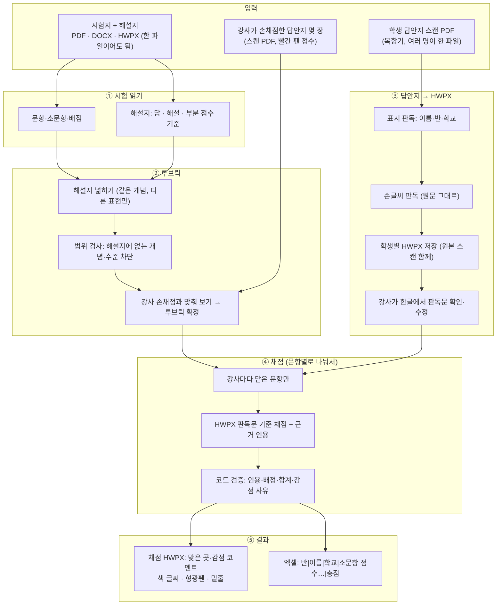

# Dawoni — 손글씨 서술형 채점 전용 프로그램 계획

> 2026-11-03 작성. 옛 다워니(`~/Dev/Dawoni-old`, 마지막 커밋 `b3902b4`)에서 **채점 기능만** 떼어 새로 만든다.
> 이 문서는 계획이다. 코드는 아직 한 줄도 없다.

**이 프로그램의 의의: 토큰을 최소로 쓰면서, 일관성 있게 채점한다.**
아래 모든 결정은 이 두 기준(토큰 ↓, 일관성 ↑)으로 고른다.

---

## 0. 한눈에 보기



| 옛 다워니에서 | 그대로 가져옴 | 다듬어 가져옴 | 버림 |
|---|---|---|---|
| 기능 | CLI 브리지, 컨텍스트 엔진(수리 루프·호출 기록), 해설지 판독, 해설지 넓히기 루브릭, 손글씨 판독·교차 판독, 표지 판독, 채점·검증, 보정, 로그인(gist), 함께 쓰기, 스캐너 | 메모리·스킬(→ md 파일), 역할·등급(→ 서브 에이전트), 외부 OCR, 설정 화면 | 문제은행, 문항 제작, 파라미터 그림, 강의 요약, 교재 DB화·범위 프로필 편집, DOCX 출력, 구글 시트 |

---

## 1. 옛 다워니에서 배운 것 (반드시 지킬 것)

옛 다워니 실측(실제 시험 24명, 소문항 192개)에서 확인된 사실이다. 새 프로그램에서도 깨지 않는다.

1. **해설지가 기준이다.** AI 풀이만으로 만든 루브릭은 AI의 오답을 정답으로 인정했다(5/8). 해설지 기준으로 바꾸자 7/8, 규칙을 다듬은 뒤 강사와 소문항 일치 **95%(182/192)**.
2. **문항의 문구가 요구사항을 정한다.** 해설지의 "○○ 없으면 0점"은 문항이 그것을 물었을 때만 적용한다. 나머지는 강사에게 '해설지와 충돌'로 보여 준다. (실측: 문항은 "전압과 전류를 이용하여 반박하라"였고, 해설지는 "밝기 표현 없으면 0점". 강사는 만점.)
3. **해설지도 틀릴 수 있다.** 실측 해설지가 θ와 α를 바꿔 적었다. 정답이 둘로 갈리는 곳은 강사에게 표시한다.
4. **AI는 "고쳐 읽는다".** 학생의 ㉢을 해설지에 맞춰 ㉠으로 읽고, 해설지의 "전체 전압, 1/2"을 "2/3, 1/3"로 읽었다. 그래서:
   - 판독과 채점을 분리하고, 판독은 원문 그대로 한다.
   - 해설지는 두 번 읽어 숫자를 비교한다.
   - 가장 싼 모델(Flash Low)은 손글씨 판독에 쓰지 않는다. 25초로 빠르지만 ㉠→㉢ 오독을 냈다.
5. **작업 1건 = AI 호출 1회 = 새 세션.** 대화를 이어 가면 앞의 지침을 잊는다. 학생 1명 × 문항 1개 단위로 채점한다.
6. **AI는 판단, 코드는 검증.** 합계·배점 상한·근거 인용의 실존·감점 사유는 코드가 검사한다. 실패하면 오류를 붙여 다시 요청한다(최대 2회).
7. **토큰의 대부분은 그림과 생각이다.** 채점 프롬프트 글자는 약 0.27만 토큰이지만, 호출 하나의 전체는 2만~15만 토큰이다. 그래서 호출 수를 줄이고 그림을 줄이는 쪽이 효과가 크다. 해설지 넓히기는 호출 8번(1.5만) → 1번(0.27만)으로 줄였다.
8. **강사가 마지막 결정을 한다.** 루브릭 확정, 판독 확인, 채점 검토는 강사 단계다. 건너뛰는 길을 코드에 두지 않는다.
   - 예외 (2026-11-04 사용자 결정): **판독 확인은 채점 뒤에 해도 된다.** 한 학생이 막혀 반 전체가 기다리지 않게,
     `[판독불가]`가 없는 답안은 확인 전에도 채점까지 간다. 채점에 "판독문 확인 전" 표시가 남고, 강사가 판독문을
     고쳐 확정하면 다시 채점한다. 강사의 직접 채점(기준 예시·보정)은 여전히 확인한 판독문만 쓴다.

남아 있던 오답 유형: 과정 점수를 너무 후하게 줌(6점 vs 강사 2점), 범위 부분 점수, 학생이 그린 그림. 이것들은 보정(§6)으로 다룬다.

---

## 2. 에이전트 구조 — 총괄 에이전트 + 서브 에이전트

### 2-1. 원칙

- **총괄(오케스트레이터)은 대부분 코드다.** 채점 흐름(읽기 → 루브릭 → 판독 → 채점 → 출력)은 정해져 있다. 그래서 매번 AI에게 "다음에 뭘 할까"를 묻지 않는다. 묻는 만큼 토큰이 들고, 할 때마다 결과가 달라진다.
- **총괄 AI는 얇게 둔다.** 아래 세 가지만 맡고, 학생 답안·해설지 원문은 보지 않는다(요약과 기록만 본다).
  1. 강사의 자연어 요청 → 정해진 작업 호출로 바꾸기 ("2반 3번만 다시 채점해" → `grade(exam, class=2, q=3, redo=True)`)
  2. 오류 진단: 실패한 호출의 기록(`calls.jsonl`, 오류 목록)을 보고 원인과 대책을 제안
  3. 배우기: 강사의 수정·지적 → 메모리/스킬 제안 (§10)
- **서브 에이전트는 자기 일만 한다.** 서브 에이전트 하나 = 역할 지시서(짧은 md) + 과업 템플릿 + 출력 스키마 + 등급(모델) + 예산 + 수리 횟수. 다른 역할의 결과는 필요한 조각만 받는다.
- **역할마다 다른 모델.** 쉬운 일은 싼 모델에, 어려운 일만 비싼 모델에 맡긴다.

### 2-2. 서브 에이전트 목록

| 역할 | 하는 일 | 기본 등급 | 예산(프롬프트) | 비고 |
|---|---|---|---|---|
| `exam_reader` 시험 판독 | 시험지 쪽 → 문항·소문항·배점 | standard | 40k | 옛 다워니 page_reader |
| `key_reader` 해설지 판독 | 해설지 → 답·해설·부분 점수·0점 조건 (2회 읽고 숫자 비교) | standard | 40k | 옛 다워니 그대로 |
| `rubric_builder` 루브릭 | 해설지 넓히기 (문항당 1회) | standard | 30k | 옛 다워니 expand_key_rubric |
| `cover_reader` 표지 판독 | 이름·반·학교, (손채점본이면) 빨간 펜 점수 | fast | 8k | 옛 다워니 그대로 |
| `handwriting_reader` 손글씨 판독 | 답안 쪽 → 원문 그대로 (LaTeX) | standard | 20k | fast 금지 (§1-4) |
| `grader` 채점 | 학생 1명 × 문항 1개 | standard | 24k | 옛 다워니 그대로 |
| `second_grader` 재채점 | 확신 낮은 것만 다른 모델로 한 번 더 | standard(다른 AI) | 24k | 전부 이중 채점하지 않음 |
| `calibrator` 보정 | 강사 손채점 ↔ AI 채점 차이 → 루브릭 개선 제안 | strong | 30k | 시험당 몇 번만 |
| `light_helper` 가벼운 도우미 | 정답 후보 맞추기, 규칙 정제, 배우기 | fast | 24k | |
| `coordinator` 총괄 AI | 요청 해석, 오류 진단 | fast | 8k | 원문을 보지 않음 |

등급은 AI별 모델로 바꾼다(설정에서 강사가 고침, 칸이 비면 그 AI의 기본 모델. 모델 이름은 짐작하지 않음):

| 등급 | agy (Gemini) | claude | codex (ChatGPT) | 로컬 LLM |
|---|---|---|---|---|
| fast | gemini-3.8-flash-low | claude-haiku-5-5 | effort low | 설정한 모델 |
| standard | gemini-3.8-flash-medium | claude-sonnet-5-5 | effort medium | 설정한 모델 |
| strong | gemini-3.8-flash-high | claude-sonnet-5-5 (effort high) | effort high | 설정한 모델 |

### 2-3. 컨텍스트가 넘치지 않게

옛 다워니 `context/assembler.py`의 레이어 조립을 그대로 쓴다.

| # | 레이어 | 넘칠 때 |
|---|---|---|
| 1 | 계약 (JSON 하나만, 파일 수정 금지) | 자르지 않음 |
| 2 | 역할 지시서 (60~250토큰, 영어) | 자르지 않음 |
| 3 | 과업 + 출력 스키마 | 자르지 않음 |
| 4 | 전역 규칙 · 메모리 (작업별 글자 상한) | 상한 안에서만 |
| 5 | 스킬 (상황 단어가 맞을 때만) | 개수 축소 |
| 6 | **이 문항**과 **이 문항의 해설지·루브릭**만 | 자르지 않음 |
| 7 | 기준 예시 (강사 채점) | 개수 축소 → 판정만 |
| 8 | 대상 (판독문 / 쪽 이미지) | 호출 분할 |

- 예산을 넘으면 7 → 5 → 4 순으로 줄인다. 그래도 넘으면 **멈추고 알린다**(조용히 자르지 않음).
- 모든 호출은 새 세션이다. 수리할 때도 전체를 다시 조립한다.
- 호출 기록(`logs/calls.jsonl`): 역할·모델·토큰·시간·수리 횟수·검증 결과. 역할별 토큰 합계를 화면에 보여 준다.

### 2-4. 토큰을 줄이는 장치 (우선순위 순)

1. **호출 수 줄이기**: 해설지 넓히기는 문항당 1회만 한다. AI 풀이·검토·검산은 강사가 "해설지 검산"을 켰을 때만 돌린다.
2. **같은 답 묶기**: 객관식·단답형은 코드로 채점한다(AI 0회). 서술형도 판독문이 정답 후보와 같으면 미리 맞추고, 남은 학생만 AI로 채점한다.
3. **그림 줄이기**: 쪽 이미지는 긴 변 1568px로 줄인다(손글씨는 실측 뒤 결정). 답안 쪽만 보내고 표지는 따로 싼 모델로 읽는다.
4. **이중 채점은 필요할 때만**: 확신도가 낮거나 검증 수리가 있었던 채점만 다시 본다.
5. **싼 모델 먼저, 올리기는 기록으로**: 며칠 쓴 뒤 `calls.jsonl`에서 실패·수리가 쌓이는 역할만 등급을 올린다.
6. **판독 결과 재사용**: 강사가 HWPX에서 확인한 판독문은 다시 판독하지 않는다(파일 해시로 확인).

### 2-5. 속도 — 옛 다워니가 느렸던 이유와 목표

옛 다워니에서 작업 하나에 3분 이상, 길게는 8~10분이 걸렸다. 호출 기록(`calls.jsonl`, 621건, 2026-11-03 분석)을 보면 원인은 **AI 호출**이다. Python 처리(PDF 그림 변환·검증·저장)는 1초 안쪽이다.

| 작업 | 모델 | 시간(중앙값) | 보낸 프롬프트 | 실제 토큰 | 재요청 |
|---|---|---|---|---|---|
| 시험지 쪽 읽기 | gemini-3.8-flash-medium | 4~6분 | 약 3,600 | 6만~14만 | 20~50% |
| 시험지 쪽 읽기 | claude-opus-5-5 (agy) | 25~35초 | 약 4,000 | 3.3만 | 40~60% |
| 해설지 읽기 | gemini-3.8-flash-medium | 3~6분 | 5,000~9,000 | 5만~10만 | 약 50% |
| 채점 (1명 × 1문항) | gemini-3.8-flash-medium | 37초 | 2,150 | 1.4만 | 17% |
| 채점 (1명 × 1문항) | claude-sonnet-5-5-low | 11초 | 2,150 | 1.6만 | 0% |

알게 된 것:
- **모델이 시간을 정한다.** 같은 일을 모델만 바꿔 8~10배 빨라졌다. Flash Medium은 생각을 길게 해서, 보낸 것의 20~30배 토큰을 썼다.
- **재요청이 시간을 두 배로 만든다.** 시험지·해설지 읽기는 절반 가까이 형식 검증에 실패해 처음부터 다시 호출했다.
- **프롬프트 길이는 문제가 아니다.** 가장 긴 것도 약 1만 토큰으로, 모델 컨텍스트(20만~100만)의 5% 이하다. 토큰의 대부분은 우리가 보내지 않은 것이다: CLI가 붙이는 자기 시스템 프롬프트·도구 설명, 모델의 생각, 그림.

대책 (효과 큰 순):
1. **역할별 모델을 실측으로 고른다.** M0에서 같은 자료(옛 다워니 실측 시험)를 역할마다 후보 모델로 돌린다. 시간·토큰·정확도를 재고 기본값을 정한다. 생각 단계(effort)를 낮출 수 있으면 함께 잰다.
2. **재요청을 줄인다.**
   - 고칠 수 있는 형식 오류(번호 표기, 빈칸, 공백, 소수/분수 표기)는 AI에게 다시 묻기 전에 코드가 고친다.
   - 꼭 다시 물어야 하면 틀린 소문항·필드만 다시 묻는다(전체 재호출 금지).
   - 목표: 재요청 비율 10% 이하
3. **호출을 안 한다.** 객관식·단답형은 코드로 채점한다. 같은 답은 묶고, 확인된 판독은 재사용한다(§2-4).
4. **동시에 돌린다.** 학생·문항 단위 호출을 구독 한도 안에서 여러 개 동시에 보낸다(옛 다워니 `parallel.py`). 동시 개수는 설정으로 정하고, 한도 신호(claude `rate_limit_event`)를 보면 줄인다.
5. **그림을 줄인다.** 답안 쪽만, 실측으로 정한 해상도로 보낸다.

목표 (M4에서 잰다):

| 작업 | 목표 시간 |
|---|---|
| 채점 1건 | 15초 이하 |
| 시험지·해설지 한 쪽 | 1분 이하 |
| 학생 24명 판독 + 채점 | 30분 이하 (동시 실행 포함) |

**M4에서 만듦 (2026-11-05)** — 대책 2~4를 코드로:
- **코드 선수리** (`TaskDef.fix`, 채점은 `pipeline.fix_grade`): 검증 전에 형식만 틀린 것을 코드가 고친다 —
  항목 ID 대소문자·띄어쓰기, 같은 판정 두 번, 배점을 소수 끝자리만큼 넘은 점수, 인용을 감싼 따옴표, 없는
  정답 후보 ID. 점수·근거 판단이 걸린 오류(인용이 답안에 없음 등)는 그대로 AI에게 돌린다. 고친 것은
  호출 기록 `fixes`에 남는다.
- **부분 재요청** (`TaskDef.partial`): 검증 오류가 모두 채점 항목 하나하나의 것이면(`R2: …`, 판정 빠짐)
  그 항목만 다시 묻고 받은 항목을 앞 결과에 합친다(`repair.md.j2`의 `only`). 항목 밖 오류(중복 판정 등)는
  전체를 다시 묻는다. 호출 기록 `partial`에 다시 물은 항목.
- **호출 안 하기** (`answers.pre_grade`): 빈 답안은 AI 없이 0점 + 검토 필요(원본 그림으로 확인). 소문항
  표시가 있는 판독문에서 빈 소문항은 0점, 서술형 문항 속 단답형 소문항(항목 1개, 해설지 답 있음)은 결론
  줄을 `judge_value`로 비교해 분명히 같거나 다르면 코드가 정한다. AI에게는 나머지 항목만 보내고("코드가
  이미 채점한 소문항" 안내), 모두 정해지면 호출하지 않는다. `GradeResult.code_items`.
- **재채점은 필요한 것만** (`second_opinion`, 기본 `low`): 확신도 < 0.6이거나 수리한 채점만
  새 세션(설정 `second_agent`/`second_model`)으로 한 번 더. 다르면 검토 필요. `--double`은 모두.
- **동시에** (`parallel_grading`, 기본 4): 학생 × 문항 채점을 4개씩. claude `rate_limit_event`(허용 밖
  상태)를 보면 `parallel.Throttle`이 하나씩 줄인다. 한도 초과·로그인 필요는 남은 채점을 시작하지 않고 멈춘다
  (끝난 채점은 저장, 다시 실행하면 남은 것만). `parallel_students`(묶음 판독) 기본값도 M3 실측대로 4.
- 채점마다 `calls`·`repairs`·`tokens`·`duration_s`를 남기고, 채점 작업 끝에 합계를 보여 준다.

**언어는 Python으로 간다.** Rust로 바꿔도 줄어드는 건 전체 시간의 1% 미만인 Python 처리뿐이다. 반면 sympy(단답형 수식 동치)에 해당하는 것이 Rust에 없고, PDF·DOCX 라이브러리도 손이 더 간다. 실측으로 다듬은 옛 다워니 코드(해설지 판독·채점 검증·보정)도 다시 써야 한다.

---

## 3. 입력: 시험지·해설지 읽기

| 형식 | 읽는 법 | 비고 |
|---|---|---|
| 디지털 PDF | PyMuPDF 글자 + 쪽 이미지 → `exam_reader` | 옛 다워니 `ingest/exam.py`, `ingest/layout.py` |
| 스캔 PDF | 쪽 이미지 → `exam_reader` (선택: RapidOCR 글자 층) | |
| 한 파일에 시험지+해설지 | 해설 쪽("정답 및 해설", "부분 점수")을 자동으로 찾아 나눔, 강사가 쪽 번호로 고칠 수 있음 | 옛 다워니 그대로 |
| DOCX | zip 안의 XML을 직접 읽기 (문단·표·글 상자·자동 번호·그림·미주) | 수식은 OMML → LaTeX (`mathx/omml.py`) |
| HWPX | zip 안의 `Contents/section*.xml`을 직접 파싱 (문단·표·글 상자·그림·미주·한글 수식 스크립트) | 수식은 한글 수식 → LaTeX (§5-3 변환기 공용) |
| HWP | python-hwpx(HWP5 → HWPX, 한글 없이·맥에서도)로 HWPX를 만든 뒤 위와 같이. 못 바꾸거나 수식·표 등을 못 옮겼다고 하면 Windows 한글(COM)로 (2026-11-10) | 둘 다 안 되면 "HWPX로 저장해 주세요" |

**DOCX·HWPX·HWP (M1, 2026-11-04, `ingest/document.py`)** — 쪽을 그림으로 그리지 않고 문서에서 글·식·그림을
꺼낸다. 문항은 문단 맨 앞의 "1."(DOCX 자동 번호도 글로 풀어서)로 나누고, PDF와 같은 번호 줄기 규칙을 쓴다.
- **학원 시험지는 문항마다 답·해설을 미주로 붙인다** (실측: 다운로드 폴더의 학원 HWP 3개 모두, DOCX 월례 1개도).
  미주는 그것이 달린 문항의 해설로 모은다 — 시험지와 해설지가 한 파일이어도 쪽 번호를 고를 필요가 없다.
  미주 안에서 **그 미주의 번호("2)")보다 앞에 친 글은 앞 미주(앞 문항) 것**이다 — 한글·Word는 미주를 이어 보여
  주므로 앞 해설의 끝으로 보인다 (2026-11-10 실측, §16 20번).
  미주가 없으면 "정답 및 해설" 뒤 문단을 문항 번호로 나눈다. 따로 온 해설 파일은 문서 전체를 번호로 나눈다.
- 문항 뒤의 답안지 표("답안지 …")는 마지막 문항에 넣지 않는다. 첫 문항 앞의 머리 표(학원 이름·반·성명)도 뺀다.
- 식이 글이라 깨지지 않는다: 문항 구조화에 쪽 그림 대신 문서 속 그림만 붙이고, **해설지는 한 번만 읽는다**
  (PDF는 숫자를 확인하려고 두 번 읽음). 문항 4개(또는 4,000자)씩, 해설 5문항(6,000자)씩 한 호출로 묶는다.
- 한글 수식: 실측 278개 식 모두 LaTeX로 바뀜. 한글은 붙여 쓴 명령을 알아보므로(`v^2 overg`, `2 pim overBq`,
  `Deltax`, `90 DEG`) 띄워서 변환기에 넘기고, 변환기가 분모 첨자를 떼는 것(`L over v_0` → `\frac{L}{v}_0`)도 묶어 넘긴다.
- Word 자동 번호는 본문과 미주를 따로 센다 (안 그러면 미주의 "1) 2) …"가 본문 소문항을 9)부터 시작하게 만듦).

**PDF로 바꾸는 기능은 기본에 넣지 않는다.** LibreOffice를 동봉하면 수백 MB라 무겁다. 대신:
- DOCX·HWPX를 직접 읽어 보고(M1에서 실측 4개 모두 직접 읽힘 — 아직 필요 없음), 판독이 부족한 문서만 PC에 **이미 설치된** 프로그램으로 PDF를 만든다.
  - Windows: Word(COM `Documents.Open → SaveAs PDF`), 한글(COM `HWPFrame.HwpObject → SaveAs PDF`)
  - macOS: Word가 있으면 AppleScript로 저장
  - 둘 다 없으면 "PDF로 저장해서 넣어 주세요"라고 안내한다.
- 이 변환은 동봉 프로그램 없이 수십 줄짜리 코드로 끝나므로 가볍다. 설치된 프로그램이 없으면 나타나지 않는다.

해설지 검증(옛 다워니 `ingest/answer_key.py`):
- 문항 번호와 소문항 표시는 시험에 있는 것만, 빠짐없이 받는다.
- 해설의 한글이 원문에 있어야 한다(지어낸 해설 차단).
- 부분 점수 합이 배점과 다르면 고치지 않고 경고만 한다.
- 두 번 읽어 숫자를 비교하고, 다르면 '원본 확인'으로 표시한다 (PDF만 — 문서 해설은 식이 글이라 한 번).
- 소문항마다 해설이 쓴 개념·기법을 짧은 이름으로 함께 낸다(`KeyPart.concepts`, §4-2) — 추가 호출 없음.

---

## 4. 루브릭: 해설지 넓히기 + 범위 지키기

### 4-1. 흐름

1. `rubric_builder`가 문항당 1회 호출로 처리한다. 입력은 문항, 그 문항의 해설지, 수준 정보뿐이다. 출력은 두 가지다.
   - 소문항별 채점 항목·배점: 해설지의 부분 점수 논리를 그대로 옮긴다.
   - 'AI가 넓힌 표현'(E1, E2…): **같은 근거·같은 결론**을 다르게 쓴 말만 넣는다.
2. 코드가 검사한다.
   - 배점 합 = 문항 배점, 소문항 구조 = 해설지
   - 넓힌 표현은 정답·결론이 해설지와 같아야 한다.
   - 범위 검사(§4-2)
3. 강사가 넓힌 표현을 인정하거나 빼면 루브릭 **초안**이 된다.
4. 강사 손채점과 맞춰 보면 **확정**된다(§6). 확정된 루브릭만 채점에 쓴다.

### 4-2. "미적분·대학 수준"을 막는 법

옛 다워니는 교재를 DB화한 '범위 프로필'로 막았다. 새 프로그램은 교재가 없으므로 **해설지 자체를 범위로** 삼는다.

- **해설지 개념 목록**: 해설지를 읽을 때 `key_reader`가 소문항마다 쓰인 개념·기법을 짧은 이름으로 함께 낸다(예: "옴의 법칙", "직렬 연결 전압 분배"). M1에서 만듦: `KeyPart.concepts`, `AnswerKey.concepts`(문항 전체, 겹침 없이).
- **수준 프리셋**: 시험을 만들 때 학년·과목을 고른다(중1~고3, 수학/물리/화학/생명/지구). 프리셋마다 "이 수준에서 쓰지 않는 것" 목록을 둔다(예: 고1 물리 → 미분·적분, 라그랑지안, 벡터 외적. 중3 수학 → 미분, 판별식의 일반 이론). 강사가 고칠 수 있다.
  M1에서 만듦 (`levels.py`): `ingest exam --level "고1 물리"`, `GET /api/levels`, 업로드 양식의 `level`. 고르면
  `scope_preset_h1_phys` 범위 프로필이 생기고(개념은 비움 — 해설지 개념 목록이 범위), 이미 있으면 강사가 고친 것을
  그대로 쓴다. 과학은 학교급(중·고)만 나누고, 영재반처럼 앞선 내용은 강사가 금지 목록을 덜어 쓴다.
- **코드 검사**:
  - 넓힌 표현·채점 항목이 쓰는 개념은 해설지 개념 목록 안에 있어야 한다. 밖이면 수리를 요청한다.
  - 금지 목록의 낱말(미분, 적분, d/dx, ∫, lim …)이 채점 기준에 나오면 수리를 요청한다.
  - 채점할 때 감점 사유가 "○○을 쓰지 않아서"이고 ○○이 해설지에 없으면 수리를 요청한다(옛 다워니 `never_deduct`).
- **역할 지시서**: "Expand wording, not concepts. Never require more than the key shows."

**M2에서 만듦 (2026-11-04, `grading/checks.py`의 `check_rubric_scope`)** — 해설지 넓히기와 AI 풀기 루브릭
모두 수리 검사에 들어간다.
- 금지 기법은 이름만이 아니라 **흔적**으로 찾는다: 낱말(미분·도함수·적분·극한·로피탈·테일러·라그랑지안·외적 …)과
  식(`\frac{dv}{dt}`, `f'(x)`, `\dot{x}`, `\int`, `∫`, `\lim`, `\partial`, `\mathcal{L}`, `\vec{r}\times\vec{F}`,
  `\log`, `b^2-4ac` …). 기준·찾을 식·부분 점수·넓힌 표현·정답 후보·개념 표시를 모두 본다.
- 금지 목록 이름 안의 **가장 긴 열쇠**를 쓴다: "벡터 외적"은 외적만 막고 물리의 `\vec{F}`는 범위 안. 충돌 뒤
  속도 `v'`는 미분이 아니다(`f'`, `y'`만). "로그"는 "프로그램"에서 걸리지 않게 낱말로만.
- **해설지·문항이 이미 쓰는 기법은 범위다** — 프리셋이 금지해도 강사 해설지가 미분을 쓰면 그 시험에서는 허용.
- 개념: 루브릭 항목·넓힌 표현이 `concepts`에 해설지 개념 이름을 적는다. 목록 밖이면 수리
  (띄어쓰기·"법칙/원리" 꼬리·"에너지 보존" ⊂ "역학적 에너지 보존" 같은 줄임은 봐줌). 해설지에 개념 목록이
  없으면(예전 해설지) 이 검사만 건너뛴다.
- 넓힌 표현의 결론: 해설지 답과 같은 좌변에 sympy로 분명히 다른 값을 쓰면 수리(`v=2\sqrt{gh}` ≠ `v=\sqrt{2gh}`).
- 채점: 감점 이유가 "○○을 쓰지 않아서"이고 ○○이 루브릭 글·개념 표시에 없으면 수리 (`unrequired_method`).
  "단위·풀이·답을 쓰지 않음"처럼 답안의 모양을 말하는 것은 그대로 둔다.

### 4-3. 객관식·단답형

- 객관식: 정답 번호 비교. 복수 정답·전원 정답은 강사가 지정한다. **AI 호출 0회.**
- 단답형: 정답 문자열·수식의 동치를 sympy로 판정한다(옛 다워니 `mathx/sym.py`). 단위·표기 차이(분수/소수)는 규칙으로 처리하고, 판정이 애매한 것만 `light_helper`에 보낸다.
- 답안지의 객관식 마킹이나 짧은 답은 손글씨 판독의 일부로 읽는다(OMR은 범위 밖).

**M2에서 만듦 (2026-11-04, `grading/answers.py`)** — 객관식, 단답형, 소문항이 모두 단답형인 문항
(`ExamQuestion.needs_rubric()`이 거짓)은 루브릭도 채점도 코드가 한다.
- 루브릭: 해설지 답(없으면 시험지에서 읽은 정답)으로 항목 하나씩 만들고 `Rubric.answer_rules`에 정답을 둔다.
  AI 호출 0회. 합답형 해설 "ㄱ, ㄷ"은 그 내용의 선지 번호로 바꾼다. 해설지에 번호가 여럿이면 복수 정답(어느 것이든)
  으로 두고 메모를 남긴다. 정답이 없으면 승인할 수 없다.
- 강사가 정답을 고친다: `exam answers <시험> -q 4 --answer 3 --answer 4`(복수 정답), `--answer 2,4`(둘 다 써야 정답),
  `--all-correct`(전원 정답), API `PUT …/rubric/answers`. 고치면 다시 승인. 루브릭을 다시 만들어도 강사가 고친
  정답은 그대로 둔다.
- 객관식 채점: 적힌 번호(①, 3, 3번, 합답형 내용)를 비교. 번호를 못 읽으면 0점 + 검토 필요.
- 단답형 채점: 정규화한 글이 같거나, sympy로 값이 같으면 맞음(0.5 = 1/2, `\frac13`처럼 괄호 없는 분수도). 좌변이
  둘 다 있으면 좌변도 같아야 한다. 정답에 단위가 있는데 학생이 안 썼으면 맞음 + "감점할지 확인" 검토 표시.
  값이 분명히 다르거나 짧은 기호 답(㉠ ≠ ㉢)이 다르면 틀림.
- 코드가 못 정한 답(말로 쓴 답, 단위가 다름, 좌변이 다름)만 `(소문항, 답)`으로 묶어 **문항당 한 번**
  `light_helper`(`check_short_answers`)에게 묻는다. 같은 답은 한 번만 보낸다. 도우미가 실패하거나 "unsure"면
  0점 + 검토 필요로 두고 채점은 끝낸다.
- 서술형 소문항이 하나라도 섞인 문항은 AI 채점이다. 다만 그 안의 단답형 소문항은 답이 분명하면 코드가
  먼저 정하고 나머지 항목만 AI에게 보낸다 (M4, `answers.pre_grade` — §2-5).

---

## 5. 학생 답안지 → HWPX

### 5-1. 흐름

1. **스캔 가져오기**: 복합기 공유 폴더(SMB)와 작업공간의 '스캔본' 폴더를 나란히 연다(옛 다워니 `scanner.py` 그대로).
2. **학생별로 나누기**: 한 PDF에 여러 학생이 들어 있다(실측: 3쪽 × 24명 = 72쪽, 가로로 돌아감). 쪽 수로 묶음을 나누고, 첫 쪽은 표지로 본다(옛 다워니 `ocr/batch.py`).
3. **표지 판독**: `cover_reader`(fast)가 돌릴 각도, 이름, 반, 학교를 읽는다. 반 목록을 주면 그 안에서만 고른다. 학생 명부(§7)와 맞춰 보고, 없는 학생은 강사에게 묻는다. **같은 반에 같은 이름의 시험지가 두 장 이상이면 경고 창**을 띄워 강사가 이름을 `김다원A`, `김다원B`처럼 바꾸게 한다(학원이 쓰는 방식, §15-5). 바꾸기 전에는 HWPX를 만들지 않는다.
4. **손글씨 판독**: `handwriting_reader`가 답안 쪽을 원문 그대로 읽는다. 줄마다 문항 번호, 확신도, 불확실 표시, 지운 흔적을 남긴다. 외부 OCR(§11-6)은 켜 두었을 때만 참고 자료로 쓴다. 교차 판독은 설정으로 켠다.
   - **말투·맞춤법도 그대로** (2026-11-04, claude 실측에서 "같아"→"같다", "적은"→"작은"으로 고쳐 읽음). 지시문에 예시를 넣고, 같은 호출 안에서 문장 끝·맞춤법을 원본과 다시 대조하게 한다 (추가 호출 없음, 지시문 약 +700토큰).
   - 후보조차 없는 글자는 `[판독불가]`로 남긴다. 남아 있으면 **확정할 수 없다** — 강사가 채우거나 지운다.
   - **자동 검토(`ocr/review.py`, 토큰 0)**: 판독 뒤 코드가 문맥에 안 맞는 곳에 `검토필요:` 표시를 단다 — 문제에 없는 기호(㉣), 이 답안에서 한 번만 나오는 소문자 변수("20a"), 식 밖 중괄호, 글 사이에 낀 영문·숫자("2i1"), 겹친 글자("동일하하지만"), 깨진 LaTeX. AI 자신도 같은 호출에서 "문맥과 맞지 않음"을 적는다. 실측 판독 30건(모델 5 × 학생 6)에서 claude의 실제 오독 2건과 판독불가 4곳만 걸리고 gemini 24건은 거짓 경보 0. 말이 되는 오독("2+R"→"R+R")은 못 잡는다 — 강사 확인을 대신하지 않는다.
   - **한 명이 막혀도 나머지는 끝까지 간다** (2026-11-04): 판독(한 명·묶음)이 끝나면 같은 작업 안에서 이어서 채점한다 — `[판독불가]`가 남은 학생·문항만 건너뛰고 "입력 대기"로 둔다. 시험 요약의 `needs_input`이 알림 숫자, `GET /api/exams/{id}/needs-input`이 그 목록이다(누르면 원본 그림 + 판독문). 강사가 채워 **확정하면 그 학생·문항만 채점**한다(작업 목록의 `grade`, auto). 고친 것 없이 확정하면 AI를 부르지 않고 채점의 `transcript_confirmed`만 켠다. 확정하지 않은 저장은 채점하지 않는다(고칠 때마다 토큰을 쓰지 않게).
   - **HWPX는 채점이 저장될 때마다 저절로** (`dawoni/export/`, 2026-11-04, 코드만·토큰 0): 작업공간 `exports/<날짜_시험>/`에 학생 파일(`반_이름_문항.hwpx`)은 그 문항 채점이 끝났을 때만 쓰고, 반별 묶음은 그때마다 다시 만든다 — 아직 안 끝난 학생은 "입력 대기"·"채점 전" 쪽으로 넣는다. 한 번의 채점 작업이 끝날 때 한꺼번에 쓰고(묶음은 한 번), 강사 검토·보정 점수를 저장할 때도 다시 쓴다. 한글에서 열어 둔 파일은 못 쓰므로 경고만 남기고 채점은 그대로(`exam export`/`POST …/export`로 다시). 원본 그림은 폭 1,400px PNG로 줄여 넣는다(실측 묶음 4.6 → 2.7 MB). 실제 판독·채점 5명을 앱 모듈로 만들어 한글 2024에서 열고 다시 저장한 파일을 다시 읽어도 같음.
   - 채점 단위는 **학생 × 문항**이다. 1번 (2)만 `[판독불가]`여도 1번 전체가 기다리고, 채우면 1번을 한 번에 채점한다(호출 1번 — 소문항별로 나누면 호출이 늘고, 앞 소문항을 보고 판단하는 채점이 흐려진다).
   - 아직 없는 것: 앱 화면(알림 숫자를 그릴 곳 — M7).
5. **HWPX 저장**: 학생 × 문항 = 파일 1개(반 폴더 안 `2반/2반_김다원_1.hwpx`). 다 만든 뒤 반 × 문항마다 **반별 묶음**(시험 폴더 맨 위 `2반_1.hwpx`)을 하나 더 만든다. 구조는 §5-2. PDF는 만들지 않는다 — 한글 자동화의 '모두 허용' 창이 떠야 해서, 필요한 강사만 한글에서 따로 저장한다 (2026-11-05 결정).
6. **강사 확인**: 강사가 한글에서 HWPX를 열고 원본 그림과 판독문을 비교해 고친다. 앱에서 "확인 완료"를 누르면 앱이 HWPX를 다시 읽어 **확정 판독문**으로 저장한다.

**M3에서 만듦 (2026-11-04)** — 코드만, 토큰 0 (판독 호출은 그대로):
- **판독이 끝나면 바로 판독본 HWPX** (`workflow.export_readings`): 채점 전에도 학생 × 문항 파일과 반별 묶음을 쓴다.
  머리 아래 빨간 글씨로 "판독문 확인 전"·"입력 대기: [판독불가] n곳(분홍)"을 적는다 — 소문항 표식 앞 문단이라
  다시 읽기에 섞이지 않는다. `[판독불가]`가 남은 답안도 파일을 쓴다(강사가 그 파일에서 채운다). 채점이 끝나면
  같은 파일 새 쪽에 채점본이 붙는다.
- **강사가 고친 파일은 덮어쓰지 않는다**: 앱이 쓴 파일의 sha256을 시험 폴더 `exports.json`에 두고, 파일이 다르면
  강사가 한글에서 고친 것으로 보고 건너뛴다(경고, `exam export --force`로만 덮어씀). 묶음을 고쳐 둔 경우도 같다
  (앱은 묶음을 읽지 않으니 학생 파일에서 고치라고 알림).
- **확인 완료** (`workflow.confirm_from_files`, `exam confirm`, `POST …/confirm-files`): 학생 파일을 다시 읽어
  줄마다 앱의 판독문과 맞춘다(difflib). 고치지 않은 줄은 **원래 줄(원래 LaTeX)을 그대로** 쓰고 고친 줄만 새로
  만든다 — 한글 수식을 거치면 `^2`→`^{2}`처럼 표기가 바뀌기 때문. 소문항 표식이 없어졌거나 다른 학생의 머리가
  달린 파일은 확정하지 않고 그 문항만 알린다(§14). `[판독불가]`가 남으면 고친 줄만 받고 확정하지 않는다.
  확정하면 §1-8 예외대로 고쳤을 때만 다시 채점하고, 파일을 다시 써 "확인 전" 표시를 지운다. 확정한 뒤 파일이
  그대로면(해시) 다시 읽지 않는다(§2-4 6번).
- **같은 반 동명이인** (`needs_rename`): 표지 이름이 같은 반에 또 있으면 둘 다 "이름 확인 대기" — 강사가
  `exam student <시험> 김다원#5 --name 김다원B`(API `PUT …/students/{학생}/identity`)로 바꾸기 전에는 그 학생
  파일을 만들지 않는다(묶음에는 안내 쪽). 바꾸면 판독문·채점·스캔을 새 이름으로 옮기고 파일을 쓴다. 다른 반의
  동명이인은 파일 이름(반_이름_문항)이 겹치지 않으므로 학생 ID만 `김다원@3반`으로 가른다.
- 묶음 판독은 표지를 모두 읽고(동명이인을 가르려면 앞 학생을 알아야 함) 학생 ID를 차례로 정한 뒤 답안을
  판독한다. 표지·판독 모두 `parallel_students`명씩 동시에(기본 1 — 기본값은 M4에서 한도를 재어 정함).

### 5-2. 학생 HWPX 구조 (판독본)

```text
┌──────────────────────────────────────────────┐
│ 2026-11 중간고사 물리 · 2반 · 김다원 · ○○고    │  ← 머리 (앱이 다시 읽는 표식)
├──────────────────────────────────────────────┤
│ [원본] 답안 1쪽 스캔 그림                      │  ← 원본을 그림으로 넣음
│ [원본] 답안 2쪽 스캔 그림                      │
├──────────────────────────────────────────────┤
│ ■ 1-(1)                                       │  ← 소문항 표식 (앱이 다시 읽음)
│   판독문 …  (불확실한 글자는 노란 바탕)        │
│ ■ 1-(2)                                       │
│   판독문 …                                    │
│ ■ 문항을 알 수 없는 줄                         │
├──────────────────────────────────────────────┤
│ (새 쪽) 채점본 — §9-1                          │  ← 채점 머리(고정 스타일), 다시 읽기는 여기서 멈춤
└──────────────────────────────────────────────┘
```

- 순서: 원본 그림(그 문항의 답안 쪽) → 학생이 쓴 글 그대로(글자·수식, 그림 제외) → 새 쪽에서 채점본.
- 학생이 쓴 글 전체를 옮기는 데 드는 AI 호출은 **학생 1명당 1번**(답안 2쪽 한꺼번에)이고, 이 판독문은
  채점에 어차피 필요하다. HWPX를 만드는 것은 코드라 토큰이 들지 않는다. M0 실측(학생 6명): flash-medium
  약 5.7만 토큰·262초, argon-low 약 1.6만 토큰·38초. 이 중 프롬프트 글자는 약 3,400이고 나머지는 그림과
  모델의 생각이다.
- **반별 묶음**: 그 반 학생 파일을 이름순으로 이어 붙인 인쇄용 파일. 학생마다 새 쪽에서 시작한다.
  `(`로 시작해 탐색기 이름순에서 학생 파일보다 위에 온다. 앱은 묶음을 다시 읽지 않는다 — 강사가 고치는
  곳은 학생 파일이고, 묶음은 학생 파일이 바뀌면 다시 만든다. M0 실험에서 한글로 확인 (2명 → 4쪽).

- 원본을 HWPX 안에 그림으로 넣는다. 그러면 파일 하나로 다닐 수 있고, 강사가 한글 안에서 바로 대조할 수 있다.
- 앱 데이터에는 HWPX ↔ 원본 PDF 쪽 ↔ 학생 ID를 함께 묶어 둔다.
- 앱이 다시 읽을 수 있도록 소문항 표식(`■ 1-(1)`)은 고정된 문단 스타일로 둔다. 강사가 표식을 지우면 "표식이 없어 읽을 수 없음"으로 알린다.

### 5-3. HWPX를 만드는 방법

- **기본: 파이썬에서 HWPX(OWPML: zip + XML)를 직접 만든다.** 한글이 설치되지 않은 PC(맥 포함)에서도 돌아간다.
  - 빈 HWPX 템플릿 하나를 동봉하고, 문단·글자 모양·그림·표를 XML로 채운다.
  - M0에서 확인할 것: 공개 라이브러리(`python-hwpx` 등)가 있으면 쓰고, 부족하면 직접 쓴다.
- **Windows + 한글 설치 PC: 한글 COM 자동화(`pywin32`)는 검증용으로만 쓴다.** 만든 HWPX를 한글로 열어 보고 PDF로 저장하는 시험(M0, CI가 아니라 강사 PC에서)에만 쓴다. 기능이 한글 설치에 기대지 않게 한다.
- **수식**: 판독문의 LaTeX → 한글 수식 스크립트(`{a} over {b}`, `sqrt {x}` …)로 바꾼다. 다시 읽을 때는 반대로 바꾼다.
  - 위험이 가장 큰 부분이다(§14). 변환기를 만들기 전 첫 판(M3)은 수식을 **글자**로 넣는 방안도 함께 둔다.
  - M0 실제 판독문(학생 6명 × 3문항, argon-low, `hwpx_probe.py --real`): 글 사이의 `\( \)` 식을 그 자리에
    한글 수식으로 넣어 원문 전체가 들어감. 한글 2024에서 21개 파일 모두 열리고, 한글이 다시 저장한 파일을
    다시 읽어도 같음. 반별 묶음 22~28쪽(4.5 MB, 원본 그림 포함). python-hwpx 변환기에서 고친 것:
    ㉠ 같은 ASCII 밖 글자는 받지 않음(자리표로 넘기고 `rm "㉠"`으로 되돌림), `\uparrow`·`\quad` 모름,
    `:`과 화살표의 식 상자 폭을 틀리게 재어 뒤 글자가 겹치거나 빔(비슷한 폭의 글자로 재서 넘김).

### 5-4. 학생 답안 보관·검색

- 한 달에 한두 번 시험을 보면 시험마다 폴더가 하나씩 쌓인다: `exams/2026-11-03_중간고사_물리/`
- 앱에서 학생 이름·반·학교·시험·기간으로 검색해 그 학생의 HWPX(판독본·채점본)와 원본을 연다.
- 색인은 PC 로컬 SQLite에 둔다. 파일이 원본이고, 색인은 언제든 다시 만들 수 있다(동기화 충돌을 피하려고 색인은 공유하지 않음).

---

## 6. 강사 손채점으로 루브릭 확정 (보정)

1. 강사가 답안지 몇 장(3~5명 권장)을 손으로 채점하고 스캔 PDF로 넣는다.
2. `cover_reader`가 표지·답안의 **빨간 펜 소문항 점수**를 읽는다. 실측으로 표지 총점 72개 중 68개를 맞혔고, 이름과 반은 모두 맞혔다.
3. 강사가 읽은 점수를 확인한다. 같은 답안을 판독하고 루브릭 초안으로 AI 채점한 뒤 소문항별로 비교한다.
4. `calibrator`가 차이 나는 소문항만 근거로 루브릭 개선을 제안한다(제안마다 사례 학생). 코드가 합계·구조를 검사한다.
5. 강사가 적용하면 새 버전이 된다. 일치도가 충분하면 **확정**한다. 확정 버전 번호는 채점 결과에 남는다.
6. 손채점 답안은 같은 문항의 **기준 예시**가 된다(옛 다워니 `grading/calibration.py`).
   - 대상 학생 자신의 답안은 예시로 쓰지 않는다.
   - 고치는 순서: AI 점수를 고친 사례 → 강사 직접 채점

> 빨간 펜을 읽는 기능은 옛 다워니에서 표지 총점까지만 실측했고, 소문항 점수로 넘기는 연결은 '다음에 할 일'이었다. 여기서 처음 완성한다.

**M5에서 만듦 (2026-11-05, `ocr/marks.py`, `grading/marks.py`)**:
- **빨간 펜 소문항 점수 읽기** (`exam read-marks`, API `POST …/marks/read`): 판독해 둔 학생의 답안 쪽(세운
  그림)을 `cover_reader`(fast)가 학생당 한 호출로 읽는다 — 읽을 칸(`2 · (1)① · 2점`)을 주고, 답안 글은 읽지
  않는다. 없는 칸·배점을 넘는 점수는 수리, 칸 표기(`2-(1)①`)·같은 칸 두 번은 코드가 고친다. 못 읽은 칸은 비움.
  빈 답안은 강사가 점수 칸을 비우고 표지에만 0을 적는다(실측) → 표지가 0점이거나 빈 칸이 하나뿐이면 표지
  총점으로 채우고 알림을 남긴다. 학생 기록 `teacher_marks`(문항 → 소문항 → 점수)에 둔다.
- **강사 확인** (`exam marks [학생] [-q 2 --part "(1)①=2"] --confirm`, API `GET …/marks`,
  `PUT …/students/{학생}/marks/{문항}`, `POST …/marks/confirm`): 못 읽은 칸이 있으면 확정하지 않고, 표지
  총점과 소문항 합이 다르면 `--force`로만. 판독문도 강사가 확인한 것이어야 한다(§1-8). 확정하면
  `teacher_part_review`로 강사 확정 채점이 되어 기준 예시·개선 사례가 된다. 고치면 확인 표시가 풀린다.
- **소문항 일치도** (`exam compare [-q] [--student …] [--cases]`, API `GET …/compare`): 강사 소문항 점수 ↔ AI
  채점(강사가 고치기 전 점수)을 소문항마다. 옛 다워니 95%(182/192)와 같은 잣대. 소문항 점수가 없으면 예전처럼
  표지 문항 점수와 비교한다.
- **`calibrator` 역할 (strong)**: 루브릭 개선 제안(`suggest_rubric`)을 `rubric_builder`에서 옮겼다 (§2-2).
- **확정** (`exam calibration -q 1 --finalize --by 김선생`, API `POST …/calibration/{문항}/finalize`): 승인된
  루브릭에 확정한 사람·때·그때의 소문항 일치도를 남긴다. 루브릭을 고치면 새 버전은 다시 초안이다.

---

## 7. 학생 명부

| 필드 | 예 |
|---|---|
| `id` | 자동 순번 (이름이 같은 학생도 구분되게) |
| 이름 | 김다원 |
| 반 (학원 반) | 2반 / TSS1 |
| 학교 | ○○고 |

- 엑셀(xlsx)·CSV로 한 번에 넣고, 앱에서 고친다.
- 표지에서 읽은 이름·반을 명부와 맞춘다. 명부에 없으면 새 학생 후보로 강사에게 보여 준다.
- 학원 내부용이며 개인정보 수집 동의를 받았다(2026-11-03 사용자 확인). **전화번호는 받지 않는다**(§15-5). 동명이인은 이름 뒤 알파벳으로 가른다(김다원A·김다원B).

**M3에서 만듦 (2026-11-04, `dawoni/students/`)** — 작업공간 `students/S0001.json`(학생 1명 = 파일 1개).
- `students import 명부.xlsx|csv`(머리 줄 이름/성명·반·학교, 없으면 반·이름·학교 순서, 한국어 엑셀 CSV(cp949)도),
  `students list`, `students add`; API `GET/POST /api/students`, `POST /api/students/import`. 전화번호 열은
  읽지 않는다. 같은 반에 같은 이름이 두 줄이면 넣지 않고 알린다.
- 표지 맞추기(`Roster.match`): 띄어쓰기·알파벳 대소문자 무시, 반은 "2반" = "2". 한 명으로 정해지면 명부의
  이름·반·학교로 바꾸고 `roster_id`를 단다(표지 글은 `cover_name`에 남김). 반이 다르거나, 명부에 김다원A·B가
  있는데 표지에 "김다원"만 있거나, 명부에 없으면 정하지 않고 `roster_note`로 알린다 → 강사가
  `exam student … --roster S0012`로 잇거나 이름을 고친다.
- 반 목록을 주지 않으면 명부의 반을 표지 읽기의 반 목록으로 쓴다.

---

**명부와 맞추기 (2026-11-05 사용자 결정)**: 명부가 있으면 표지 이름을 명부의 이름 안에서 고르게 한다(claude가 한글
손글씨 이름을 못 읽음 — 실측 1/6 → 명부로 6/6). 명부와 맞지 않은 학생도 **판독·채점은 계속**하고, 알림·"이름 확인 대기"를
띄운다. 강사가 이름을 확인(명부에서 고르기 · 고쳐서 다시 맞추기 · 명부에 없는 학생으로 두기)하기 전에는 판독본 HWPX를
쓰지 않는다 — 잘못된 이름으로 파일이 생기지 않게 (`StudentRecord.name_pending`).

## 8. 나눠서 채점하기

- 채점 단위는 **문항(또는 시험지 쪽)**이다. 시험 화면에서 강사가 "내가 맡을 문항"을 고르면 `exams/<시험>/assign/<문항>.json`에 이름이 적힌다.
- 다른 강사가 맡은 문항은 채점 버튼이 잠긴다. 강사는 "가져오기"로 넘겨받는다(기록이 남음).
- 같은 학생의 다른 문항을 여러 강사가 동시에 채점할 수 있도록 채점 결과는 **학생 × 문항 = 파일 1개**로 둔다(옛 다워니 원칙). 한 파일을 둘이 고치지 않는다.
- 진행판은 문항별로 채점 완료·검토 필요·미채점 학생 수를 보여 준다.

**M4에서 만듦 (2026-11-05, `grading/assign.py`)** — 코드만, 토큰 0.
- `exam assign <시험> -q 3 --by 김선생 [--take | --release]`, `exam board <시험>`; API
  `GET …/assign`, `PUT …/assign/{문항}`(`take`로 가져오기), `DELETE …/assign/{문항}?by=`, `GET …/board`.
  가져오면 앞 강사 이름이 기록(`history`)에 남는다.
- `exam grade … --by 김선생`(API `by`)이면 다른 강사가 맡은 문항은 "○○ 선생님이 맡은 문항 — 가져오기로
  넘겨받으세요"로 건너뛴다. 이름 없이 부르면(혼자 쓰는 PC) 잠그지 않는다. 잠금은 실수 방지이지 보안이 아니다.
- 진행판: 문항마다 맡은 강사, 판독문이 있는 학생 수, 완료(자동·강사 확정)·검토 필요·입력 대기·채점 전
  (루브릭이 바뀌어 다시 채점할 것 포함).

---

## 9. 출력

### 9-1. 채점 HWPX (학생 × 문항, 피드백)

**학생 × 문항 = 파일 1개**(`반_이름_문항번호.hwpx`, §15-4)와 반별 묶음(§5-2). 앞쪽은 그 문항의 판독본(§5-2), 채점본은 새 쪽부터 같은 파일에 잇는다. 앱은 판독 부분만 다시 읽고, 채점 부분은 채점이 바뀔 때마다 다시 만든다.

- 소문항마다 `점수 / 배점`과 코멘트를 넣는다.
  - **파란 글씨**: 맞은 근거 ("옴의 법칙으로 전류를 구함 → 2점")
  - **빨간 글씨**: 감점 이유 ("전류가 2배라 2배 밝다 → 4배여야 함, 0점")
- 판독문 안의 근거 인용 부분을 강조한다.
  - 맞은 곳: 연두 **음영**(글자 모양의 음영색). 한글은 형광펜(markpen)을 PDF·인쇄에 찍지 않아 M6에서 바꿨다
    (2026-11-05 한글 2024 PDF 저장으로 확인 — 판독본의 불확실·판독불가 형광펜은 강사가 확인한 뒤 저장하므로 그대로 — 사용자 결정).
  - 틀린 곳: 빨간 **밑줄**
  - 인용에 든 식: 식 상자에는 음영·밑줄이 칠해지지 않아 글자색으로(맞음 초록 `#00804A`, 틀림 빨강).
  - 위치는 채점의 `evidence_quote`가 판독문의 어디에 있는지 코드가 찾아서 정한다 (`export/quotes.py`). 인용 실존
    검사(`quote_in_transcript`)와 같은 정규화로 판독문 전체에서 찾고(여러 줄·`(1)` 표시·`\( \)` 없는 식) 글자마다
    원래 자리를 기억한다. 같은 글이 여러 번 나오면 그 채점 항목의 소문항 안의 것.
- 맨 위에 총점과 문항별 점수표를 둔다.
- 한글의 '메모(주석)'는 쓰지 않는다 (2026-11-05 강사 확인): 오른쪽 여백 댓글은 인쇄되지 않고 빨간 ✕ 줄과
  같은 말이 두 번 나온다. 코멘트는 파란 ○·빨간 ✕ 글씨로만.
- 이유 글에 섞인 식(`2\Omega이나`, `T_1 = 2\sqrt{\frac{r}{g}}를` — AI는 `$` 없이 쓴다)은 그 자리에
  한글 수식으로, 글과 같은 색으로 넣는다 (`export/hwpx.py` `prose_pieces`). 실측 채점 이유 317개의
  식 319개 모두 바뀜, 한글 2024 인쇄(PDF)로 확인.

### 9-2. 엑셀 점수표

- `openpyxl`로 만든다(`export/xlsx.py`). 시험 1개 = 파일 1개 `(점수표)_<시험>.xlsx`(시험 폴더, 이름순 맨 위), 반별
  시트 없이 한 시트에 담는다(강사가 원하면 반별 시트 옵션 — 시험의 `scores_by_class`, `exam scores --by-class`).
  HWPX를 쓸 때마다 전체를 다시 만들고, 엑셀에서 고쳐 둔 파일은 덮어쓰지 않는다. 마지막 `안내` 시트에 색의 뜻·배점.
- 열: `반 | 이름 | 학교 | 1-(1) | 1-(2) | 2-(1)① | … | 총점` (전화번호 열은 없음, §15-5)
- 정렬:
  1. 반 오름차순: 자연 정렬로 1반 < 2반 < 10반, TSS1 < TSS2
  2. 같은 반 안에서는 이름 가나다순: 한글 음절 코드 순서가 가나다순과 같다. 김 < 이
- 미채점(회색)·검토 필요(노랑) 칸은 비우고 색으로 표시한다. 판독문 강사 확인 전에 채점한 칸은 값을 넣고 옅은
  파랑. 총점은 엑셀 수식이 아니라 값으로 넣는다(앱이 채점에 저장한 문항 총점의 합). 한 문항이라도 비면 총점도 비운다.

---

## 10. 메모리 · 스킬 (md 파일)

옛 다워니는 메모리를 JSON으로 두었다. 새 프로그램은 사람이 열어 고칠 수 있도록 **모두 md 파일**로 둔다.

```text
<작업공간>/
├── memory/<id>.md      # 짧은 한 문장 + 앞머리(적용 작업, 상태, 출처)
├── skills/<id>/SKILL.md  # 상황별 절차서 (앞머리: 이름·설명·적용 작업·상황 단어)
└── rules/<id>.md       # 강사가 정한 전역 규칙 (ON/OFF, 적용 작업)
```

- **규칙**: 강사가 정한다. 해당 작업의 모든 호출에 들어간다.
- **메모리**: 일하며 배운 짧은 사실이다. 작업별 글자 상한이 있어서, 가득 차면 새 것을 넣을 때 기존 것과 합치거나 바꿔야 한다.
- **스킬**: 길어도 되는 절차서다. 상황 단어가 맞을 때만 들어간다(예: "물리", "회로").
- **배우기**:
  - 강사가 AI 결과를 고치거나 "앞으로는 이렇게"라고 쓰면, `light_helper`가 메모리나 스킬을 **제안**한다.
  - 오류(검증 실패가 반복된 역할 등)가 나면, `coordinator`가 원인과 대책을 메모리 제안으로 적는다.
  - 제안은 `status: proposed`로 저장되고, 강사가 승인해야 적용된다.
- 옛 다워니의 역할 지시서에 있던 "실제로 본 실수" 목록(㉠↔㉢ 등)은 첫 메모리로 옮겨 시작한다.

---

## 11. 부가 기능

| # | 기능 | 출처 | 할 일 |
|---|---|---|---|
| 1 | **CLI 연결 마법사** | 옛 다워니 `agents/detect.py`, Setup 화면 | Claude Code, agy(Gemini), Codex(ChatGPT), 로컬 LLM(Ollama·LM Studio, OpenAI 호환 주소). 설치 여부·버전·로그인 감지 → 설치·로그인 방법 안내 → 동봉 이미지로 연결 시험. Gemini CLI는 넣지 않고 agy로 대신한다(옛 다워니 결정) — 필요하면 다시 검토 |
| 2 | **저장소 연결** | `workspace.py`, `sharing.py` | 혼자 쓰기(로컬 폴더) / 함께 쓰기(구글 드라이브 등 동기화 폴더). 사용 중 표식, 충돌 사본 감지. PC별 설정·로그·색인은 작업공간 밖 |
| 3 | **로그인** | `access.py` | Google 로그인 + gist 허용 명단. 처음 한 번, 오프라인 7일 허용. `access.json`은 git에 올리지 않고 배포 빌드 비밀값으로 |
| 4 | **복합기 스캐너** | `scanner.py` | SMB 주소·사용자 이름만 저장, 비밀번호는 OS 키체인 |
| 5 | **역할별 모델** | `roles/`, 설정 `tiers`·`role_tiers` | 서브 에이전트마다 AI·등급, 등급마다 모델. 역할별 토큰 사용량 표시 |
| 6 | **손글씨 판독 설정** | `ocr/`, 설정 `ocr` | 교차 판독 ON/OFF, 외부 OCR(CLOVA·Mathpix) 켜기/끄기 + 키 입력(옛 다워니 `b3902b4`에서 화면 완성), 그림 크기 |
| 7 | **메모리 · 스킬** | `context/memory.py` 등 | §10 |

---

## 11-1. 화면 설계 — 간단하고 예쁘게

옛 다워니 화면이 "윈도우 98" 같았던 이유는 색이나 글꼴보다 **구조**에 있다. 모든 설정·선택지를 체크박스와 입력칸으로 한 화면에 펼쳤다. 그래서 강사가 지금 무엇을 눌러야 하는지 찾아야 했다.

원칙:
1. **한 화면 = 할 일 하나.** 시험 화면 위에 단계 표시줄(시험 읽기 → 루브릭 → 판독 → 채점 검토 → 내보내기)을 둔다. 지금 단계의 주 버튼 하나만 강조한다(화면당 강조 버튼 1개).
2. **기본값이 일을 한다.** 대부분의 설정은 숨기고 좋은 기본값으로 둔다. 바꿀 일이 드문 것은 "고급" 접기 안에 넣는다. 설정 화면은 카드 몇 장으로 정리한다(AI 연결 / 저장소 / 스캐너 / 판독).
3. **체크박스 대신 알맞은 조작.**
   - 켜기/끄기 → 스위치
   - 하나 고르기 → 둘·셋이면 구간 버튼, 많으면 드롭다운
   - 여러 개 고르기 → 칩
   - 파일 → 끌어다 놓는 영역
4. **검토는 나란히.** 왼쪽에 원본 스캔, 오른쪽에 판독문과 채점을 둔다. 판독문의 근거 인용은 HWPX와 같은 색으로 표시한다(맞은 곳 연두 형광펜, 틀린 곳 빨간 밑줄). 소문항마다 점수 칩과 짧은 코멘트를 붙인다.
5. **목록은 할 일 순서로.** 학생 목록은 "검토 필요"를 위에, "완료"를 아래에 둔다. 키보드로 넘긴다(확정 Enter, 다음 ↓).
6. **기다리는 동안 보이게.** 오래 걸리는 작업은 진행 막대와 남은 시간 추정으로 보여 준다. 끝나면 알림으로 알린다. 오류는 "무슨 일이 있었고 무엇을 하면 되는지" 한 문장으로 쓰고, 원문 오류는 '자세히' 안에 둔다.
7. **문구는 짧게.** 버튼은 동사로 끝나는 1~3단어로 쓴다("판독 시작", "확정하고 다음"). 긴 설명은 물음표 아이콘 안에 넣는다.

모양:
- 화면 글꼴: **운영체제 기본 한글 글꼴**을 쓴다. 맥은 Apple SD Gothic Neo, Windows는 맑은 고딕이다. CSS는 `font-family: "Apple SD Gothic Neo", "Malgun Gothic", "맑은 고딕", sans-serif`. 굵기는 보통·중간 두 가지만 쓴다.
  - 앱에 글꼴을 동봉하지 않으므로 배포 크기와 라이선스 문제가 없다. 화면을 PDF로 인쇄할 때도 문제가 없다.
  - Pretendard는 쓰지 않는다. 사용자 지적(2026-11-03): PDF 인쇄 시 문제가 있었다.
  - AppleGothic도 쓰지 않는다. 맥에만 있고(Windows에 없음), 다시 배포할 수 없으며, 모양이 오래됐다. 맥에서는 그 후속인 Apple SD Gothic Neo를 쓴다.
- 출력물 글꼴(HWPX·엑셀)은 화면과 따로 정한다. 기본은 **맑은 고딕**(Windows 기본 탑재)이고, 한글 문서에서는 **함초롬돋움·함초롬바탕**(한글에 함께 설치됨)을 고를 수 있다. 옛 다워니 DOCX의 '한글 글꼴 4중 고정'처럼 문서 안의 모든 글자 모양에 한글 글꼴을 명시해 빈 네모(tofu)를 막는다.
- 색: 회색 바탕에 흰 카드를 놓고 강조색은 하나만 쓴다. 의미 색(성공 초록, 주의 노랑, 오류 빨강)은 상태 표시에만 쓴다. 다크 모드를 지원한다.
- 테두리는 얇게, 모서리는 둥글게, 여백은 넉넉하게. 그림자·그라데이션은 쓰지 않는다.
- 아이콘: Lucide (선 아이콘, 무료)

만드는 법:
- **shadcn/ui** (Radix UI + Tailwind CSS)를 쓴다. 스위치·드롭다운·대화상자·알림·표 같은 부품이 이미 예쁘고 키보드·화면 낭독기도 지원한다. 코드를 프로젝트에 복사해 쓰는 방식이라 고치기 쉽다.
- 옛 다워니에서는 화면 틀만 가져온다(라우터, 화면 유지 `Activity`, API 연결). 화면 부품(`components/ui.tsx`)은 가져오지 않고 새로 만든다.
- 화면 시안을 먼저 만들어 강사에게 보여 준 뒤 코드를 쓴다. 채점 검토 화면의 첫 시안은 2026-11-03 대화에서 만들었다
  ([`uiexample.png`](uiexample.png), 다크 모드): 위에 단계 표시줄(끝난 단계 ✓ 초록, 지금 단계 `채점 검토 18/24`),
  왼쪽 학생 목록(검토 필요 → 완료, 점수), 가운데 원본 스캔, 오른쪽 소문항 판독문(맞은 근거 연두 바탕·틀린 곳 빨간
  밑줄)과 점수 칩, ✓ 초록·✕ 빨강 이유 카드, 버튼 `점수 고치기` · 강조 `확정하고 다음 →` 하나.

---

## 12. 기술 스택

| 영역 | 선택 | 비고 |
|---|---|---|
| 언어 | **Python 3.13**, `uv` | 옛 다워니(3.15)에서 낮춤: 3.15용 onnxruntime(로컬 OCR)이 없어 막혔음. 3.13은 PyMuPDF·Pillow·lxml·openpyxl·sympy·pywin32·onnxruntime 모두 맥·Windows용 미리 빌드된 설치 파일이 있고 2029년까지 보안 지원. 이식할 때 3.14·3.15 전용 문법이 있으면 바꾼다. Rust는 쓰지 않음 (§2-5) |
| 서버 / 화면 | FastAPI + React(Vite, TS), KaTeX | 옛 다워니 화면 틀(화면 유지 `Activity` 포함) 재사용 |
| 화면 부품 | shadcn/ui (Radix + Tailwind CSS), Lucide 아이콘, 운영체제 기본 한글 글꼴(Apple SD Gothic Neo / 맑은 고딕) | §11-1. 옛 다워니 `ui.tsx`는 가져오지 않음. 글꼴 동봉 없음 |
| 앱 창 | macOS pywebview / Windows Edge `--app` | |
| PDF | PyMuPDF | |
| 이미지 | Pillow (OpenCV 없음) | |
| HWPX | 직접 OWPML 생성 (+ 라이브러리 후보 검토), lxml | §5-3 |
| DOCX 읽기 | python-docx | 쓰기는 하지 않음 |
| 엑셀 | openpyxl | |
| 수학 판정 | sympy | 단답형 동치 |
| 색인 | SQLite (PC 로컬) | 학생·시험 검색 |
| 품질 | ruff, pyright, pytest, vitest, tsc | |
| Windows 전용(선택) | pywin32: 한글·Word COM → PDF, HWPX 열어 보기 | 설치된 경우에만 |

**저장소는 새로 만든다.** 옛 다워니를 fork하지 않는다. 필요한 모듈만 복사해 오고, 복사한 커밋에 "옛 다워니 `b3902b4`의 ○○에서 가져옴"을 적는다. 옛 다워니는 이대로 마무리한다(읽기 전용 참고).

### 12-1. 가져올 모듈 목록

| 옛 다워니 | Dawoni | 손질 |
|---|---|---|
| `agents/` 전부 | `agents/` | 그대로 |
| `context/` (assembler, engine, extract, schema, calllog, rules, refine, tasks) | `context/` | 템플릿은 채점 관련만 |
| `context/memory.py`, `skills.py`, `learn.py` | `context/` | JSON → md 저장 |
| `roles/` | `roles/` | 역할 목록 §2-2로 정리, `coordinator`·`second_grader`·`calibrator` 추가 |
| `ingest/answer_key.py`, `exam.py`, `layout.py`, `grounding.py` | `ingest/` | 교재·범위 프로필 의존 제거 |
| `grading/` (pipeline, checks, render, store, calibration, workflow) | `grading/` | 범위 프로필 → 해설지 개념 + 수준 프리셋 |
| `ocr/` 전부 | `ocr/` | 그대로 (+ 빨간 펜 점수 읽기) |
| `mathx/sym.py` | `mathx/` | OMML은 DOCX 읽기용으로만 |
| `models/grading.py`, `answer_key.py`, `calibration.py`, `job.py`, `base.py` | `models/` | |
| `access.py`, `sharing.py`, `workspace.py`, `scanner.py`, `paths.py`, `fsio.py`, `logs.py`, `parallel.py`, `config.py` | 같은 이름 | config에서 안 쓰는 항목 제거 |
| `server/` (app, jobs, security, state, launch, api_setup, api_auth, api_exams, api_calibration, learning) | `server/` | bank·generate·figures·lecture API 제거 |
| `frontend/` 틀 (라우터, 화면 유지, API 연결) | `frontend/` | 화면 부품·화면은 §11-1에 따라 새로 만듦 (Setup·Exam·Learning·Rules의 기능 목록만 참고) |
| 관련 테스트 | `tests/` | 가져온 모듈의 테스트를 같이 가져와 먼저 통과시킨다 |

새로 만드는 것: `hwpx/`(쓰기·읽기·수식 변환), `students/`(명부·색인·검색), `export/xlsx.py`, `assign.py`(문항 나눠 맡기), DOCX·HWPX 시험지 읽기, 수준 프리셋, 빨간 펜 점수 → 보정 연결, 총괄 AI.

---

## 13. 마일스톤

각 단계는 완료 기준을 통과해야 다음으로 간다. 테스트를 먼저 쓴다.

| 단계 | 내용 | 완료 기준 |
|---|---|---|
| **M0 뼈대 · 실험** | 새 저장소(Python 3.13), 품질 도구, §12-1 모듈 이식 + 테스트 통과. **설치 확인**: 맥·Windows에서 모든 의존성이 소스 빌드 없이 설치되는지. **모델 실측**: 역할마다 후보 모델로 같은 자료를 돌려 시간·토큰·정확도 표 작성(§2-5). **HWPX 실험**: 문단·색 글씨·형광펜·밑줄·그림·메모·수식을 만들어 한글(Windows)에서 열어 보기, 다시 읽기 | 이식 테스트 전부 통과. 두 OS 설치 성공. 역할별 기본 모델 결정(표를 README에). 한글에서 깨짐 없이 열리고, 앱이 다시 읽은 내용이 같음 |
| **M1 시험 읽기** ✅ 2026-11-04 | PDF(합본 포함)·DOCX·HWPX → 문항·해설지. 해설지 개념 목록. 수준 프리셋 | 옛 다워니 실측 시험(`real_data/test.pdf`)에서 옛 다워니와 같은 결과. DOCX·HWPX 샘플 각 1개 — **통과**: test.pdf 소문항 8개·배점·부분 점수 표기 같음, 학원 HWPX 1개·DOCX 1개 끝까지(README "시험 읽기 실측"). HWP도 설치된 한글로 읽음 |
| **M2 루브릭** ✅ 2026-11-04 | 해설지 넓히기, 범위 검사(개념 목록·금지 낱말), 객관식·단답형 코드 채점 | 미적분·대학 수준 기준이 섞인 합성 사례를 모두 걸러냄. 실측 시험 호출 수 = 문항 수 — **통과**: 합성 사례 24개 모두 걸러짐(정당한 기준 오탐 0), `test.pdf` 해설지 넓히기 호출 3 = 문항 3, 수리 0 (README "루브릭 실측") |
| **M3 답안지 → HWPX** ✅ 2026-11-04 | 학생별 나누기, 표지, 판독, 판독본 HWPX, 강사 확인 → 다시 읽기, 명부 연결 | 24명 스캔 1개 → HWPX 24개. 강사가 한글에서 고친 내용이 확정 판독문에 반영 — **통과**: 72쪽 스캔 → 학생 24명 모두 판독본(학생 × 문항 62개 + 묶음 3개), 한글 2024에서 찾아 바꾸기로 고쳐 저장한 줄이 확정 판독문에 반영, 한글로 다시 저장만 한 62개는 고친 줄 0 (README "답안지 → HWPX 실측") |
| **M4 채점 · 나눠 맡기** — 코드 끝남, 실측 목표 일부 미달 (2026-11-05) | 문항 맡기, 채점, 검증, 확신 낮은 것만 재채점, 동시 실행, 코드 선수리·부분 재요청 | 24명 실측에서 옛 다워니 일치도(95%) 이상. 학생당 평균 토큰을 옛 다워니보다 줄임. §2-5 목표 시간과 재요청 10% 이하 달성(측정해서 기록) — **실측**(README "채점 실측"): 재요청 0% ✅, 문항 점수 일치 32/45(보정 전 루브릭·표지 총점이라 95%와 비교 불가 → M5). flash-medium: 학생당 4.1만 토큰 ❌·채점 1건 56초 ❌. argon-low: 2.3만 토큰 ✅·22초(15초 ❌)·24명 4.6분, 일치 수는 같지만 다를 때 늘 강사보다 낮음 |
| **M5 보정** ✅ 2026-11-05 | 손채점 스캔 → 빨간 펜 소문항 점수 → 비교 → 루브릭 개선 제안 → 확정 | 손채점 5명으로 보정 후 나머지 19명 일치도가 보정 전보다 오름 — **통과**(README "보정 실측"): 빨간 펜 137/144칸(틀린 칸은 모두 확인 표시), 19명 소문항 flash-medium 97/112(87%) → **103/112(92%)**. argon-low는 97 → 98로 그대로(짜게 주는 쪽 안 줄어듦) |
| **M6 출력** ✅ 2026-11-05 | 채점 HWPX(색 코멘트·형광펜·밑줄), 엑셀(정렬 규칙) | 한글에서 강조 위치가 인용과 맞음. 엑셀 정렬 테스트(1반<2반<10반, 김<이) — **통과**(README "출력 실측"): 인용 조각 84/202 → 세 채점 묶음 모두 100% 찾음, 제 소문항 안 514/517(남은 3은 판독문 소문항 오분류 1건). 한글 2024 PDF에서 음영·밑줄·식 색 확인, 다시 저장해 읽으면 바뀐 줄 0. 형광펜은 인쇄되지 않아 음영으로. 점수표 24명 소문항 합 = 문항 총점 |
| **M7 화면 · 부가 기능** | 화면 시안 → 강사 확인 → 구현(§11-1). 연결 마법사, 저장소, 로그인, 스캐너, 역할별 모델, 판독 설정, 메모리·스킬, 학생 검색, 총괄 AI 요청창 | 강사가 설명 없이 화면만으로 시험 1개를 끝까지. 어느 화면에서도 강조 버튼은 1개 |
| **M8 패키징** — 코드 끝남, 릴리스 전 (2026-11-05) | Windows 설치본(주력), macOS .app | 다른 PC에서 더블클릭 실행 — **개발 PC 실측**: 스마트 앱 컨트롤이 PyInstaller exe를 막아 서명된 python.org 파이썬 묶음으로 바꿈(README "배포 묶음"), 인터넷 표시를 붙인 묶음이 더블클릭으로 열림. 강사 이름은 허용 명단에서(서버가 `by`를 덮어씀). 다른 PC·실제 로그인·GitHub Actions는 아직 |

### 13-1. 추천 effort (2026-11-05 돌아보며 정함)

나중에 버그가 생기거나 판독·채점에 문제가 많을 때, 그 부분을 고치거나 코드 리뷰(`/code-review <level>`)할
effort를 고르는 데 쓴다. 기준: **틀려도 조용히 지나가는 일**(점수, 강사가 고친 파일, 보안)에 effort를 쓰고,
테스트·타입 검사·CI가 바로 잡아 주는 일은 낮춘다.

| 단계 | 추천 effort | 이유 |
|---|---|---|
| M0 뼈대·실험 | 이식 medium, HWPX·모델 실측 high | 이식은 테스트가 지킴. HWPX 가능 여부·역할별 모델은 뒤 단계 전부가 기댐 |
| M1 시험 읽기 | high | 미주 모으기, 자동 번호, 한글 수식→LaTeX — 내용이 틀려도 오류가 안 남 |
| M2 루브릭 | high | 범위 검사의 오탐↔미탐 줄타기(`v'`는 미분 아님, "프로그램"의 "로그") |
| M3 답안지→HWPX | 확인 완료·다시 읽기 xhigh, HWPX 만들기 high | difflib 맞추기·해시 덮어쓰기 방지·동명이인 이동 — 틀리면 강사 작업이 조용히 사라짐 |
| M4 채점 | xhigh | 점수를 바꾸는 동시 실행·부분 재요청 합치기·코드 선채점. 동시성 버그는 테스트로 잘 안 잡힘 |
| M5 보정 | high | 대부분 연결. 일치도 비교 기준(강사가 고치기 전 AI 점수) 판단은 신중히 |
| M6 출력 | 인용 자리 찾기 high, 엑셀 medium | 인용 맞추기는 까다로운 문자열 처리, 엑셀 정렬은 테스트가 바로 답함 |
| M7 화면 | 시안 medium, API 연결·총괄 AI high | 시안은 양은 많고 깊이는 얕음. 총괄 AI는 "원문 안 보냄"·"실행 전 재검사" 경계 |
| M8 패키징 | 빌드·워크플로 medium, Gist 명단 로그인·`by` 덮어쓰기 high | 빌드 실패는 CI가 알려 줌. 로그인은 뚫려도 모름 |

단계 안에서: 설계·계획은 high 이상, 실측 돌리기·README 표 채우기는 low~medium, 원인 모를 버그는 한두 번
막히면 xhigh. max는 xhigh로 두 번 실패한 문제에만.

---

## 14. 위험과 대책

| 위험 | 내용 | 대책 |
|---|---|---|
| **HWPX 수식** | LaTeX ↔ 한글 수식 스크립트 변환을 양방향으로 해야 함, 문법 범위가 넓음 | M0에서 실제 판독문 수식으로 범위를 재고, 자주 쓰는 것(분수·근호·첨자·벡터·그리스 문자)부터 만든다. 못 바꾼 식은 글자로 넣고 표시 |
| **HWPX 다시 읽기** | 강사가 한글에서 표식·스타일을 망가뜨릴 수 있음 | 표식은 고정 스타일 + 글자 둘 다로 찾고, 못 찾으면 그 소문항만 확인을 요청 |
| **HWPX 메모·형광펜 호환** | 한글 버전에 따라 보이는 방식이 다를 수 있음 | M0에서 학원 PC의 한글 버전으로 확인. 메모는 쓰지 않기로 함(인쇄되지 않음) — 색 글씨만 |
| **해설지 없는 문항** | 수준 범위를 해설지로 잡을 수 없음 | 수준 프리셋 + AI 풀이 경로(옛 다워니 예전 경로)를 강사가 켤 때만 |
| **빨간 펜 점수 판독** | 체크 표시 같은 "2"를 놓침(실측 68/72) | 강사 확인을 반드시 거치고, 총점과 소문항 합이 다르면 표시 |
| **CLI 옵션 변경** | 버전마다 플래그가 바뀜 | 옛 다워니 어댑터의 기능 감지 유지, 연결 시험으로 확인 |
| **함께 쓰기 충돌** | 동기화 폴더에서 두 강사가 같은 파일을 고침 | 학생×문항 = 파일 1개, 문항 맡기 잠금, 충돌 사본 감지 |
| **토큰 목표 미달** | 판독 그림이 토큰의 대부분 | 그림 크기 실측, 답안 쪽만 보내기, 판독 재사용 |
| **느린 호출** | 옛 다워니는 작업 하나에 3~10분 (모델의 긴 생각 + 재요청) | 역할별 모델 실측(M0), 코드 선수리·부분 재요청, 동시 실행. 빠른 모델은 정확도도 함께 잰다 (Flash Low의 ㉠→㉢ 오독 같은 일이 없게) |
| **구독 한도** | 동시 실행·빠른 모델 쪽으로 옮기면 한도에 빨리 닿을 수 있음 | 동시 개수 설정, 한도 신호 보면 자동으로 줄임, 역할별 사용량 표시 |

---

## 15. 정할 것 (사용자 확인 필요)

사용자 답 (2026-11-04):

1. 프로그램 이름 → **다워니** (영문·폴더 이름 Dawoni)
   - 2026-11-05 사용자 결정으로 다워이(Dawoai) → **다워니(Dawoni)**. 같은 이름을 먼저 쓰던 옛 프로젝트는
     **Dawoni-old**(폴더 `D:\Dev\Dawoni-old`, 저장소 `cherryopener/Dawoni-old`, 앱 데이터
     `%APPDATA%\Dawoni-old`, 환경 변수 `DAWONI_OLD_*`)로 비켰다. 이 문서·코드의 "옛 다워니"는 그 프로젝트다.
   - 예전 이름의 자료는 그대로 열린다 (`tests/test_rename.py`): 앱 데이터 `%APPDATA%\Dawoai`는 처음 켤 때
     `Dawoni`로 옮기고(표식 `dawoni-app.json` 없는 `Dawoni` 폴더는 옛 다워니 것이라 `Dawoni-old`로 비켜 둠),
     작업공간 `dawoai-workspace.json`·`sources/.dawoai/`는 열 때 새 이름으로, HWPX의 '다워이 머리' 스타일도
     다시 읽는다. 옛 다워니 작업공간(`app` 칸 없는 `dawoni-workspace.json`)은 열지 않는다.
2. 한글 버전 → 버전이 낮은 학원도 있으므로 **한글 2020에 맞춘다**. 파이썬 쪽 호환이 어려운 기능만 2024
   기준으로 한다 (2024가 최신이고 2020보다 구하기 쉬움). 개발 PC는 2024라 2020에서 여는 것은 아직 확인 못 함
3. 객관식 답안 → **손글씨** (번호 적기). OMR은 범위 밖
4. 채점 HWPX → **학생 × 문항 = 파일 1개**. 판독본이 쭉 나오고 채점본은 다음 쪽부터 (한 파일).
   강사 1명이 문항 1개씩 맡으므로 파일 이름은 `반_이름_문항번호.hwpx` (식별자는 두지 않는다 — 5번).
   학생 파일은 반 폴더(`반/`)에 넣고, 다 만든 뒤 반별 묶음 `반_문항번호.hwpx`를 시험 폴더 맨 위에 하나 더 만든다
   (2026-11-05: 처음엔 한 폴더에 `(반별)_` 접두어로 묶음을 맨 위에 두었으나, 반 폴더로 나눠 묶음만 한눈에 보이게)
   M0 실험에서 가능함을 확인했다: 채점 머리 문단에 쪽 나눔을 넣어 한글에서 2쪽으로 열리고, 다시 읽기는
   채점 머리(고정 스타일 `다워니 채점`)에서 멈춰 판독문만 읽는다 (`experiments/hwpx_probe.py`)
5. 동명이인·전화번호 → **전화번호는 아예 쓰지 않는다** (명부·엑셀 모두). 표지 판독 결과 같은 반에 같은
   이름이 둘 이상이면 경고 창을 띄워 이름을 `김다원A`, `김다원B`처럼 바꾸게 한다 (학원이 지금 쓰는 방식.
   표지 판독은 이름 뒤 알파벳까지 읽는다)
6. 총괄 AI 모델 → 강사마다 구독하는 AI가 다르므로 **강사별로 고른다**. 개발 중 시험은 agy +
   gemini-3.8-flash-low (오류가 너무 많으면 flash-medium)
7. `real_data/` → 옮겼다 (git 제외)

**기본 AI → claude (sonnet)** (2026-11-05 사용자 결정: 강사들이 주로 claude를 쓰고, 채점 실측에서 sonnet이
강사와 95%로 가장 잘 맞음 — README "flash-medium ↔ claude 견주기"). 실측은 flash-medium과 claude에 한 번씩.

그 밖의 모델 결정 (예전): 실측은 flash-medium으로 한다. agy 기본 등급은 fast·standard = flash-medium,
strong = argon-low (flash와 argon은 구독 한도가 따로라 나눠 쓴다). Windows가 주력이고 macOS 설치·호환성은
뒤로 미룬다 (README "나중에 할 일").

---

## 16. 시작 순서 (다음 세션에서)

1. `~/Dev/Dawoni`에서 `git init`, `uv init --python 3.13`, 품질 도구를 설정한다. 의존성이 맥·Windows 모두 설치되는지 먼저 확인한다.
2. §12-1 표의 위에서부터 모듈과 테스트를 복사하고 테스트를 통과시킨다. 이 단계에서는 기능을 바꾸지 않는다.
3. HWPX 실험 스크립트를 만든다. Windows 한글에서 열어 보는 것은 사용자가 확인한다.
4. M1로 넘어간다. → M1 끝남 (2026-11-04).
5. M2 루브릭 → 끝남 (2026-11-04). M1에서 남긴 것: 배점 표시가 없는 문서 문항의 자리값 배점(소문항마다 2점)을
   강사가 고치는 화면(M7), 소문항 규칙을 고친 뒤의 실제 AI 재실측.
6. M3 답안지 → HWPX → 끝남 (2026-11-04). M2에서 남긴 것: 개념 목록이 있는 해설지(M1 이후 읽은 것)로
   해설지 넓히기 실측 — 지금 실측 해설지는 개념 목록이 없어 개념 검사가 실측에서 돌지 않았다.
7. M4 채점 · 나눠 맡기. M3에서 남긴 것: 빈 답안(판독문 없음)을 AI 없이 0점으로 채점하고 강사가
   확인할 판독본(원본 그림 + 빈 소문항 표식)을 만들기, 묶음 판독 동시 실행 기본값(`parallel_students`, 지금 1
   — 실측은 4명씩 문제없었음), 명부 전체로 표지 연결 실측(학원 명부 필요), HWPX로 고친 판독문에서 배우기
   (화면 수정은 `learning`이 메모리 제안을 만들지만 HWPX 확인 완료는 아직 아님). 서술형 문항 속 단답형
   소문항의 코드 선채점도 M4.
8. M4 채점 · 나눠 맡기 → 코드 끝남 (2026-11-05). M3에서 남긴 것 모두 만듦(빈 답안 코드 0점 + 빈 표식
   판독본, `parallel_students` 4, 단답형 소문항 선채점, HWPX 확인 완료에서 배우기 — API `learn`).
   argon-low로 다시 잼(재채점 조건을 줄인 뒤 재채점 0번): 토큰은 목표 안, 시간은 22초로 15초에 못 미침.
   채점 기본 모델은 flash-medium 그대로 (2026-11-05 사용자 결정 — argon 한도는 strong 역할에 남긴다).
   남은 것: argon이 과정 점수를 짜게 주는 쪽이 보정으로 줄어드는지(M5), 화면의 진행판·맡기 버튼(M7).
   다음은 **M5 보정**: 표지·답안의 빨간 펜 소문항 점수를 읽어 소문항 일치도를 잰다(옛 다워니 95%와 같은 잣대).
9. M5 보정 → 끝남 (2026-11-05). 빨간 펜 소문항 점수 읽기·강사 확인·소문항 일치도·`calibrator`·루브릭 확정.
   19명 소문항 87% → 92%(flash-medium). 남은 것: 남은 9칸은 모두 AI가 낮게 준 것(2-(1)②에서 강사 2점을 0점) —
   강사가 2점 소문항을 0/2로만 매기는 것을 루브릭이 말하게 할지, 옛 다워니 95%에 닿으려면 판독문 확인 후 재실측.
   M3에서 놓친 표지 회전 오류(3/24명, 답안 쪽이 옆으로 저장 — 판독본 원본 그림도 돌아감)는 고칠 것. 빨간 펜
   읽기는 학생당 3.9만 토큰이라 점수 칸만 잘라 보내면 줄일 수 있다(회전이 맞아야 함).
   다음은 **M6 출력**.
10. M6 출력 → 끝남 (2026-11-05). 근거 인용 자리 찾기(`export/quotes.py`), 채점본 강조를 인쇄되는 음영으로,
   엑셀 점수표(`export/xlsx.py`, `exam scores`, `POST …/scores`). 남은 것: 점수표를 화면에서 열고 반별 시트를
   켜는 버튼(M7), 표지 회전 오류(M5에서 남김). 판독본의 불확실·판독불가 형광펜은 그대로 둔다 (2026-11-05 사용자
   결정: 강사가 확인한 뒤에 PDF로 저장하든 하므로 인쇄되지 않아도 됨).
   다음은 **M7 화면 · 부가 기능**.
11. M7 화면 시안 (2026-11-05) — `frontend/`(Vite + React 19 + Tailwind 4 + Radix/shadcn 방식 부품 + Lucide),
   가짜 자료(`src/mock/data.ts`)로 서버 없이 그린다: `npm --prefix frontend run dev`.
   화면: 시험 목록(새 시험 대화상자: 이름·학년 과목·끌어 놓기), 시험 단계 표시줄 5개 — 시험 읽기(소문항 배점
   고치기, 해설 원본 확인), 루브릭(넓힌 표현 인정/빼기 → 승인 → 손채점 일치도·보정 제안 → 확정), 답안 판독(복합기
   스캔함 + 끌어 놓기, 진행 막대·남은 시간, 동명이인 이름 나누기 창, 입력 대기, 한글에서 고친 것 반영), 채점 검토
   (uiexample.png 그대로 + 점수 고치기, Enter 확정·↓ 다음, 판독문 확인 전 표시) · 진행판(맡기·가져오기·내려놓기),
   내보내기(점수표 열기·반별 시트 스위치, HWPX 폴더, 못 쓴 파일·강사가 고친 파일 안내). 학생 검색(이름·학교, 반 칩,
   기간), 배우기(제안 승인·버리기, 전역 규칙 스위치, md 폴더), 설정 카드(AI 연결·총괄 AI 모델·고급: 역할별 등급과
   토큰 / 저장소 혼자·함께 / 스캐너 / 판독: 교차 판독·외부 OCR·그림 크기 / 계정), 처음 실행 마법사, 로그인,
   총괄 AI 요청창(Ctrl K: 부탁 → "이렇게 할까요?" 작업 카드 → 실행, 실패 진단). 화면마다 강조 버튼 ≤ 1개
   (브라우저에서 모든 화면을 세어 확인). 다크 모드.
   **알림** (2026-11-05 사용자 요청, `lib/notices.ts`): 맨 위 밝기 버튼 옆 종 버튼에 숫자, 누르면 모든 시험의 알림
   (확인할 것 / 전체). "확인할 것"(판독불가·이름 확인·채점 검토·해설 원본 확인·루브릭 승인·배우기 제안)은 처리해야
   사라지고, "작업 소식"(끝남·실패)은 읽으면 사라진다. 누르면 그 화면으로. 같은 자료로 위 메뉴(시험·배우기)와
   시험 단계 표시줄(시험 읽기·루브릭·답안 판독·채점 검토)에도 숫자 배지 — 판독불가·이름은 빨강, 나머지는 노랑.
   API 연결 때 서버의 `needs_input`·진행판·작업 목록에서 만든다.
   강사가 시안대로 진행하기로 함 (2026-11-05).
12. M7 API 연결 (2026-11-05) — 가짜 자료를 지우고 모든 화면을 서버에 이었다. 새 화면용 API
   (`server/api_views.py`, 코드만·토큰 0): `GET /api/notifications`(모든 시험의 할 일 + 배우기 제안 + 최근 끝난
   작업 — 종·메뉴·단계 숫자), 시험 요약의 `step`(지금 단계), `GET …/review/{학생}/{문항}`(채점 검토 한 장:
   소문항마다 판독문 조각과 근거 인용 자리 — HWPX와 같은 `quotes.locate`, 점수·맞은/감점 이유, 원본 쪽),
   `PUT …/questions/{n}/points`(배점 표시가 없던 문서의 자리값 배점 고치기 — M1에서 남긴 것, 루브릭 전에만),
   `GET …/outputs`·`…/student-files`(점수표·HWPX 자리, "한글로 열기"), `POST /api/scanner/upload`(끌어 놓은
   스캔 PDF → 스캔본 폴더), `GET /api/students/history`(학생 검색: 명부 + 시험마다 점수 — 시험 폴더를 읽어
   모음, 실측 24명 11ms라 SQLite 색인은 느려지면), `GET /api/usage`(역할별 호출·토큰·수리, `calls.jsonl`).
   설정에 `teacher`(강사 이름 — 맡기·승인·확정의 `by`, 처음 실행 마법사에서 묻는다), `coordinator_agent`.
   **총괄 AI** (`coordinator.py`, 역할 `coordinator` fast 8k): 부탁 → 정해진 작업 하나(grade·rubric·
   confirm_files·read_marks·export·scores·open) 또는 실패 진단. AI에게는 시험 이름·문항 번호·반과 최근 실패
   요약만 간다(학생 답안·해설지 원문 없음 — 테스트로 확인). 없는 시험·문항·반을 쓰면 코드가 수리를 요청하고,
   `POST /api/coordinator/run`이 실행 전에 다시 검사한 뒤 기존 API 함수를 그대로 부른다(승인 관문 등 그대로).
   화면: 루브릭 기준·채점 이유의 식은 AI가 `\( \)` 없이 써도 `prose_pieces`와 같은 규칙(`lib/prose.ts`, 같은
   사례 테스트)으로 KaTeX. 실측 작업공간 사본(M5, 24명)으로 브라우저에서 확인: 마법사 → 시험 목록 → 단계마다
   화면, 채점 검토에서 원본 그림·근거 연두 바탕·감점 빨간 이유·식, 화면마다 강조 버튼 ≤ 1, 콘솔 오류 0,
   API 응답 80ms 이하(AI 감지만 2.4초). 남은 것: AI를 부르는 버튼(시험 읽기·판독·채점·총괄 AI)은 화면에서
   실제 AI로 눌러 보지 않음(가짜 AI 서버 테스트만), 객관식 복수 정답 고치기 화면(지금은 보기만 — CLI·API로),
   판독문을 앱 안에서 고치기(한글에서 고치는 흐름만), 표지 회전 오류(M5에서 남김). M7 완료 기준
   "강사가 설명 없이 화면만으로 시험 1개를 끝까지"는 강사가 해 봐야 한다.
13. M8 패키징 (2026-11-05) — [docs/M8_PACKAGING_AUTH.md](docs/M8_PACKAGING_AUTH.md) "진행". 강사 이름은 허용 명단에서
   (`AppState.who`, 화면의 이름 칸은 배포본에서 읽기 전용). 배포 묶음은 PyInstaller가 아니라 서명된 python.org
   파이썬 + `Dawoni.exe`(서명된 pythonw.exe 사본) — 스마트 앱 컨트롤 실측 때문. `packaging/build_bundle.py`,
   `.github/workflows/build-windows.yml`. 남은 것: 사용자가 Gist 명단·Google OAuth 클라이언트·비밀값
   `DAWONI_ACCESS_JSON`을 준비(§3·§4) → 워크플로 수동 실행 → 태그 v0.1.0(첫 릴리스는 0.1.0부터 — 2026-11-07 사용자 결정) → 다른 PC에서 zip 풀고 더블클릭·로그인.
14. 마무리 점검 (2026-11-05, Windows) — 표지 회전 오류(M5·M6·M7에서 남김)는 `batch.settle_rotations`로 고침
   (README "M3에서 놓친 것": 실측 표지에 다시 돌려 3명 모두 90°). 내보내기 배치를 바꿈: 시험 폴더 맨 위에 반별
   묶음 `반_문항.hwpx`·점수표, 학생 파일은 반 폴더 안 — 예전 배치는 다음 내보내기 때 옮긴다. M5 작업공간 사본으로
   확인: 예전 파일 46개 → `TSS1/`, 한글 2024로 학생 파일 3개(바뀐 줄 0)·묶음 3개(24명 그대로)가 열리고 다시 저장됨.
   맥에서 이어 갈 때는 [CLAUDE.md](CLAUDE.md)(이름 바뀐 내력·결정). 남은 것: M8 릴리스(위 13번, 사용자 준비물),
   화면에서 실제 AI로 버튼 눌러 보기·강사가 화면만으로 시험 1개 끝까지(M7 완료 기준), 객관식 복수 정답 고치기 화면,
   한글에서 식 바로 뒤 글자가 식에 살짝 겹침(`2r cosθ와` — 채점 이유의 식+조사).
15. 화면 다듬기 (2026-11-05, 사용자 요청) — 처음 실행 마법사에서 연결된 AI(초록 체크) 중 **기본 AI를 고른다**
   (하나뿐이면 그것, 여럿이면 강사가 고름 — agy만 있는 PC에 기본값 claude가 남던 문제). 새 시험의 과목은
   **영재 8과목**(물리·화학·생물학·지구과학·대수·정수·기하·조합, `levels.GIFTED`, 미적분·대학 수준만 금지 —
   학년 × 과목 프리셋은 CLI·예전 시험용으로 남김). 시험 이름 예시 "2610 월례, 2611 공통, 2612 서울". 화면에서는
   **PDF·DOCX만** 받고 HWP·HWPX는 "한글에서 PDF로 저장해 넣어 주세요" (한글 개발자 도구 없는 강사 PC — API·CLI는
   그대로 받음). 모든 대화상자는 바깥을 눌러도 닫히지 않는다. 새 시험은 읽는 중에 닫아도 서버에서 계속되고,
   닫혀 있으면 끝나도 화면을 옮기지 않는다(작업·알림으로). 옛 다워니 아이콘(`frontend/src/assets`).
16. 문항 안 번호 목록 (2026-11-06, 실측 `real_data/공통형3회.pdf` — 시험지 + 미주 해설) — 강사가 agy로 읽혔더니
   문항이 1~4번(소문항 "4-1", "4-(2)1" …)으로 나옴. AI 탓이 아니라 레이아웃: 3번 안의 [실험 단서] "1.~4."(들여 씀)가
   진짜 번호 1~3보다 긴 줄기라 문항 번호가 되고, 1·2번 쪽은 어느 문항에도 들지 않았다. `layout.nested_lists`: 가장 덜
   들여 쓴 번호들의 줄기(둘 이상) 뒤에 더 들여 쓴(2pt 넘게) 번호 줄이 그 번호 이하로 다시 시작하면 문항 안 목록 —
   번호 후보와 "새 묶음 1." 울타리에서 뺀다. 실측한 시험지·교재의 문항 번호는 모두 들여쓰기 0이라 회귀 자료는 그대로.
   글꼴(굵게·크기)은 쓰지 않음: 김승규 교재는 문항 번호가 본문 글꼴이고 버린 개념 목록 "1.~4."가 굵은 글씨.
   조각난 총점 "총 점 [ 8 ]"·"[ 총 점 9 ]"도 읽는다(`layout.marked_points`, 소문항 배점 합 확인용).
   고친 뒤 flash-medium·sonnet 모두: 1번 (1)(2) 단답형 4+4, 2번 (1)(2) 서술형 5+4, 3번 (1)① (1)② (2)① (2)② 단답형
   2씩 — 강사가 말한 그대로, 해설지도 같은 소문항으로. 쪽마다 첫 시도에 통과 (flash 시험 13분·해설 5분, sonnet 1.4분·0.8분).
17. 시험 읽기 고치기 (2026-11-06, 사용자 요청) — 잘못 읽힌 시험지를 같은 방법으로 다시 읽혀도 같은 결과다
   (16번: 레이아웃이 틀리면 AI는 그 문항을 보지도 못함). 새 정보가 있을 때만 다시 읽는다 — 강사가 정한 구조와 영역.
   `ingest/fix.py`, `server/api_fix.py`, 화면은 시험 읽기 카드마다 **고치기**·**원본에서 읽기**.
   - 고치기 (AI 없음): 소문항 더하기·빼기·표시·유형·배점, 문항 유형(서술형·단답형), 본문 붙여 넣기(식은 `\( \)`,
     그림 자리는 `[그림 F1]`), 소문항마다 답·해설·부분 점수 표기 붙여 넣기(없던 해설지도 만듦, '강사 확인'으로 저장).
     빠진 문항 더하기(번호 순서 자리, 본문 없음 표시)·잘못 생긴 문항 지우기. 소문항 표시를 바꾸면 해설지가 따라간다
     (`was`), 새 소문항은 빈 해설. 그 문항 루브릭 전까지만, 표시를 더하고 빼는 것은 학생 판독 전까지만(판독문이 그
     표시를 씀). 고친 부분 점수 표기는 원문으로만 둔다(구조 `credits`를 다시 만들지 않음 — 루브릭이 원문을 읽는다).
   - 원본에서 읽기 (문항 하나에 AI 한 번): 시험지 원본 쪽에서 상자를 끌거나(여러 개·여러 쪽) 캡처한 그림을 Ctrl+V.
     본문은 상자 안의 PDF 글자·그림·글 상자를 레이아웃과 같은 쪽 분석으로 잘라(`layout.crop_region`) 읽히고, 강사가
     정한 소문항을 고정한다 — AI가 표시를 바꾸면 수리 요청, 배점·유형은 강사 것. 해설은 그 문항 소문항 표시로
     (`answer_key.CropKey`, 두 번 읽기 없음). 붙여 넣은 그림은 PDF 글자가 없어 근거 검사를 하지 않고 '원본과 비교'
     메모를 단다. 시험은 원본(`Exam.source_id`)과 문항을 읽은 쪽(`ExamQuestion.source_pages`)을 기억한다.
   - 실측(README "시험 읽기 고치기 실측"): 공통형3회에서 2번을 빼 두고 화면으로 더하기 → 소문항 (1)(2) 서술형 5·4 →
     4쪽 상자로 본문(그림 4개) → 6쪽 상자로 해설, sonnet으로 끝까지 됨.
   - 실측하다 찾은 **그림 짝짓기 오류** (영역 읽기만이 아니라 원래 시험 읽기도): 문항 영역 그림 한 장만 붙이고 그림
     ID를 목록으로만 주니 flash·sonnet 모두 그림과 ID를 어긋나게 짝지었다 — 공통형3회 2번은 그림 6개(도면·건전지·
     자석·워터마크·로고·쪽 번호) 중 자석 설명이 워터마크 F4에 붙음. flash는 영역 읽기에서 F1.png를 찾아 작업 폴더
     밖까지 읽으려다 차단돼 두 번 다 실패. 이제 영역 그림 뒤에 그림마다 잘라 낸 것을 따로 붙이고 "첨부 n번째 파일,
     영역 그림의 위에서 12%·왼쪽에서 29%"로 적는다 (`exam.attachments_for`, 문서 시험지도 같은 순번 표기).
18. 함께 쓰기·배포 다듬기·한글 자동 번호 (2026-11-06, 사용자 요청·실측, Windows 개발 PC에서 마지막 작업) —
   - **시험 지우기**: 시험 목록의 휴지통 버튼 → 경고창 → 시험 폴더째 지움(원본·문제은행·내보낸 파일은 남김).
     함께 쓰는 폴더면 "다른 강사 다워니에서도 사라짐" 경고, 작업이 돌고 있거나 다른 강사가 열어 두었으면 거절
     (`ExamStore.delete`, `DELETE /api/exams/{id}`).
   - 정답의 `[그림 4]`를 보여 주는 "그림 보기" 창은 만들었다가 뺐다 (사용자: 글로만 두고 원본에서 앞뒤 글로 찾는 게
     편함).
   - **창을 닫으면 서버도 끝남**: Edge `--app` 창은 따로 뜬 프로세스라 닫아도 python(Dawoni.exe)이 남아 묶음 폴더를
     지울 수 없었다. 화면이 20초마다 살아 있다고, 닫힐 때(`pagehide`) 닫혔다고 알리고, 10초 안에 다시 오지 않거나
     3분 조용하면 끝낸다. 도는 작업은 마치고, PC가 잠든 시간은 세지 않는다 (`server/lifeline.py`). 실제 Edge 창을
     닫아 보는 것은 Windows에서 새 exe로 확인할 것.
   - 배포 묶음: 표준 라이브러리도 미리 `.pyc`로 (처음 켤 때 느림). 워크플로 action을 Node 24 판으로
     (setup-uv@v10.3.3·upload-artifact@v7·download-artifact@v8). 새 빌드로 확인할 것.
   - **빨간 펜 점수 읽기**는 표지에 강사 점수가 있는 학생만 (손채점 안 한 답안지에 AI를 부르지 않음, 화면에
     읽음·건너뜀 수). CLI `--student`로 정하면 그대로 읽는다.
   - **한글 자동 번호**: `경기형 2회 물리시험지.hwp`가 "문항 번호를 찾지 못했습니다" — 문항 번호가 한글 문단 번호
     (`hh:heading type=NUMBER`, `^1.`)라 HWPX에 "1." 글이 없었다. HWPX 읽기가 문단·개요 번호를 글로 풀어 붙인다
     (DOCX 자동 번호와 같은 방식). 문항 4개·미주 해설 4개로 읽힘, 다른 학원 시험지 3개는 그대로(7·7·8).
   - 한글로 PDF를 만들어 문항을 읽는 방식은 넣었다가 되돌렸다: "PDF가 더 잘 읽는다"는 전제가 사실 위 자동 번호
     오류였고, 그 시험지의 한글 PDF에서는 문항을 4개 중 2개만 찾았다. 미주 해설은 HWPX에서 읽는 게 정확하다(실측
     수식 278개 모두 LaTeX로). 한글 변환 재시도(바로 앞 한글이 꺼지는 중이면 RPC_E_SERVERFAULT)만 남김.
   - 15번 고침: 화면은 HWP·HWPX도 다시 받는다 (HWP는 이 PC의 한글로 바꿔 읽음). 한글 **배포용 문서**는 한글이 다른
     형식으로 저장하지 못하게 막아 읽을 수 없다 — 원본을 받아야 한다 (안내 문구는 아직 일반 오류).
   남은 것: 맥 설치·호환 확인(README "나중에 할 일"), 새 exe로 창 닫힘·첫 실행 속도·Node 경고 확인, M8 릴리스(13번).
19. 맥으로 개발을 옮김 (2026-11-06) — 맥에서 확인 명령 모두 통과 (pyright의 `winreg` 오류는 Windows가 아니면
   `security_modules`가 레지스트리를 건너뛰게 해서 고침). 사용자가 Windows 새 exe로 확인: **창을 닫으면 서버가
   끝남**, 첫 실행이 전보다 빠르고 두 번째부터 많이 빠름, Node 경고 사라짐. **Gist 명단 로그인**: 다른 강사 계정은
   아직 못 받아, 사용자의 다른 Google 계정으로 명단·로그인이 되는 것을 확인. **macOS 묶음은 서명·공증하지 않는다**
   (학원 안 소수 강사용 — 처음 열 때 우클릭 → 열기 안내로). 맥 묶음도 GitHub Actions에서 만든다.
   - **식 뒤 글자 겹침** (14번에서 남김, `2r cosθ와`): python-hwpx의 식 폭은 맥 한글에 맞춘 값이라 Windows 한글보다
     좁다. 사용자 Google Drive의 Windows 한글 2024 시험지 식 129개(HYhwpEQ)와 비교해 폭 × 1.1 + 글자 크기 × 0.1로
     넓힘 (`export.hwpx.equation_size`): 0.18mm 넘게 좁은 식 61 → 4개, 식 뒤 빈칸 보통 0.6mm. 학원 PC 한글에서
     견본(`scratch/식겹침_견본.hwpx`, git 제외)을 열어 **겹치는 것 없음** (2026-11-07 사용자 확인).
   - **맥 묶음** (2026-11-07): `packaging/build_mac.py` + `dawoni_mac.spec` — PyInstaller로 `Dawoni.app`(pywebview 창,
     Apple 실리콘, 서명 없이 ad-hoc). 로그인 설정·표식은 빌드 때 임시 폴더에서만 넣는다(개발 PC의 access.json이 섞이지
     않게). 켜 보기(버전·화면·토큰 없는 API 거부) 뒤 `ditto`로 zip. 워크플로는 `build.yml` 하나에 windows·macos 작업,
     둘 다 되면 Release에 zip 두 개. 이 맥에서 만든 앱: 140 MB(zip 73 MB), 창 모드로도 켜짐.
     GitHub에서 만든 첫 앱은 로그인이 `CERTIFICATE_VERIFY_FAILED`: 러너의 python.org 파이썬(Python.framework)을 묶어
     인증서를 그 폴더에서 찾았다 → 맥 작업은 uv가 받은 파이썬만(`UV_PYTHON_PREFERENCE=only-managed`, macOS
     `/etc/ssl/cert.pem`을 씀), `build_mac.py`가 묶기 전에 인증서 자리를 확인한다.
     다시 만든 앱으로 맥에서 로그아웃·로그인이 됨 (2026-11-07 사용자 확인).
   - **첫 릴리스는 0.1.0** (사용자 결정): pyproject 버전 0.8.0 → 0.1.0. 태그 `v0.1.0`이 Windows·맥 zip을 Release에 붙인다.
   남은 것: 맥 설치·호환 확인, M8 릴리스(태그), 배포용 문서 안내, 객관식 복수 정답 화면.
20. 미주 경계·소문항 배점·한글 없는 HWP (2026-11-10, 실측 `11월 월례평가 문제-물리.hwp` — 사용자 요청) — 학원 PC에서
   넣었더니 배점이 모두 4점(소문항마다 2점)이고, 2번 루브릭이 '부분 점수 없음'이라 경고했다. HWP라서가 아니다
   (python-hwpx로 HWPX를 만들어 맥에서 똑같이 재현).
   - **미주 경계**: 1-2)의 `[부분점수 없음]`과 2번의 부분 점수 기준이 **다음 미주의 번호 앞**에 들어 있었다(번호 줄 앞에
     커서를 두고 친 글). 한글에서는 앞 미주 끝으로 보이지만, 앱은 미주 통째로 그것이 달린 문항에 붙여 2번 해설이
     `[부분점수 없음]`으로 시작했다. 이제 미주 안에서 그 번호(HWPX `hp:autoNum numType="ENDNOTE"`, Word
     `w:endnoteRef`)보다 앞의 문단은 앞 미주의 문항으로 (`DocParagraph.note_lead`). 번호가 없는 미주는 예전처럼.
     표 아래 모든 subList를 모으던 것도 바로 아래 칸만 — 칸 속 미주가 본문으로 한 번 더 읽히지 않게.
   - **배점**: `[단답형 4점]`, `[서술형 8점]`, `[단답형 각 1점/총 4점]`처럼 유형과 함께 적힌 표시를 못 읽었다
     (`layout._POINTS`). 이제 읽고, 소문항에만 적혀 있으면 합(1번 4+5=9, 2번 8, 3번 4+9=13). 셋 이상인데 첫 표시가
     나머지의 합이면 첫 표시가 문항 배점. `[단답형 각 2점]`처럼 소문항 수를 알아야 하는 것만 있으면 없음.
     문서는 코드가 읽은 배점이 맞으므로 AI 배점이 다르면 고치게 한다 (`check_page(doc=True)`).
   - **HWP 변환**: python-hwpx 6.11의 HWP5 → HWPX 변환을 먼저 쓴다 — 한글·'접근 허용' 창 없이, 맥에서도.
     이 시험지에서 자동 번호 문항·수식·그림·미주가 모두 그대로 나왔다. 수식·표 등을 못 옮겼다고 하면
     (바탕쪽·메모·꾸밈은 상관없음) Windows에서는 한글(COM)로 다시, 한글로도 안 되면 python-hwpx 결과를 쓴다.
   - 실측 회귀 테스트: `real_data/docs/11월 월례평가 문제-물리.hwp` (git 제외 — 다른 PC에는 손으로 복사).
   - AI 실측 (맥, flash-medium·sonnet, README "미주 경계·소문항 배점 실측"): 두 모델 모두 배점 9·8·13, 1번 1)·2)
     '부분 점수 없음', 2번 해설에 2번 부분 점수 기준, 루브릭 경고 없음. 시험 읽기 flash 371초·sonnet 111초.
     flash의 3번 루브릭 첫 호출은 120초(해설지 넓히기 제한) 안에 응답이 없어 실패, 다시 하니 96초.
   남은 것: 학원 PC에서 새 exe로 이 시험지를 다시 넣어 루브릭까지 확인. 한글이 만든 HWPX와 python-hwpx가 만든
   HWPX를 학원 HWP 여러 개로 비교 (`real_data/docs`의 HWP — 이 맥에는 없음).
21. 루브릭을 만든 뒤에 고치기 (2026-11-10, 사용자 요청) — '확인하고 루브릭 만들기'를 누르면 모든 문항에 루브릭이
   생겨 문항을 더 고칠 수 없었고, 루브릭 화면에는 채점 항목을 고칠 곳이 없었다 (서버의 `PUT …/rubric`은 있었음).
   잠금은 파일이 되돌릴 수 없게 바뀌어서가 아니라 루브릭 항목 배점·소문항이 문항에 맞춰져 있어서다.
   - **문항**: 루브릭이 있는 문항도 '고치기'·'원본에서 읽기'·배점을 열어 두고, 먼저 한 번 묻는다. 확인하면 소문항·배점·
     본문·영역 읽기·지우기가 `?reset_rubric=true`로 가고, 고치기가 통과한 뒤 루브릭을 `rubrics_retired/<문항>.json`으로
     비켜 둔다(지우지 않음). 해설 고치기는 예전처럼 루브릭을 그대로 둔다. 판독 뒤 소문항 표시 잠금은 그대로.
   - **판 번호를 잇는다**: 다시 만들 때 비켜 둔 루브릭을 앞 판으로 본다 — 1판으로 다시 시작하면 1판으로 채점한 결과가
     '다시 채점 필요'로 보이지 않는다. 객관식·단답형에서 강사가 고친 정답도 그대로 따라온다.
   - **루브릭**: 화면에 '고치기'(채점 항목의 기준·찾을 것·배점·소문항, 항목 더하기·지우기, 부분 점수)와 '다시 만들기'.
     `PUT …/rubric/items`(`edit_rubric_items`): 고치지 않는 필드(해설 단계·개념 표시)는 그대로, 지운 항목을 가리키던
     넓힌 표현·정답 후보의 연결은 뗀다. 승인·확정한 것이면 새 판(초안), 확정 기록은 지운다. 바뀐 것이 없으면 승인 유지.
     코드 채점 항목은 지울 수 없다. 부분 점수는 보기 화면에도 나온다.
   - **PDF 배점**: PDF 글자에 배점 표시가 없는데 AI가 배점을 내면 "확인 필요" 경고 (문서는 지어내지 못하게 막지만, PDF는
     글꼴 탓에 표시가 깨져 그림에서 읽은 것이 맞을 때도 있어 경고만).
22. 해설지와 다른 기준 고르기 (2026-11-11, 사용자 요청) — 해설지의 0점 조건이 문제가 요구하지 않은 것을 요구하면 AI는
   문제 기준으로 쓰고 '해설지와 충돌' 문구만 띄웠다. 강사가 해설지 쪽을 쓰려면 고치기로 문장을 직접 바꿔야 했고, 바꿔도
   문구가 남았다.
   - `key_conflicts`가 글 목록 → `KeyConflict`(K1…, 항목 ID, 문제 기준·해설지 기준 문장, 선택). AI는 `item_id`와
     `key_criterion`(해설지대로의 항목 기준 전체)을 함께 적는다 (`expand_key_rubric`·`derive_rubric` 프롬프트 2026-11-11.1).
     항목이 없거나 해설지 기준이 빠지면 수리 요청 없이 '확인만'으로 둔다 — 이것 때문에 루브릭 만들기가 실패하지 않게.
     예전 저장본(글만)도 K1…을 붙여 '확인만'으로 읽는다.
   - 화면: 루브릭에 '해설지와 다른 기준' 칸 — 문제 기준 / 해설지 기준을 고르면 그 항목의 기준 문장이 바뀐다
     (`POST …/rubric/key-conflicts`, `choose_key_conflicts`). 기준이 바뀌면 다시 승인(승인된 것이면 새 판, 확정 기록 지움),
     확인만 하면 승인 유지. 모두 정해야 승인 버튼이 열린다 (넓힌 표현·정답 후보와 같이).
   - 고치기·보정 제안 적용으로 항목 문장이 바뀌면 선택을 그 문장에 맞춘다 (`sync_key_conflicts`: 같으면 그쪽, 다르면
     '직접 고침', 항목을 지워도 '직접 고침').
   - 함께 고친 버그: 넓힌 표현·정답 후보를 인정·빼면(`decide_candidates`) 초안이 되면서 승인·확정 기록이 남아, 다시
     승인만 해도 손채점과 맞춰 보지 않은 판이 '확정'으로 보였다. 이제 기록을 지운다.
   실측(2026-11-11, sonnet, HWP 시험지 15개 — README "HWP 시험지 15개"): 9개 모두 고를 수 있게 채웠다. 다만 진짜로 고를
   만한 것은 3~4개, 나머지는 해설지 오타·같은 값·배점 불일치. 남은 것: 프롬프트를 좁히기 (오타·의심은 `item_id` 없이
   '확인만', 같은 값·표기 차이는 적지 않기), agy(flash-medium) 실측.
23. HWP 시험지 15개 실측에서 고친 것 (2026-11-11, sonnet만, README "HWP 시험지 15개")
   - **해설지 넓히기 루브릭이 수리 없이 실패**: 1점 항목에 1점 부분점수 같은 것이 `KeyRubricDraft` → `RubricDraft`로
     바꾸는 검사 안에서 터져 문항이 통째로 실패했다(호출 기록도 없음). `KeyRubricDraft`에 같은 검사를 두어 응답 검증에서
     걸리게 — 수리 요청이 된다.
   - **문서 배점**: ① 소문항 표시의 합은 최소로만 본다 — 표시 없는 소문항이 있으면 합이 모자라, AI가 그 소문항을 빼거나
     (1월 모의 1번: (1)(2)를 빼고 6점) 거절돼 시험 읽기가 실패했다. AI가 더 크게 읽으면 받고 "확인 필요" 경고.
     ② 문항 첫 줄(소문항 표시 앞)의 배점이 문항 배점 — 소문항 안의 "[총 10점]"을 문항 총점으로 읽었다(서울형 4회 2번).
24. 15개 실측에서 찾은 나머지 고침 (2026-11-11, 사용자 요청 "모두") — README "고친 뒤 다시 확인"
   - **한글 수식 대문자 낱말**: 한글은 `OVER`·`over`가 같은데 변환기는 소문자만 안다 → `from_eqedit`에서 `OVER`·`ATOP`·
     `SQRT`·`CDOT`·`TIMES`·`ANGLE`·`SIM`을 소문자로, `BULLET` → `\cdot`, `CENTIGRADE` → ℃. 15개 시험지 수식 769개가 모두
     LaTeX 오류 없이 바뀐다.
   - **해설지 부분 점수**: `KeyCredit.each`("각·1개당·마다"의 개수, 합 = 점수 × 개수), `KeyPart.credit_tiers`(단계 — 그중
     하나만 받음, 만점 = 가장 높은 단계). 합계 경고·루브릭 구조 검사가 이것을 따르고, 단계는 표기마다 합을 묻지 않는다
     (항목 하나 + 낮은 단계 부분점수). 예전 저장본은 each 1·단계 아님으로 읽힌다.
   - **단답형 부분 점수**: 해설지가 부분 점수를 주는 단답형 소문항(`KeyPart.gives_partial`)이 있는 문항은 코드 채점 대신
     해설지 넓히기 루브릭(AI)으로 — 루브릭에 "단답형이지만 … AI가 채점" 메모. 서술형 안의 단답형 소문항도 부분 점수가
     붙은 항목은 코드가 먼저 정하지 않는다(`pre_grade`). 대가: 그런 문항은 학생마다 AI 채점 호출.
   - **'해설지와 다른 기준'**: "해설지대로와 문제대로 채점하면 같은 답안의 점수가 달라지는가"로 고를 수 있게 적는다.
     오타·계산 실수 의심·같은 값의 다른 표기는 `item_id` 없이 확인만, 배점 합 불일치는 적지 않음 (앱이 경고).
   - **해설지 읽기 캐시**: `reads/p1-1-v<프롬프트 판>.json` — 프롬프트가 바뀌면 다시 읽는다 (전에는 예전 판 결과를 써서
     새 표시가 비어 있었다).
   남은 것: agy(flash-medium)로도 같은 확인. 단답형 부분 점수의 AI 채점을 실제 학생 답안으로 확인.
25. 데일리 테스트 9개 실측 (2026-11-11, sonnet만, README "데일리 테스트 9개")
   - 고침: 2단 쪽 제목 줄이 단 나누기를 가려 오른쪽 단 문항이 사라짐(DT3 2번) — 단은 첫 문항 번호 줄부터, 그 위의
     가로지르는 줄은 머리말로(`_title_above_columns`). PDF 해설지 두 번째(비교) 읽기 실패가 해설지 전체를 잃게 함 —
     근거 검사만 남으면 받고, 그래도 실패하면 비교 없이.
   - 이어서 고침 (사용자 요청, 같은 날):
     - **배점 표시가 없는 문항 = ⌊100 ÷ 문항 수⌋** (사용자 결정 — 7문항 14점, 9문항 11점, 적어도 1점). 적힌 배점은 그대로.
       문항을 다 센 뒤에 정하고(`suggested_points`), 소문항에는 정수로 고르게(`split_points`, 14 → 4·5·5). PDF도 글자가
       있고 깨지지 않았으면 같은 규칙(전에는 AI가 지어낸 배점을 경고만 하고 씀). 소문항은 AI 것 → AI가 옮긴 본문의
       (1)(2) → (문서만) 원문 글. 선택형에는 만들지 않는다.
     - 해설지 읽기에 문항 유형을 준다("선택형 — answer는 정답 선지 번호"), 답이 해설 문장에만 있으면 그것을, 그림뿐이면
       "(그림: …)"으로 (`extract_answer_key` 2026-11-11.3).
     - 단답형인데 해설지에 글로 된 답 없이 해설(그림)만 있는 소문항은 AI 루브릭(`answerless_parts`).
     - 해설지에 답·해설이 하나도 없는 서술형은 해설지 넓히기 대신 AI 풀기 → 루브릭(`AnswerKey.empty`) — 경고도 그대로.
   남은 것: 해설이 하나도 없는 서술형의 AI 풀기를 실제 시험지로 확인. 예전 교재·수능 PDF로 레이아웃 회귀 테스트.
26. 릴리스 0.1.1 (2026-11-11, 사용자 요청) — 22~25번(해설지와 다른 기준 고르기, 단답형 부분 점수, "각"·단계 점수,
   한글 수식 대문자, 문서 배점·2단 나누기, 데일리 테스트, 배점 ⌊100 ÷ 문항 수⌋). 태그 `v0.1.1` → Actions가 Windows·맥 zip.
