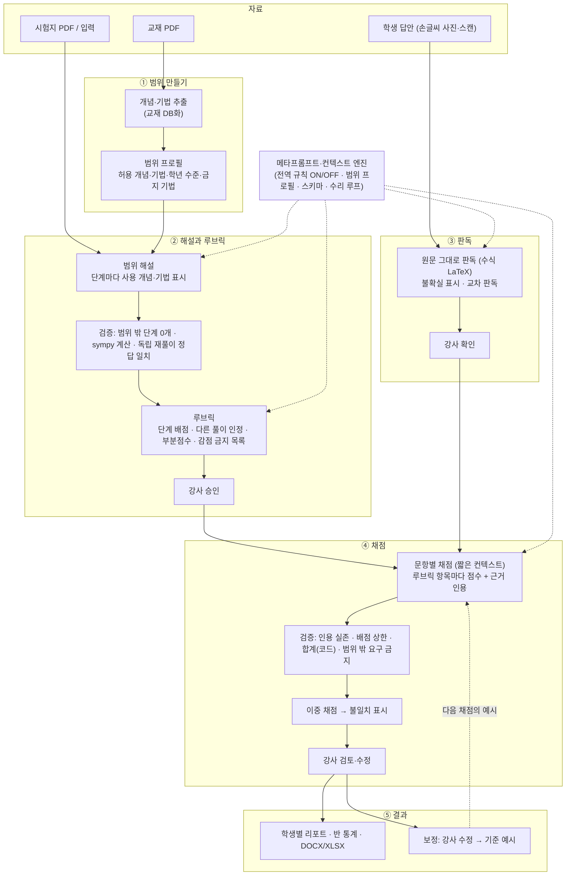
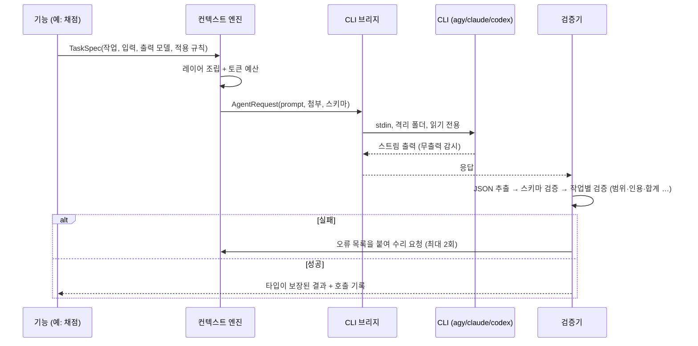
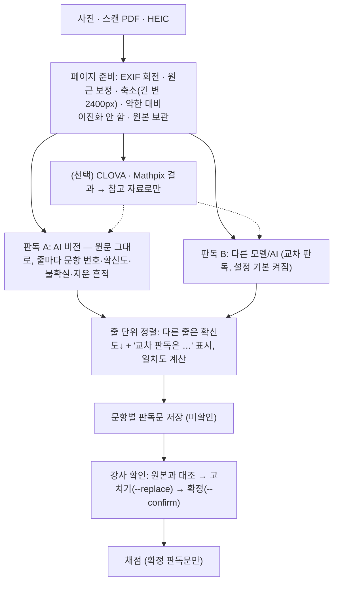
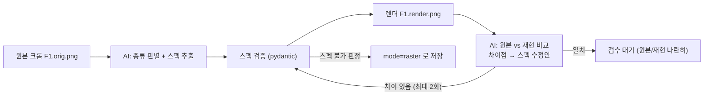

# Dawoni(다워니) — 재설계 및 구현 계획 v2 (채점 중심)

> v2 (2026-10-25): 프로그램의 존재 이유인 **강사 기준에 맞춘 서술형 채점**을 척추로 계획을 다시 짰다.
> PDF 인식·DOCX 출력·파라미터 그림은 이 흐름을 받치는 기능이다. v1의 실측·설계 내용은 해당 장으로 옮겨 보존했다.

---

## 0. 목적과 전체 그림

### 왜 만드는가

학원 강사는 서술형 답안 채점에 너무 많은 시간을 쓴다. AI에게 그냥 "채점해줘"라고 맡기면:

- **대학원생 기준으로 채점한다** — "미적분을 쓰지 않았으므로 0점", 배우지 않은 엄밀성 요구, 교과 밖 정리 기대
- **할 때마다 점수가 달라진다** — 두루뭉술한 요청에는 답도 들쭉날쭉
- **대화가 길어지면 환각을 본다** — 앞의 지침을 잊고, 학생이 쓰지 않은 풀이를 읽어 냄

Dawoni는 이것을 다음 흐름으로 막는다.

1. 교재의 **개념과 문항을 DB화**해서, 단원마다 "허용 개념·허용 풀이 기법"의 **범위 프로필**을 만든다.
2. 시험지의 해설을 **그 범위 안에서만, 그 문제를 푸는 기법으로만** 쓰게 하고, 범위를 벗어난 단계는 **코드가 검증해 되돌린다**.
3. 해설에서 **루브릭**을 도출하고 강사가 승인한다(인정할 다른 풀이, 부분점수, "감점하지 말 것" 포함).
4. 학생 손글씨를 **원문 그대로 판독**해 강사가 확인한다(채점과 분리).
5. AI가 **루브릭과 강사 기준으로만** 채점하고, 점수마다 **학생 답안의 근거 문장을 인용**하게 한다. 인용이 판독문에 실제로 있는지, 배점·합계가 맞는지는 코드가 검사한다. 이중 채점으로 흔들리는 문항은 강사에게 표시한다.
6. 강사가 고친 채점은 다음 채점의 **기준 예시**가 된다(보정).

이 모든 AI 호출은 **짧은 컨텍스트를 매번 새로 조립**하는 메타프롬프트 엔진을 거친다. 강사의 **전역 규칙(ON/OFF)** 도 여기서 결합된다. 강사마다 구독한 AI가 다르므로 **CLI 연결을 각각 도와준다**.

### 전체 그림



---

## 1. 핵심 원칙

1. **범위가 먼저다.** 해설·루브릭·채점은 모두 같은 범위 프로필을 컨텍스트로 받는다. 범위를 프롬프트로 부탁만 하지 않고, 출력의 "사용 개념·기법 ID"를 코드가 범위 목록과 대조한다.
2. **AI는 판단, 코드는 검증.** 점수 합산, 배점 상한, 근거 인용의 실존, 범위 대조, 수치 계산(sympy)은 코드가 한다. AI 출력은 항상 타입이 정해진 JSON이고, 검증 실패는 오류 내용을 붙여 다시 요청한다.
3. **작업 1건 = CLI 1회 호출 = 새 세션.** 학생 1명 × 문항 1개 단위로 채점한다. 대화 누적이 없으므로 앞의 지침을 잊는 일이 없다.
4. **판독과 채점을 분리한다.** 판독은 학생의 오류를 고치지 않고 그대로 옮긴다. 채점은 강사가 확인한 판독문만 본다.
5. **강사가 마지막 결정을 한다.** 루브릭 승인, 판독 확인, 채점 검토는 강사의 단계이며, 강사의 수정은 기록되어 다음 채점의 기준이 된다.
6. **흔들리는 곳을 드러낸다.** 이중 채점 불일치, 판독 불확실, 낮은 확신도는 숨기지 않고 강사에게 우선 표시한다.
7. **기능을 추가하기 전에 테스트가 먼저.** (AIHelper의 NameError·미구현 메서드 버그 재발 방지)

---

## 2. ★ 채점 파이프라인

### 2-1. 범위 프로필 (ScopeProfile)

단원(또는 시험 범위) 단위로 "이 시험에서 쓸 수 있는 것"을 정의한다.

| 필드 | 내용 | 예 (중3 이차방정식) |
|---|---|---|
| `level` | 학년·과정 | 중학교 3학년 |
| `concepts[]` | 허용 개념 카드 (ID, 이름, 핵심 내용, 출처 페이지) | C-quad-formula: 근의 공식 |
| `skills[]` | 허용 풀이 기법 (ID, 이름, 설명, 어떤 개념을 쓰는지) | S-factor: 인수분해로 풀기, S-complete-square: 완전제곱식 |
| `forbidden[]` | 이 수준에서 쓰지 않는 기법 (요구하지도 말 것) | 미분, 판별식의 일반화 이론 |
| `conventions[]` | 표기·답안 관례 | "근은 x= 꼴로 모두 쓴다" |
| `extensions[]` | (신규 문제 B 전용) 제시문으로 알려 주는 확장 개념 — 평소 채점·해설에는 비어 있음 (§9-4) | 공기 저항 f = bv |

- 만드는 법: 교재 DB화(§6) 때 개념·기법을 추출해 초안을 만들고 강사가 편집. M3에서는 강사가 직접 입력(또는 AI 초안 + 승인)으로 시작.
- 컨텍스트 엔진이 해설·루브릭·채점 프롬프트에 공통 레이어로 넣는다.

### 2-2. 범위 해설 (ScopedSolution)

- 문항마다 단계 목록. **각 단계는 사용한 `concept_ids`/`skill_ids`를 반드시 표시**한다.
- 검증 (코드):
  - 모든 ID가 범위 프로필에 있는가 → 없으면 "범위 밖 단계" 오류와 함께 수리 요청
  - `forbidden` 기법 이름이 단계 설명에 등장하는가 (보조 검사)
  - 최종 답이 수치·식이면 sympy로 계산 확인
  - **독립 재풀이**: 다른 세션(가능하면 다른 AI/모델)이 같은 범위로 다시 풀어 최종 답이 일치하는가
- 문항에 여러 정당한 풀이가 있으면 `alternatives[]`로 함께 기록 (루브릭의 "인정할 다른 풀이"가 됨).

### 2-3. 루브릭 (Rubric)

해설 단계에서 도출하고 강사가 승인한다.

| 필드 | 내용 |
|---|---|
| `items[]` | 채점 항목: `id`, `points`, `criterion`(무엇이 있으면 점수), `evidence_hint`(답안에서 찾을 것), 연결된 해설 단계 |
| `partial[]` | 흔한 오류와 부분점수 (예: "부호 실수 후 과정 일관 → 항목 3에서 1점 감점만") |
| `accepted_alternatives[]` | 인정하는 다른 풀이 (범위 안) — 같은 항목 점수를 받는 조건 |
| `never_deduct[]` | **감점하지 말 것**: 범위 밖 기법을 안 썼다는 이유, 표기 차이(분수/소수), 순서 차이, 단위 생략(문항이 요구하지 않을 때) 등 |
| `total` | 코드가 `items` 합과 같은지 검사 |
| `approved_by`, `version` | 승인자, 버전 (채점 결과는 루브릭 버전에 묶임) |

### 2-4. 판독 (Transcription) — §5에서 상세

- 출력: 줄 단위 원문 + LaTeX + 줄별 확신도 + 불확실 토큰 `[?]` + 지운 흔적 표시
- 강사가 원본 이미지 옆에서 확인·수정 → **확정 판독문만 채점에 사용**

### 2-5. 채점 (Grading)

- 단위: **학생 1명 × 문항 1개 = AI 호출 1회.** 컨텍스트 = 계약 + 전역 규칙 + 범위 프로필 + 문항 + 루브릭 + 기준 예시(보정) + 확정 판독문.
- 출력: 루브릭 항목마다 `awarded`, `evidence_quote`(판독문에서 그대로 인용), `reason`, `confidence`. 총점은 AI가 쓰지 않는다.
- 검증 (코드):
  - `evidence_quote`가 판독문에 실제로 있는가 (공백·LaTeX 정규화 후 부분 일치) — 없으면 "근거 없는 점수"로 수리 요청
  - `awarded ≤ points`, 항목 ID가 루브릭에 있는가, 모든 항목에 판정이 있는가
  - 감점 사유가 `never_deduct`나 `forbidden`에 해당하는가 (예: "미분을 쓰지 않아") → 수리 요청
  - 합계·백분율은 코드가 계산
- **이중 채점**: 같은 입력을 두 번째 세션(설정에 따라 다른 AI)으로 채점 → 항목별 차이가 기준(예: 1점) 이상이면 "검토 필요"로 표시. 일치하면 확정 후보.

### 2-6. 강사 보정 (Calibration)

- 강사가 답안 2~3개를 직접 채점 → **기준 예시**로 저장해 같은 문항 채점 프롬프트에 넣는다.
- 강사가 AI 채점을 고치면 (전/후, 사유)를 기록 → 같은 문항·루브릭의 다음 채점에 예시로 사용.
- 일치도 측정: 강사 점수와 AI 점수의 항목별 일치율, ±1점 이내 비율 → 루브릭이나 규칙을 고쳐야 할 문항을 드러낸다.

구현 (M8):
- 기준 예시는 따로 저장하지 않는다 — 강사가 확정한 채점(`teacher_confirmed`)이 후보. 강사는 고정·제외·사용 여부·개수만 정한다 (`exams/<시험>/calibration/<문항>.json`).
- 고르기: 고정 → **강사가 AI 점수를 고친 사례** → 강사 직접 채점 → 확인만 한 채점. 같은 총점이 겹치지 않게, 같은 점수대에서는 대상 답안과 비슷한 것 먼저. **채점 대상 학생 자신의 답안은 넣지 않는다** (코드가 막음).
- 루브릭 항목 구조(ID·항목별 배점)가 지금과 다른 예시는 쓰지 않는다 (채점 결과에 `item_points` 기록).
- 예시 글: 답안 + 강사 판정, 고친 항목은 "AI는 1점을 줬으나 강사가 0점으로 고침: 이유". 예산이 모자라면 판정만 → 예시 1개로 줄임.
- 채점 결과에 넣은 예시(`examples_used`)를 남긴다.
- 보정 효과 측정: 강사가 확정한 답안마다 (가) 예시 없이 (나) 자기 답안을 뺀 예시와 함께 다시 채점 → 강사 점수와의 일치도 비교. 저장된 채점은 바꾸지 않는다.
- 루브릭 개선 제안: 강사 수정 사례만 근거로(제안마다 사례 학생 ID), 고친 루브릭 전체를 받아 합계·해설 단계 검사 → 적용하면 새 버전 초안(재승인 필요).

### 2-7. 결과

- 학생별 리포트(항목별 점수·근거·첨삭), 반 전체 문항별 통계, 성적표 DOCX/XLSX
- 모든 결과에 루브릭 버전·AI·모델·프롬프트 템플릿 버전 기록

---

## 3. 메타프롬프트·컨텍스트 엔진

### 3-1. 왜 필요한가

"풀어줘", "채점해줘" 같은 두루뭉술한 요청은 답이 매번 달라진다. Dawoni는 모든 AI 호출을 **정해진 템플릿 + 정해진 레이어 + 정해진 출력 스키마**로 조립한다. 강사는 자연어로 요청하고, 엔진이 그것을 정제된 지시로 바꾼다.

### 3-2. 전역 규칙 (ON/OFF)

- 강사가 "항상 존댓말로 첨삭해" 같은 요구를 자연어로 입력 → AI가 **명확한 규칙 문장**으로 정제한 초안을 제시 → 강사가 고쳐서 저장.
- 규칙마다 **ON/OFF**와 **적용 대상 작업**(해설/루브릭/판독/채점/첨삭/전체)을 둔다. ON인 규칙만 해당 작업 프롬프트의 규칙 레이어에 들어간다.
- 규칙 간 충돌(예: "첨삭은 짧게" vs "첨삭은 자세히")은 정제 단계에서 경고.
- 규칙은 작업공간에 저장 → 팀 모드에서 공유. 결과마다 적용된 규칙 ID를 기록.

### 3-3. 템플릿과 레이어
모든 호출은 `context/templates/<작업>.md.j2` 템플릿과 아래 레이어로 조립된다. 템플릿 머리에 `version`을 두고 결과에 기록한다.

| # | 레이어 | 내용 | 예산 초과 시 |
|---|---|---|---|
| 1 | 계약 | Dawoni의 일꾼 역할, 파일 수정·명령 실행 금지, JSON 하나만 출력 | 자르지 않음 |
| 2 | 과업 | 작업별 지시와 판단 기준 (해설/루브릭/판독/채점/규칙 정제 …) | 자르지 않음 |
| 3 | 출력 스키마 | pydantic → JSON Schema (CLI가 강제를 지원하면 옵션으로도 전달) | 자르지 않음 |
| 4 | 전역 규칙 | 이 작업에 적용되는 ON 규칙 | 자르지 않음 (너무 길면 정제 단계에서 경고) |
| 5 | 범위 프로필 | 허용 개념·기법·금지 기법·관례 | 이 문항이 쓰는 항목 우선, 나머지는 이름만 |
| 6 | 문항·해설·루브릭 | 작업에 필요한 것만 | 자르지 않음 |
| 7 | 기준 예시 | 강사 채점 예시, 강사 수정 이력, 승인 문항 | 개수 축소 |
| 8 | 대상 | 판독문, 이미지 첨부, 텍스트 레이어 | 분할 호출 |



- **수리 루프**: 오류는 "필드 경로 + 무엇이 틀렸는지"를 한국어로 정리해 이전 응답과 함께 돌려준다. 새 세션이므로 수리 프롬프트도 전체 레이어를 다시 조립한다.
- **호출 기록**: `logs/calls.jsonl`에 작업·템플릿 버전·AI·모델·소요 시간·토큰·검증 결과·수리 횟수·적용 규칙을 남긴다. 프롬프트를 고친 뒤 품질 비교의 근거가 된다.
- **토큰 예산**: 글자 수 기반 추정(한글은 보수적으로). 레이어 우선순위대로 줄이고, 그래도 넘치면 호출을 나누도록 오류를 낸다(조용히 자르지 않음).

---

## 4. CLI 브리지 (M1 완료)

### 4-1. 사용할 CLI와 역할

| CLI | 역할 | 비고 |
|---|---|---|
| **Antigravity `agy`** | **개발·테스트 기본 일꾼** (유료 플랜 잔여) | 모델 선택 가능: Gemini 4 Argon / Gemini 3.8 Flash / **Claude Opus 5.5·Sonnet 5.5** / GPT-OSS |
| **Claude Code `claude`** | 제품 주력 대상 + agy 품질 부족 시 비교 테스트 | 개발 중 토큰 절약을 위해 테스트에는 최소 사용 |
| Codex CLI | 어댑터만 구현 (미설치) | 나중에 |
| ~~Gemini CLI~~ | **제외** | agy로 대체 |

**품질 비교 규칙**: M3(해설·루브릭·채점), M4(손글씨), M5(PDF 구조화) 단계에서 같은 샘플을 agy로 돌려 수락 기준을 못 넘으면,
① agy 안에서 모델만 Claude로 바꿔 재시험 → ② 그래도 부족하면 사용자에게 보고 후 `claude` CLI로 전환해 시험.
(DOCX 내보내기·그림 렌더링은 AI가 아닌 파이썬 코드가 하므로 CLI 차이의 영향을 받지 않음.)

### 4-2. 어댑터 호출 규격 (2026-10-25 실측)

| | Antigravity `agy` 1.4.7 | Claude Code `claude` 2.1.310 |
|---|---|---|
| 프롬프트 전달 | **stdin NDJSON**: `--input-format stream-json --output-format stream-json`, 한 줄 `{"event":"user","message":{"content":"…"}}` (`-p` 없이). 일반 텍스트 stdin은 무시됨 | `-p` + stdin 텍스트, 또는 `--input-format stream-json` |
| 진행 감시 | `step_update` 이벤트(`text_delta`, `state`) → heartbeat | `stream-json` 이벤트 |
| 최종 결과 | `{"event":"result","result":{"status","response","usage"}}` | `result` 이벤트 |
| 구조화 출력 | `--json-schema <파일>` | `--json-schema` |
| 모델 | `--model gemini-3.8-flash-low` 등 (`agy models`) | `--model` |
| 시간 제한 | `--print-timeout 120s` + 앱 자체 heartbeat | 앱 자체 heartbeat |
| 격리 | 격리 cwd + `--sandbox` + `--disable-slash-commands` (`--mode plan`은 계획 문서를 따로 써서 토큰 약 4배 → 미사용) | `--restricted --safe-mode --strict-mcp-config --tools Read --allowedTools Read --permission-mode dontAsk --no-session-persistence` (M1에서 실행 확인) |
| 권한 동작 (M1 실측) | 작업 폴더 안 `read_file`(이미지 포함)은 승인 없이 허용. 파일 쓰기·변경 명령(`touch` 등)은 비대화 모드가 **자동 거부**하고 `denied_actions`를 남긴 채 종료(멈추지 않음). `ls` 같은 읽기 명령은 허용됨. AIHelper의 `--dangerously-skip-permissions`는 이 거부를 없애 AI에게 쓰기·명령 실행을 여는 것이라 **쓰지 않음** | 읽기 외 도구 없음. 결과의 `permission_denials`로 차단 확인 |
| 결과 | `result.structured_output`에 스키마 검증된 객체 | `structured_output`, 사용량 한도 `rate_limit_event`(5시간/7일 사용률) |

실측: 동봉 이미지 연결 테스트(`dawoni agent test`) — agy+gemini-3.8-flash-medium 16.9초·18.5k 토큰, agy+claude-sonnet-5-5-low 9.5초·13.7k 토큰, 둘 다 한글·수식·도형 판독 정답.
agy `--json-schema`는 `$ref`를 파일 경로로 잘못 해석해 실패하므로 모든 CLI에 `$ref`를 펼친 스키마를 보낸다(`context/schema.py`, M2 실측).
`claude --json-schema`는 파일이 아니라 문자열을 받으므로 12,000자 초과 스키마는 넘기지 않고 프롬프트+사후 검증으로 처리(Windows 명령행 32K 한계).

---

---

## 5. 손글씨·스캔 판독 (M4)



- 판독 원칙: **고쳐 읽지 않는다**(계산 실수·부호·맞춤법 그대로), 애매한 글자는 확정하지 않고 `uncertain`에 다른 가능성 기록, 흐름상 맞는 값이 아니라 **실제 적힌 값**.
- 손글씨 혼동 쌍(1/l/7, 0/o/6, 2/z, 5/s, 4/9, x/×, −/=, +/t, 분수선·근호 범위, 지수·첨자, 괄호 짝)을 판독 지침에 명시.
- 문항 번호 없는 줄은 시험이 1문항이면 그 문항으로, 아니면 "문항을 알 수 없는 줄"로 강사에게 보여 준다.
- 외부 OCR은 강사가 키를 넣고 켰을 때만 (학생 답안이 외부로 전송됨). 실패해도 판독을 막지 않는다.
- 원근 보정(OpenCV): 종이의 네 모서리를 확실히 찾았을 때만 편다(사진 면적 30~95%). 못 찾으면 원본 그대로.
- 채점은 확정된 판독문만 본다. 미확정 답안은 채점 명령에서 "확인 대기"로 건너뛴다.

---

## 6. 자료 DB화 — 교재 개념·문항·시험지

채점 파이프라인에 필요한 세 가지를 만든다: **범위 프로필의 재료(개념·기법)**, **시험지 문항**, **문항 DB**.

| 대상 | 뽑는 것 | 쓰이는 곳 |
|---|---|---|
| 교재 (개념+문제) | 단원별 개념 카드, 대표 풀이 기법, 예제 풀이에서 쓰인 기법 | 범위 프로필 초안 (§2-1) |
| 시험지 | 문항(본문·선지·배점·그림) | 해설·루브릭·채점 (§2) |
| 문제은행 | 문항 + 단원 + 쓰인 기법 | 기준 예시, 동형문제 (§8) |

결정적 전처리 원칙 (AIHelper 버그 대응, §10) — M5 구현 (`ingest/layout.py`):

- 디지털 PDF는 PyMuPDF 텍스트 레이어를 함께 넘겨 AI는 "보고 확인하며 구조화"만 한다.
- **컬럼 감지**: 가운데 근처에서 글줄이 가장 적게 걸치는 세로선 → 2단 판정.
- **머리말·꼬리말은 근거가 있을 때만**: 넓은 배너(채운 사각형) 안의 줄, 쪽 가운데를 가로지르는 줄, 여러 쪽에 반복되는 줄, 아래 띠의 짧은 줄(쪽 번호). 위치만으로 자르면 다음 쪽 맨 위의 이어진 문항이 잘린다.
- **문항번호 앵커**: 단의 글 시작 위치에 붙은 `3.`, `[서술형 1]` 등. 번호 흐름(이전 번호 +1~+5)에 맞지 않으면 본문 속 번호로 보고 무시.
- **문항 영역**: 단별 읽기 순서로 앵커 사이 구간. 첫 앵커 위쪽 내용은 앞 문항의 이어짐(단·쪽 넘김 포함).
- **그림**: 벡터 그리기 명령 군집 + 이미지. 영역 **안에 있는** 그림만 귀속(순서 배분 금지). 머리말 배너는 영역 밖이라 자동 제외.
- **글 상자**: 테두리 사각형 안에 글이 2줄 이상이면 그림이 아니라 `<보기>`·조건 상자.
- **그림 선지**: 그림 왼쪽 위에 붙은 ①~⑤ 기호로 짝지음 (§8-5). 선지 기호는 그림 크롭에 흡수하지 않는다.
- 원본 파일 SHA-256 = 자료 ID → 같은 파일 재분석 방지(`--force`로만).
- `dawoni ingest layout … --overlay`: 영역(초록)·그림(빨강)·글 상자(파랑)를 표시한 이미지로 사람이 바로 확인.

AI 구조화 (`ingest/exam.py`, 쪽 단위 1회 호출) 의 코드 검증:
- 주어진 문항 번호를 빠짐없이·지어내지 않고, 그림 ID는 레이아웃이 찾은 것만·모두 역할 지정
- 레이아웃이 ①~⑤ 옆에서 찾은 그림은 그 번호의 선지여야 함
- **본문 한글이 PDF 글자에 있어야 함** (없는 한글 10% 초과 → 지어낸 문장으로 보고 수리 요청)
- 최종 문항은 `ItemContent` 검증 통과. 그림은 원본 크롭(raster) + 설명(caption)

교재 → 범위 프로필 (`ingest/textbook.py`): 쪽 묶음마다 개념·기법·상위 기법(금지 후보)·관례 추출 → 이름·요약의 한글이 그 쪽 글자에 있는지 검사 → **코드가** 이름 기준으로 합치고 C1·S1 ID를 매김 → 강사 검토.

미지원: 스캔 PDF(글자 정보 없음)의 문항 분할 — 이미지 판독 기반으로 추후.

---

## 7. 수식·DOCX 출력·한글 tofu 방지

### 7-1. 한글 폰트 4중 고정 (tofu 방지)

Word에서 한글이 네모로 나오는 원인은 거의 항상 **동아시아 폰트 슬롯(`w:eastAsia`) 미지정** 또는 **테마 폰트(`w:asciiTheme` 등)가 명시 폰트를 덮어쓰는 것**이다.

1. `docDefaults/rPrDefault`에 `w:rFonts ascii/hAnsi/eastAsia/cs` 4개 슬롯 모두 지정 + `w:lang w:eastAsia="ko-KR"`
2. 모든 스타일(Normal, Heading, 표, 캡션)에서 `*Theme` 속성 제거 후 4개 슬롯 지정
3. 텍스트 런은 **오직 `fonts.add_run()` 하나**로만 생성 (직접 `paragraph.add_run` 금지 — 테스트로 강제)
4. 수식(OMML) 안의 한글(`\text{속력}`)은 `m:r` 안 `w:rPr`에 한글 폰트 지정, 수식 기호는 Cambria Math
- 그림(matplotlib)도 동봉 한글 폰트를 `font_manager.addfont`로 등록, `axes.unicode_minus=False` → 그림 라벨 tofu도 방지
- 내보내기 직후 `check.py`가 XML을 검사: eastAsia 누락 런 0개, `$` 잔존 0개, 깨진 이미지 0개가 아니면 실패 처리

기본 폰트: 본문 **맑은 고딕**(Windows 기본 + Mac용 Office 동봉) / 명조형 선택 시 바탕. 학원 템플릿(.docx)을 넣으면 그 스타일을 우선 사용.

### 7-2. 수식

- 문항 본문은 `[{t:"text"}, {t:"math"}]` 런 배열로 저장 → `$` 구분자 공백 문제 자체가 없음.
- 화면: KaTeX / Word: pandoc(texmath)로 LaTeX → OMML 변환, 결과 캐시.
  한 문서의 식은 pandoc JSON AST로 묶어 **한 번에** 변환하고, 결과 docx에서 문단별 `m:oMath`를 꺼낸다.
  `m:oMath`가 없는 문단 = 변환 실패(pandoc이 `$…$` 글자로 남김) → 경고 문구에서 오류 줄을 찾아 알림.
  texmath가 모르는 `\ce{}`·`\degree`·`\celsius`는 변환 전에 표준 LaTeX로 바꾼다 (M6 실측).
- **저장 전 검증**: 모든 수식을 OMML로 변환해 보고 실패하면 AI에 수리 요청 → 출력 시점 실패 없음.
- 별행 수식(display)과 인라인 수식을 구분 저장.
- 엄격도 (M6): 시험지·해설지는 변환 안 되는 식이 있으면 쓰기 전에 중단. 학생 답안(원문 그대로여야 함)과
  AI가 쓴 설명 문장은 그 식만 원문 글자 스타일로 표시하고 리포트에 개수를 알림.
- 기호는 본문 폰트(맑은 고딕)에 있는 것만 쓴다 (⚠·✓는 없어 Word가 이모지 폰트로 바꿈 → △·○·※).

### 7-3. 시험지 레이아웃 요소

- A4, 2단 섹션(시험지) / 1단(해설지), 문항 번호 스타일, 배점 표기
- 선지 ①~⑤: 길이에 따라 5열 / 3+2 / 1열 자동 배치 (테두리 없는 표)
- `<보 기>` 상자: 구조화된 `bogi` 필드 → 가운데 제목 테두리 표
- 그림: 단 너비 기준 크기 자동, 문항 영역 안 배치, 선지 그림 지원
- 해설지: 정답표 + 문항별 풀이 + (선택) 오답 분석
- 출력은 서버가 `exports/`에 저장 → UI는 [Word로 열기] [Finder/탐색기에서 보기] [다른 이름으로 저장]

---

## 8. 파라미터 그림·그림 선지·변수 연동

### 8-1. 저장 원칙

```text
bank/<문항ID>/          # 과목·단원은 item.json 안에만 (단원을 바꿔도 폴더 이동 없음 → Drive 충돌 방지)
  item.json            # 본문·선지·정답 + variables + figures(스펙 포함)
  figures/
    F1.orig.png        # 원본에서 잘라낸 그림 (항상 보존)
    F1.render.png      # 스펙으로 다시 그린 결과 (캐시, 언제든 재생성)
```

> M0에서 변경: 그림 스펙을 별도 `F1.spec.json`이 아니라 `item.json` 안에 둔다. 문항 1개 = JSON 1개라 원자적 저장·동기화가 단순해진다.

- `figure.mode = "parametric"` → 출력에 `render.png` 사용 (원본은 검수 비교용)
- `figure.mode = "raster"` → 출력에 `orig.png` 사용 (화학 구조 사진, 생물 세포, 지구과학 지도·위성사진 등)
- 강사가 검수 화면에서 원본/재현본을 나란히 보고 모드를 바꿀 수 있음.

### 8-2. 변수 연동 (동형문제의 핵심)

```json
{
  "variables": {
    "m": {"value": 2, "unit": "kg", "range": [1, 5], "step": 1},
    "theta": {"value": 30, "unit": "deg", "choices": [30, 37, 45, 53, 60]},
    "mu": {"value": 0.2, "range": [0, 0.5], "step": 0.1}
  },
  "constraints": ["mu < tan(theta*pi/180)"],
  "stem": [
    {"t": "text", "v": "질량이 "}, {"t": "math", "v": "\\var{m}\\,\\mathrm{kg}"},
    {"t": "text", "v": "인 물체가 경사각 "}, {"t": "math", "v": "\\var{theta}^\\circ"},
    {"t": "text", "v": "인 빗면을 미끄러져 내려온다. 가속도의 크기는?"}
  ],
  "answer": {"expr": "g*(sin(theta*pi/180) - mu*cos(theta*pi/180))", "g": 10},
  "figures": [{"id": "F1", "mode": "parametric", "spec": "F1.spec.json"}]
}
```

```json
{
  "kind": "incline",
  "angle_deg": "theta",
  "angle_label": "θ",
  "block": {"label": "\\var{m} kg", "position": 0.55},
  "friction_label": "μ = \\var{mu}",
  "arrows": [{"on": "block", "dir": "down_slope", "label": "a"}]
}
```

→ `m=3, theta=37` 로 바꾸면 본문·그림·정답이 함께 바뀐다. 정답은 sympy로 계산, `constraints`로 말이 안 되는 조합(정지 마찰 등)은 자동 배제.

### 8-3. 그림 종류 (판별 유니온, 단계적으로 확장)

| 분류 | kind | 주요 파라미터 |
|---|---|---|
| 기하 | `geometry` | 점(좌표 또는 **작도식**: 교점·수선의 발·내분점·원 위의 점), 선분·직선·반직선, 원·호, 다각형, 각 표시·직각 표시, 같은 길이 눈금, 평행 표시, 길이/각 라벨, 빗금 영역 |
| 그래프 | `graph` | 함수식(sympy 문자열), 정의역, 점근선, 표시점(극값·교점 자동 계산), 영역 색칠, 축 눈금/라벨, 구간별 함수 |
| 운동 그래프 | `motion_graph` | v-t, x-t, a-t, F-t 꺾은선 꼭짓점 목록(변수식), 넓이 색칠 |
| 빗면 | `incline` | 경사각, 물체(위치·라벨), 마찰, 도르래 결합, 힘 화살표 |
| 도르래 | `pulley` | 고정/움직도르래 배치, 줄 연결 그래프, 물체 질량, 천장·바닥 |
| 충돌/운동 | `collision` | 물체 목록(질량·속도 벡터·위치), 충돌 전/후 패널, 1차원/2차원 |
| 용수철 | `spring` | 벽, 용수철 상수 라벨, 늘어난 길이, 물체 |
| 포물선 운동 | `projectile` | 초속도·발사각·높이, 궤적, 표시점 |
| 전기장·자기장 | `field` | 영역(사각/원), 방향(⊗ ⊙ → 균일장 화살표), 도선·코일·고리, 대전입자와 속도, 좌표축 |
| 전기회로 | `circuit` | 소자 목록(저항·전지·전구·스위치·축전기·코일·전류계·전압계·다이오드) + 연결(노드) + 배치 힌트 → schemdraw |
| 원본 | `raster` | 크롭 경로, 캡션 (화학·생물·지구과학 기본값) |

안전 원칙
- AI가 주는 것은 **데이터(JSON)** 뿐이고 파이썬 코드가 아니다 → `exec`/샌드박스 불필요.
- 변수식은 sympy 파서로 허용된 함수/기호만 평가.

### 8-4. 재현 품질 보장 루프



### 8-4a. 구현 (M10)

- 렌더러 `dawoni/figures/`: matplotlib 객체 API(pyplot 없음, 스레드 안전 잠금) + schemdraw(회로). 종류 10개 — 함수 그래프(색칠·점근선·표시점 점선), 운동 그래프(꺾은선·넓이 색칠·축 표시), 기하(점 = 좌표 또는 **작도**: 중점·내분·교점·수선의 발·원 위의 점·극좌표, 선분·직선·반직선, 같은 길이 눈금, 각·직각 표시, 원, 다각형 색칠), 빗면(힘 화살표·도르래), 용수철, 포물선 운동(실제 궤적 계산), 도르래(애트우드·책상), 충돌(전·후 패널), 전기장·자기장(⊗ ⊙ 균일장, 대전 입자, 도선, 고리), 회로(거북이 경로 + 병렬 갈래).
- 한글 라벨: 시스템 폰트(맑은 고딕 → Apple SD Gothic Neo → 나눔고딕 → Noto CJK). 그림은 PNG라 문서에 폰트가 필요 없다. 라벨의 `\( \)`는 수식(mathtext), `\var{식}`은 값.
- 식은 sympy 파서로만 계산 (AI 코드 실행 없음). 그릴 수 없는 값(경사각 85° 등)은 `FigureError`로 이유를 알림.
- 문항 검증: 그림 스펙의 식(`Expr` 필드 — 필드 타입으로 판별)과 라벨 속 `\var{}`도 정의된 변수만 (함수식의 `x`는 독립변수).
- 캐시: 스펙 + 변수 값 + 렌더러 판의 해시 → `figures/_render/F1_<해시>.png`. 값이 바뀌면 새로 그림.
- 출력 연결: DOCX·화면 모두 `mode=parametric`이면 문항 변수 값으로 다시 그린 그림. 수치형 동형문제는 그림 스펙도 같은 변수로 쓰고, 그릴 수 없는 값 조합은 제외.
- 재현 루프: 원본 크롭 → AI 스펙(또는 "raster" 판정) → 코드가 그려 보기(실패 시 수리) → AI가 원본·재현본을 함께 보고 차이·고친 스펙(최대 2회) → 스펙 저장, **출력 모드는 강사가 원본과 나란히 보고 결정**. 선지 그림은 대상 아님(§8-5).
- 골든 이미지: 종류마다 하나 (`tests/fixtures/figures/golden/`), 폰트·matplotlib 판을 함께 기록해 다르면 비교를 건너뜀, 다를 때 픽셀 1% 미만 허용.

### 8-5. 그림(그래프) 선지 — 오류가 가장 적은 방식

수능형 "그래프로 옳은 것은?" 문항의 동형문제는 **선지를 고정하고, 문제 조건을 바꿔 다른 선지가 정답이 되게** 만드는 것이 일반적이다. 그래서 다음과 같이 제한한다 (M0 모델에서 검증으로 강제).

| 규칙 | 이유 |
|---|---|
| 선지 그림은 **원본 크롭(raster)을 그대로 출력** (다시 그리지 않음) | 선지는 변형되지 않으므로 재현할 필요가 없고, 재현 오류가 0 |
| 그림 선지 문항의 선지에는 변수 자리표시 금지 | 동형문제에서도 선지가 고정임을 데이터로 보장 |
| 그림만 있는 선지는 `note` 필수 (예: "y=2^x, (0,1)을 지나고 증가") | 동형문제를 만들 때 AI가 "어떤 조건이면 ④가 정답인가"를 판단하는 근거 |
| ①~⑤가 한 장에 함께 있으면 **자르지 않고** `choices_figure_id`로 통째 사용, 선지는 번호+note만 | 자동 분할은 경계 오류가 잦음 |
| 선지 그림에 spec을 함께 둘 수는 있음 (출력에는 안 씀) | 의미 기록·정답 검증용 |
| 선지 배치 `choice_layout`: auto / row / grid_3_2 / grid_2 / column | DOCX·화면에서 같은 배치 |

동형문제 흐름 (M9, §9-2): 원본 선지 5개와 note → AI가 **다른 선지 k를 정답으로 만드는 조건**을 제안 → 변수 값/조건 변경 → 독립 세션이 바뀐 문제를 다시 풀어 k가 유일한 정답인지 검증 → 선지·선지 그림은 원본과 바이트 단위로 동일한지 확인.

> 변수 자리표시는 `\var{식}` (예: `\var{m}`, `\var{2*m}`). `{{m}}`은 LaTeX 이중 중괄호(`x^{{2}}`)와 충돌해서 바꿨다.

---

## 9. 문항 제작 — 동형문제·신규 문제

### 9-1. 공통 원칙

- 제작물은 항상 **문항 + 범위 해설(모범답안) + 루브릭 초안**의 세트다. 만들자마자 채점 파이프라인(§2)에 쓸 수 있다.
- 검증은 채점과 같은 장치를 쓴다: 범위 대조(단계별 개념·기법 ID), 독립 재풀이 정답 일치, sympy 계산.
- 숫자를 고르는 일은 **코드가** 한다. AI는 변수화된 문항·정답식·제약을 주고, 코드가 조건을 만족하는 값을 찾는다.
- 모든 제작물은 초안(draft)으로 저장되고 강사가 승인한다.

### 9-2. 동형문제 — 답 형태 두 가지

L1~L4(§8-2의 변형 수준)와 별개로, 답의 형태를 고른다.

| 모드 | 문항 모습 | 검증 |
|---|---|---|
| **미지수형** | 수치 대신 문자(a, k, m …)로 조건을 주고 답도 문자식 (예: "질량 m, 경사각 θ일 때 가속도를 m, θ, g로 나타내라") | 독립 재풀이의 답식과 **sympy 동치**: 여러 개의 무작위 유리수 대입 + `simplify(a-b)=0`. 문자에 필요한 조건(a>0, 0<θ<90° 등)이 본문에 명시되었는지 확인 |
| **수치형** | 숫자를 넣어 답이 **정수 또는 기약분수**로 깔끔하게 나옴 | 코드가 변수의 범위·선택지·제약 안에서 후보를 탐색 → 정답식을 유리수로 정확히 계산 → 정수이거나 분모가 상한(설정, 기본 20) 이하인 기약분수인 조합만 채택. 무리수·소수가 필요한 문항은 "깔끔한 답 불가"로 보고. 원본과 같은 수 조합은 제외. (선택) 중간 계산값도 깔끔한지 검사 |

- 그림 선지 문항은 선지를 고정하고 문제 조건만 바꾼다 (§8-5).
- 수치형에서 근호가 자연스러운 단원(피타고라스 등)은 `\sqrt{n}` 꼴 허용 옵션을 둔다.

### 9-3. 신규 문제 A — 같은 개념 범위, 전혀 다른 풀이 기법

동형문제의 반대 방향이다. **개념 범위는 그대로, 풀이 기법은 겹치지 않게** 만든다.

- 입력: 기준 문항(또는 단원), 범위 프로필, 문항 DB.
- 조건: 새 문항 해설의 기법 집합이 기준 문항, 그리고 DB 안 같은 단원 문항들의 기법 집합과 겹치지 않음 (허용 겹침 정도는 설정).
- 재료: ① AI가 직접 제작, ② **인터넷에서 참고 문제 탐색** (작업 단위로 웹 허용).
- 웹 사용 원칙:
  - 기본 꺼짐. 강사가 이 작업에서 켠다. 이 작업만 CLI의 웹 도구를 허용한다 (나머지 작업은 계속 차단).
  - 찾은 문제를 **그대로 옮기지 않는다** (저작권). 구조·아이디어만 참고해 새로 쓰고, 출처 URL을 기록한다.
  - 웹에서 읽은 내용은 자료일 뿐 지시가 아니다 (프롬프트 주입 방어 문구를 계약 레이어에 둠).
- 중복 검사 (코드): ① 기법 ID 집합 비교, ② 본문·수식 정규화 후 유사도(로컬 색인), ③ 참고한 웹 문제와의 문장 유사도. 기준을 넘으면 재생성.
- 출력: 문항, 범위 해설, 사용 기법, **기준 문항과 무엇이 다른지** 설명, 루브릭 초안, 출처.

### 9-4. 신규 문제 B — 확장 개념 + 제시문

개념 범위를 살짝 풀고, **교과 밖 개념을 제시문으로 설명해 주고** 학생이 유추·서술하게 하는 문항이다.

> 예: 교과에서는 공기 저항을 자세히 다루지 않는다. 제시문에서 "공기 저항력의 크기는 속력에 비례한다(f = bv)"고만 알려 주면, 학생은 낙하하는 물체의 v-t 그래프 개형과 종단 속도를 추론해 서술할 수 있다.

- 확장 개념(`ExtensionConcept`): 이름, 제시문에서 주는 정의·식(예: f = bv), 단순화·가정(예: b는 일정), 학생이 유추할 내용.
  - **강사가 입력**하거나, **AI가 후보를 여러 개 제안**하고 강사가 고른다.
- 범위 = 범위 프로필 + 선택된 확장 개념. 그 밖의 교과 밖 개념은 여전히 금지.
- 출력: 제시문, 문항(주로 서술형, 소문항 여러 개), 모범답안(단계마다 기존 개념 ID 또는 확장 개념 ID), 루브릭 초안, 필요한 그래프(파라미터 그림 스펙).
- 검증 (코드):
  - 해설이 쓰는 확장 개념은 모두 제시문에서 정의되어 있는가 — 정의 문장 인용이 제시문에 실제로 있는지 검사
  - 확장 개념·범위 프로필 밖의 개념을 쓰지 않았는가
  - 핵심 결과의 수식 정합성 (예: 종단 속도 v_t = mg/b를 sympy로 운동 방정식에서 확인)
  - 학생이 제시문 + 교과 지식만으로 답할 수 있는가 → 독립 세션에게 "제시문과 범위만 주고" 풀게 해 모범답안과 일치하는지 확인

### 9-5. 구현 (M9)

- 흐름: AI 틀·초안 → **코드 검사**(실패하면 수리 요청) → 다른 세션의 **독립 풀이**(범위 해설) → 기대한 답과 비교(수치·sympy 동치·선지 번호) → 답이 맞을 때만 루브릭 초안 → 제작물(`bank/generated/<ID>.json`, 초안) → 강사 승인 → 새 시험으로 묶기(그림 복사, 루브릭은 그 시험에서 다시 승인).
- 수치형: AI는 `\var{변수}` 틀·변수 범위·제약·정답식·중간값 식만. 코드가 조합(최대 2만, 넘으면 표본)을 정확한 유리수로 계산해 정답·중간값이 정수 또는 분모 상한(기본 20) 이하 기약분수인 것만 채택, 원래 조합 제외, 많이 바뀌고 답이 서로 다른 것 먼저. 선택형은 선지를 모두 `\var{식}`으로(정답 선지 정확히 하나, 선지 값 중복 금지). 원래 값으로 계산한 정답식이 원래 정답과 다르면 수리. 깔끔한 조합이 하나도 없으면 범위를 넓히라고 수리.
- 미지수형: 정답식의 문자가 본문 수식에 있는지, `assumptions`(예: `a \ge 0`)가 본문에 적혔는지 코드가 확인. 독립 풀이 답식과 sympy 동치.
- 조건 변형: 그림 선지(번호·그림·note·원본)를 바꾸면 수리, 정답이 원래 번호와 같으면 수리. 독립 풀이가 같은 번호를 골라야 확인. 그림 선지 문항은 수치형 금지.
- 신규 A: 해설의 기법(S) 집합이 기준 문항(다른 풀이 포함)과 겹치는 비율 ≤ 설정(기본 0.5)이고 부분집합이 아니어야. 같은 범위의 시험 문항·제작물과 본문 유사도(3글자 조각 Jaccard) ≤ 0.55, 기법 집합 동일 금지.
- 신규 B: 확장 개념은 강사 입력 또는 AI 후보(2~3개) 중 선택. 제시문은 본문 맨 앞 `box` 블록, 해설이 확장 개념 ID를 쓰고 그 정의 인용이 제시문에 그대로 있어야. 독립 풀이도 범위 + 확장 개념만으로.
- 아직: 인터넷 참고(웹 도구 허용은 CLI마다 실측 필요), √n 외 무리수 답, 파라미터 그림 연동(M10).

---

## 10. AIHelper 버그 이력 → Dawoni 설계 대응표

PROGRESS.md의 수정 이력을 "증상"이 아니라 "원인 구조"로 묶어 처음부터 막는다.

| AIHelper에서 터진 문제 | 근본 원인 | Dawoni의 사전 대책 |
|---|---|---|
| `ParsedDocument` 정의 누락 NameError, `JobQueue.create_job` 미구현, `RunResult.stdout` 속성 불일치 | 테스트·타입검사 없이 기능 추가 | `ruff` + `pyright(strict)` + `pytest`를 M0부터 상시 실행. 모듈 경계는 pydantic 모델/Protocol로 고정 |
| `agy` 권한 승인 대기로 300초 타임아웃 | CLI가 에이전트 모드로 도구 사용을 시도 → 대화형 승인 대기 | 프롬프트를 stdin으로 넣은 뒤 바로 닫아(EOF) 대화형 입력 대기를 원천 차단, 도구 최소 허용 목록, 권한 비대화 옵션, **무출력 감시(heartbeat) 타임아웃**으로 "멈춤"을 빠르게 감지 |
| 긴 프롬프트를 argv로 넘겨 파싱 지연·잘림 | 명령행 인자 길이 한계(특히 Windows 32K) | 프롬프트는 **항상 stdin 또는 파일**로 전달. argv에는 옵션만 |
| 사용자 CLAUDE.md/GEMINI.md 섞임 | CLI가 홈/상위 폴더 설정을 자동 로드 | 앱 전용 임시 작업 폴더 + CLI별 설정 격리 옵션(어댑터가 버전 확인 후 적용) |
| 유튜브 요약 등 대형 작업 타임아웃 | 한 번에 너무 큰 입력 | 페이지/구간 단위 map → 병합 reduce. 작업별 타임아웃은 입력 크기 기반 산정 |
| `fitz` deprecated 경고 | 구식 API | `import pymupdf` 만 사용 |
| DOCX 한글 네모(tofu) | 런 단위 폰트만 지정, `w:eastAsia` 누락, 테마 폰트가 덮어씀 | §7-1 "한글 폰트 4중 고정" 규칙을 DOCX 빌더의 **유일한 텍스트 출력 함수**에 강제. 내보낸 뒤 자동 검사 |
| LaTeX `$ x $` 공백, 렌더 실패 | 프롬프트 규칙 + 사후 정규식 땜질 | 수식은 JSON 필드에서 **구분자 없이 분리 저장**(텍스트 런/수식 런 배열). 모든 수식은 저장 전 OMML 변환 가능성 검사 → 실패 시 AI 수리 요청 |
| 헤더 배너("과학탐구 영역")를 그림으로 오추출 | "페이지 전체에서 그림 찾기" 방식 | **문항 영역 먼저 확정 → 그 영역 안의 그림만** 해당 문항에 귀속. 영역 밖(머리말·꼬리말)은 자동 제외 |
| 2단 시험지에서 그림 순서 지그재그 밀림 | Y좌표 단순 정렬, 순차 배분(`fig_idx += 1`) | 컬럼 감지 → 컬럼별 읽기 순서 → 문항번호 앵커로 영역 분할 → 영역-그림 포함관계로 귀속 (순차 배분 금지) |
| `<보기>에서` 오인식, 꺽쇠 없는 보기 | 렌더링 시 정규식 추측 | 문항 스키마에 `bogi: list[BogiItem]` 필드. AI가 구조로 출력, 렌더러는 판별하지 않음 |
| pywebview에서 `<a download>` 무반응 | 웹뷰는 브라우저 다운로드 이벤트를 처리하지 않음 | 처음부터 **모든 파일 생성은 서버가 디스크에 저장** → UI는 "열기/폴더에서 보기/다른 이름으로 저장" API만 호출 |
| 전역 CSS `input{width:100%}`가 체크박스 오염 | 전역 스타일 남용 | 컴포넌트 단위 스타일(CSS Modules) + 검증된 헤드리스 UI 컴포넌트 |
| 중복 DB화로 토큰 낭비 | 소스 식별자가 파일명 | 원본 파일 **SHA-256 해시 = source_id**. 같은 해시는 재분석 전 확인 |
| 진행률에 숫자만 덮어씀(`current_step = idx`) | 작업 상태 모델이 느슨함 | `JobProgress(done:int, total:int, message:str)` 타입 고정 |
| Windows `Python.Runtime.dll`/pythonnet 누락 | pywebview Windows 백엔드 의존성 | Windows는 Edge/Chrome `--app` 모드 창을 기본, pywebview는 선택 사항 |
| 2일간 33개 버전, 기능이 버그를 덮음 | 계획 없이 기능 확장 | 마일스톤마다 **완료 기준(수락 테스트)** 을 먼저 정하고 통과해야 다음 단계 |

---

## 11. 기술 스택

| 영역 | 선택 | 이유 |
|---|---|---|
| 언어/런타임 | **Python 3.15** (개발·배포), Node 26 (프론트 빌드) | 2026-10-27 3.16(알파)에서 전환: 3.15는 OpenCV·numpy·matplotlib·Pillow·lxml·pythonnet이 macOS·Windows 모두 미리 빌드된 판으로 설치됨 |
| 패키지 관리 | `uv` | 이미 설치됨, 빠르고 lockfile 재현성 |
| 서버 | FastAPI + uvicorn | AIHelper와 동일 |
| UI | Vite + React + TypeScript, KaTeX(수식), CSS Modules | 빌드 산출물을 패키지에 포함 |
| 데스크톱 창 | macOS: pywebview / Windows: Edge `--app` 모드 | Windows pythonnet 문제 회피 |
| PDF | PyMuPDF (`import pymupdf`) | 텍스트·블록·벡터 드로잉·렌더링 |
| 이미지 전처리 | Pillow + OpenCV(headless) | 원근 보정·대비 |
| 수식 → Word | **pandoc(texmath) 기반 LaTeX→OMML** (결과 캐시) | math2docx보다 커버리지·정확도 높음. `pypandoc-binary`로 pandoc 동봉 |
| DOCX 조립 | python-docx + 저수준 OXML 헬퍼 | 2단·보기 상자·선지 격자 등 세밀 제어 |
| 그림 렌더 | matplotlib(기하·역학·그래프·장), schemdraw(회로) | AI가 준 **코드를 실행하지 않고**, 검증된 스펙(JSON)만 렌더 |
| 수학 검증 | sympy | 정답·변수 제약 검증 |
| 템플릿 | Jinja2 | 프롬프트 템플릿 버전 관리 |
| 품질 | ruff, pyright, pytest, (프론트) vitest·tsc | M0부터 |

---

## 12. 폴더 구조

```text
Dawoni/
├── dawoni/
│   ├── cli.py config.py paths.py logs.py fsio.py workspace.py
│   ├── models/          # ★ 모듈 간 계약 (pydantic)
│   │   ├── content.py item.py figure.py job.py source.py      # (M0)
│   │   ├── scope.py           # 범위 프로필: 개념 C·기법 S·확장 X·금지·관례  (M3)
│   │   └── grading.py         # 시험·범위 해설·루브릭·판독문·채점 결과     (M3)
│   ├── agents/          # CLI 브리지 (M1)
│   ├── context/         # 메타프롬프트 엔진 (M2)
│   │   ├── templates/*.md.j2  # 계약·과업·수리 템플릿 (첫 줄 version)
│   │   ├── assembler.py       # 레이어 조립 + 토큰 예산
│   │   ├── engine.py          # 호출 → 추출 → 검증 → 수리 루프
│   │   ├── extract.py schema.py   # JSON 추출 · CLI용 스키마($ref 펼치기)
│   │   ├── rules.py refine.py # 전역 규칙 ON/OFF·적용 대상 · 자연어 정제
│   │   ├── tasks.py           # 작업 정의 (템플릿 + 출력 모델 + 검증기)
│   │   └── calllog.py         # calls.jsonl
│   ├── grading/         # ★ 채점 파이프라인 (M3)
│   │   ├── checks.py          # 범위 대조·금지 기법 흔적·인용 실존·배점·감점 사유·이중 채점 차이
│   │   ├── render.py          # 문항·범위·해설·루브릭·판독문 → 프롬프트 텍스트
│   │   ├── pipeline.py        # 해설(+재풀이) → 루브릭 → 승인 → 채점(+이중 채점), 강사 단계 관문
│   │   └── store.py           # 작업공간 저장 (항목 1개 = 파일 1개)
│   ├── cli_exam.py      # dawoni scope / dawoni exam
│   ├── ocr/             # 손글씨 판독 (M4)
│   ├── ingest/          # PDF 자료 DB화 (M5)
│   ├── mathx/           # sym.py: sympy 동치 판정(M3) · LaTeX 검증·OMML(M6)
│   ├── export/docx/     # DOCX (M6)
│   ├── generate/        # 문항 제작: 동형(미지수형·수치형)·신규 A·신규 B (M9)
│   ├── figures/         # 파라미터 그림 (M10)
│   ├── server/          # FastAPI + 작업 실행기 + 로컬 보호 (M7)
│   ├── web/             # 화면 빌드 결과 (커밋 안 함)
│   ├── bank/
│   └── assets/          # 시험 이미지, 동봉 폰트
├── frontend/            # React UI (M7)
└── tests/  fixtures/    # 채점 시험 세트 (문항·루브릭·답안·강사 점수)
```

작업공간에 추가되는 것: `scopes/`(범위 프로필), `rules/`(전역 규칙), `exams/<시험ID>/`(문항·해설·루브릭·학생별 판독·채점 결과).

---

## 13. 마일스톤 (채점 중심 재배치)

각 단계는 **완료 기준**을 통과해야 다음으로 간다.

| 단계 | 내용 | 완료 기준 |
|---|---|---|
| **M0 기반** ✅ | 프로젝트·품질 도구·핵심 모델 | 완료 (2026-10-25) |
| **M1 CLI 브리지** ✅ | agy·claude·codex 어댑터, 격리, 무출력 감시, 전환 | 완료 (2026-10-25) |
| **M2 메타프롬프트·컨텍스트 엔진** | 템플릿·레이어 조립·토큰 예산·JSON 추출·스키마 검증·작업별 검증 훅·수리 루프·호출 기록. **전역 규칙 ON/OFF + 적용 대상 + 자연어 정제 작업.** 범위 프로필 레이어 자리 | 깨진 JSON·스키마 위반을 주는 가짜 CLI → 2회 안에 복구. 규칙 ON/OFF가 프롬프트에 정확히 반영(스냅숏 테스트). agy로 규칙 정제 실호출 |
| **M3 채점 파이프라인 1차** | 범위 프로필·범위 해설·루브릭·판독문(텍스트 입력)·채점·이중 채점 모델과 작업. 범위 검증, 인용 실존 검증, 배점·합계, 감점 사유 검사. `dawoni exam …` 명령으로 시험 1개 관통. 결과는 JSON + 간단한 텍스트 리포트. **실제 시험 세트가 아직 없으므로 기능 먼저**: 합성 세트로 개발·테스트하고, 강사가 세트를 주면 아래 기준을 측정 | (강사 세트 도착 시) 서술형 3문항 × 답안 6~8개에서: 범위 안 다른 풀이 감점 0, "범위 밖 기법을 안 써서" 감점 0, 근거 없는 점수 0, 강사 점수와 ±1점 이내 90% 이상, 이중 채점 불일치 모두 표시. 그 전까지는 합성 세트·가짜 CLI 테스트와 agy 실호출로 관통 확인 |
| **M4 손글씨 판독** | 사진 보정, 원문 판독(수식 LaTeX·불확실 표시·지운 흔적), 교차 판독(다른 AI/모델), (선택) CLOVA·Mathpix. 판독 → M3 채점 연결 | 손글씨 답안 샘플에서 불확실 구간 모두 표시, 강사 확인 후 채점까지 관통. agy 품질 부족 시 보고 후 claude 비교 |
| **M5 자료 DB화** | 교재 → 개념·기법 추출 → 범위 프로필 초안. 시험지 PDF → 문항(그림 포함). 레이아웃·컬럼·문항 영역·그림 귀속 | 교재 1단원 → 범위 프로필 초안을 강사가 편집해 M3에 사용. 수능형 2단 시험지에서 문항-그림 귀속 오류 0 |
| **M6 수식·DOCX** ✅ | OMML 수식, 한글 tofu 방지, 해설지·채점 리포트·성적표·시험지 출력, 자동 검사 | Word에서 tofu 0·수식 편집 가능, 그림 선지·한 장짜리 선지 그림·`choice_layout` 확인 |
| **M7 UI** ✅ | 연결 마법사, 전역 규칙 화면, 범위 프로필 편집, 루브릭 승인, 판독 확인(원본 나란히), 채점 검토(불일치 우선), 리포트 열기 | 강사가 UI만으로 시험 1개 채점 완료 |
| **M8 보정 고도화** ✅ | 기준 예시 관리, 강사 수정 이력 → 예시 자동 선택, 일치도 화면, 루브릭 개선 제안 | 보정 전후 일치도 향상 측정 |
| **M9 문항 제작** ✅ | 동형문제(L1~L4 × 미지수형/수치형, 그림 선지 고정), 신규 문제 A(같은 범위·다른 기법, 선택적 웹 참고·중복 검사), 신규 문제 B(확장 개념 + 제시문, 강사 입력 또는 AI 제안). 모두 문항+모범답안+루브릭 세트 (§9) | 수치형: 답이 정수/기약분수인 조합만 채택. 미지수형: 재풀이 답식과 sympy 동치. A: 기법 집합 비중복·본문 유사도 기준 통과. B: 확장 개념 정의가 제시문에 실존, 제시문+범위만으로 독립 재풀이 일치 |
| **M10 파라미터 그림** ✅ | 그림 스펙 렌더러(기하·그래프·역학·장·회로), 원본 비교 루프, 동형·신규 문제 그림 연동 | 종류별 골든 이미지, 변수 변경 시 본문·그림·정답 일치 |
| **M11 패키징** | macOS .app / Windows | 다른 PC에서 더블클릭 실행 |
| **M12 확장** ✅ | 유튜브 강의 요약(교재 범위 비교, A4 1장·양면 1장), 혼자/함께 쓰기(공유 폴더: 사용 중 표식·충돌 사본) | 기능별 수락 테스트 |

> 팀 공유를 고려해 처음부터 **항목 1개 = 파일 1개**, 색인은 PC 로컬.

### 확정 결정 (2026-10-25)

- 목적: **강사 기준에 맞춘 서술형 채점**이 중심. PDF·DOCX·그림은 받치는 기능
- 포함 기능: 채점 파이프라인 + 자료 DB화 + 손글씨 판독 + DOCX + 해설 + 문항 제작(동형 미지수형·수치형, 신규 A·B) + 시험지 단위 워크플로우 + 유튜브 요약 + Drive 팀 공유
- 2026-10-27: 실제 시험 세트는 나중에 제공 → M3는 기능 먼저(합성 세트로 개발)
- CLI: 테스트는 **agy**, 제품 주력은 **Claude Code**(로그인 완료). Gemini CLI 제외. agy 품질이 부족하면 보고 후 claude로 비교 (§4)
- 외부 OCR: CLOVA·Mathpix는 **선택 플러그인**
- UI: 엔진 먼저(M2~M6은 `dawoni` 명령줄 + 테스트로 검증), React UI는 M7

---

## 14. 리스크

| 리스크 | 내용 | 제안 |
|---|---|---|
| ~~Python 3.16 알파~~ | 2026-10-27 **3.15로 전환해 해소**. 3.16에서는 numpy 등이 소스 빌드라 Windows·Xcode 없는 PC에서 설치 실패 위험, OpenCV·pythonnet 없음 | 코드는 `requires-python >=3.14` 유지 (uuid7·PEP 758) |
| agy 권한 정책 | 이미지 읽기 도구 호출 시 승인 대기로 멈출 수 있음 | M1에서 최소 권한 조합 실측, heartbeat로 멈춤 즉시 감지 |
| Claude Code 로그인 | 설치 완료(2.1.310), 사용자가 터미널에서 로그인 완료(claude.ai 계정) | 테스트는 agy 우선 |
| CLI 옵션 변경 | 버전마다 플래그가 바뀜 | 어댑터가 `--help`/버전으로 기능 감지 |
| 외부 OCR | CLOVA·Mathpix는 유료 API 키 필요 | 선택 플러그인 |


## 부록 — 환경 점검 결과

> 2026-10-27: 개발 Python을 **3.15.0**(Homebrew)으로 전환. 아래 표는 3.16 당시 기록. 3.15는 OpenCV·numpy·matplotlib·Pillow·lxml·pythonnet 모두 macOS(arm64)·Windows(x64) 미리 빌드 판 확인. PyMuPDF 1.29+는 onnxruntime 의존으로 3.14/3.15/3.16 모두 불가 → 1.28.2 고정 유지.

2026-10-25, macOS(Apple Silicon), `/usr/local/bin/python3.16` = **3.16.0a1**, Node **v26.12.1**, uv 사용 가능, Xcode 있음.

| 패키지 | 3.16 휠 | 결과 |
|---|---|---|
| pymupdf 1.28.2, pydantic, fastapi, uvicorn, sympy, latex2mathml, pywebview, jinja2, schemdraw 0.23, pypandoc-binary(pandoc 3.9) | 있음 | OK |
| numpy 2.5.4, lxml, pillow, python-docx | 없음 | 소스 빌드 OK |
| matplotlib 3.11.2 | 없음 | 처음엔 실패 → 원인은 **python.org Python의 SSL 인증서 미설치**(freetype 다운로드 실패). `SSL_CERT_FILE=/etc/ssl/cert.pem` 지정 시 빌드 OK. 근본 해결: `/Applications/Python 3.16/Install Certificates.command` 실행 |
| opencv-python-headless | 없음 | 미시험 → 기본 의존성에서 제외, Pillow로 전처리 |

검증 실험: pandoc으로 `\frac`, `\sqrt`, `pmatrix`, `\text{가속도}`를 docx로 변환 → `m:oMath` 3개, 분수/근호/행렬 OMML 생성, 수식 내 한글 보존 확인 → §7-2 방식 채택 근거.

설치된 CLI: `agy` 1.4.7(테스트 기본), `claude` 2.1.310(`~/.local/bin/claude`, 로그인 완료), Gemini CLI 삭제됨, `codex` 미설치. Word 설치됨(DOCX 실물 확인 가능). Python 3.16 SSL 인증서 등록 완료.
