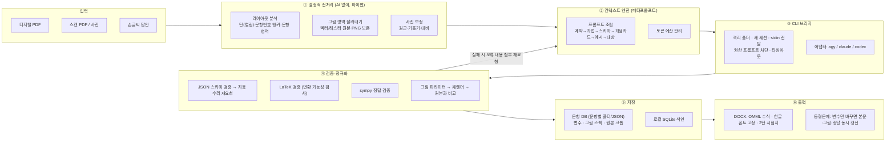
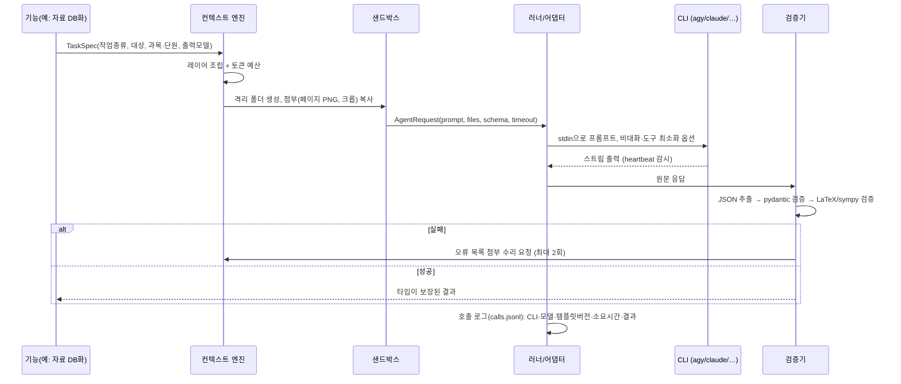
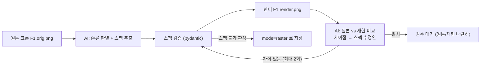
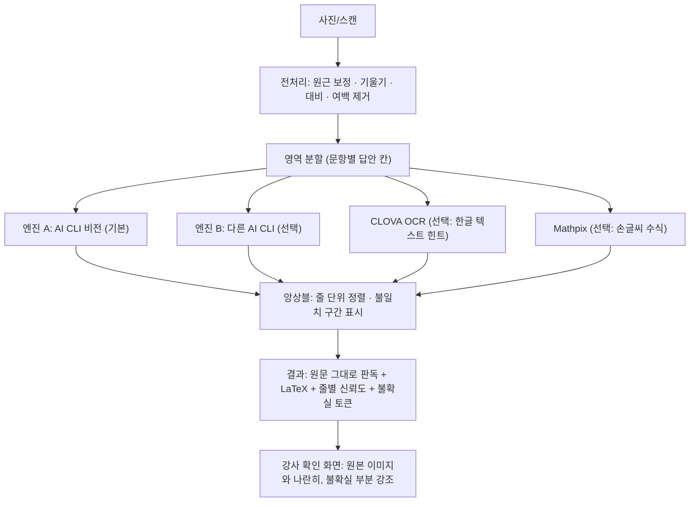

# Dawoni(다워니) — 재설계 및 구현 계획 v1

> 학원 강사가 **이미 구독 중인 AI의 공식 CLI**(Antigravity `agy` / Claude Code / Codex CLI)를
> "일꾼"으로 부리고, Dawoni는 그 사이에서 **작업 지시서(메타프롬프트)·컨텍스트·검증·출력**을 책임지는 징검다리 앱.
> AIHelper(v0.1.33)의 설계 의도는 유지하고, PROGRESS.md에 쌓인 버그의 **원인 구조**를 처음부터 제거한다.

---

## 0. 한 장 요약 (전체 그림)



핵심 원칙 5가지

1. **AI는 '판단'만, 파이썬은 '결정적 작업'을 맡는다.** 좌표 계산·그림 자르기·문항 영역 분할·수식 변환·DOCX 조립은 코드가 한다. AI에게 맡기는 것은 인식(OCR), 구조화, 그림의 의미 해석(파라미터 추출), 풀이뿐이다.
2. **모든 AI 출력은 타입이 정해진 데이터(JSON 스키마)다.** `<보기>` 판별처럼 렌더링 시점에 정규식으로 추측하는 일을 없앤다 → 구조는 AI 출력 단계에서 확정.
3. **작업 1건 = CLI 1회 호출(새 세션, 격리 폴더).** 대화 누적 없음. 필요한 컨텍스트만 매번 새로 조립.
4. **그림은 "원본 크롭 + 파라미터 스펙" 두 벌로 저장.** 기하·물리·그래프·회로는 스펙에서 다시 그리고, 화학·생물·지구과학 사진류는 원본 이미지를 정본으로 쓴다.
5. **기능을 추가하기 전에 테스트가 먼저.** AIHelper의 `NameError`, `create_job` 누락 같은 버그는 테스트 한 줄이면 잡혔다.

---

## 1. AIHelper 버그 이력 → Dawoni 설계 대응표

PROGRESS.md의 수정 이력을 "증상"이 아니라 "원인 구조"로 묶어 처음부터 막는다.

| AIHelper에서 터진 문제 | 근본 원인 | Dawoni의 사전 대책 |
|---|---|---|
| `ParsedDocument` 정의 누락 NameError, `JobQueue.create_job` 미구현, `RunResult.stdout` 속성 불일치 | 테스트·타입검사 없이 기능 추가 | `ruff` + `pyright(strict)` + `pytest`를 M0부터 상시 실행. 모듈 경계는 pydantic 모델/Protocol로 고정 |
| `agy` 권한 승인 대기로 300초 타임아웃 | CLI가 에이전트 모드로 도구 사용을 시도 → 대화형 승인 대기 | 프롬프트를 stdin으로 넣은 뒤 바로 닫아(EOF) 대화형 입력 대기를 원천 차단, 도구 최소 허용 목록, 권한 비대화 옵션, **무출력 감시(heartbeat) 타임아웃**으로 "멈춤"을 빠르게 감지 |
| 긴 프롬프트를 argv로 넘겨 파싱 지연·잘림 | 명령행 인자 길이 한계(특히 Windows 32K) | 프롬프트는 **항상 stdin 또는 파일**로 전달. argv에는 옵션만 |
| 사용자 CLAUDE.md/GEMINI.md 섞임 | CLI가 홈/상위 폴더 설정을 자동 로드 | 앱 전용 임시 작업 폴더 + CLI별 설정 격리 옵션(어댑터가 버전 확인 후 적용) |
| 유튜브 요약 등 대형 작업 타임아웃 | 한 번에 너무 큰 입력 | 페이지/구간 단위 map → 병합 reduce. 작업별 타임아웃은 입력 크기 기반 산정 |
| `fitz` deprecated 경고 | 구식 API | `import pymupdf` 만 사용 |
| DOCX 한글 네모(tofu) | 런 단위 폰트만 지정, `w:eastAsia` 누락, 테마 폰트가 덮어씀 | §6 "한글 폰트 4중 고정" 규칙을 DOCX 빌더의 **유일한 텍스트 출력 함수**에 강제. 내보낸 뒤 자동 검사 |
| LaTeX `$ x $` 공백, 렌더 실패 | 프롬프트 규칙 + 사후 정규식 땜질 | 수식은 JSON 필드에서 **구분자 없이 분리 저장**(텍스트 런/수식 런 배열). 모든 수식은 저장 전 OMML 변환 가능성 검사 → 실패 시 AI 수리 요청 |
| 헤더 배너("과학탐구 영역")를 그림으로 오추출 | "페이지 전체에서 그림 찾기" 방식 | **문항 영역 먼저 확정 → 그 영역 안의 그림만** 해당 문항에 귀속. 영역 밖(머리말·꼬리말)은 자동 제외 |
| 2단 시험지에서 그림 순서 지그재그 밀림 | Y좌표 단순 정렬, 순차 배분(`fig_idx += 1`) | 컬럼 감지 → 컬럼별 읽기 순서 → 문항번호 앵커로 영역 분할 → 영역-그림 포함관계로 귀속 (순차 배분 금지) |
| `<보기>에서` 오인식, 꺽쇠 없는 보기 | 렌더링 시 정규식 추측 | 문항 스키마에 `bogi: list[BogiItem]` 필드. AI가 구조로 출력, 렌더러는 판별하지 않음 |
| pywebview에서 `<a download>` 무반응 | 웹뷰는 브라우저 다운로드 이벤트를 처리하지 않음 | 처음부터 **모든 파일 생성은 서버가 디스크에 저장** → UI는 "열기/폴더에서 보기/다른 이름으로 저장" API만 호출 |
| 전역 CSS `input{width:100%}`가 체크박스 오염 | 전역 스타일 남용 | 컴포넌트 단위 스타일(CSS Modules) + 검증된 헤드리스 UI 컴포넌트 |
| 중복 DB화로 토큰 낭비 | 소스 식별자가 파일명 | 원본 파일 **SHA-256 해시 = source_id**. 같은 해시는 재분석 전 확인 |
| 진행률에 숫자만 덮어씀(`current_step = idx`) | 작업 상태 모델이 느슨함 | `JobProgress(done:int, total:int, message:str)` 타입 고정 |
| Windows `Python.Runtime.dll`/pythonnet 누락 | pywebview Windows 백엔드 의존성 | Windows는 Edge/Chrome `--app` 모드 창을 기본, pywebview는 선택 사항 |
| 2일간 33개 버전, 기능이 버그를 덮음 | 계획 없이 기능 확장 | 마일스톤마다 **완료 기준(수락 테스트)** 을 먼저 정하고 통과해야 다음 단계 |

---

## 2. 기술 스택

| 영역 | 선택 | 이유 |
|---|---|---|
| 언어/런타임 | Python 3.16 (개발), Node 26 (프론트 빌드) | 사용자 지정. 단, §9 리스크 참고 |
| 패키지 관리 | `uv` | 이미 설치됨, 빠르고 lockfile 재현성 |
| 서버 | FastAPI + uvicorn | AIHelper와 동일 |
| UI | Vite + React + TypeScript, KaTeX(수식), CSS Modules | 빌드 산출물을 패키지에 포함 |
| 데스크톱 창 | macOS: pywebview / Windows: Edge `--app` 모드 | Windows pythonnet 문제 회피 |
| PDF | PyMuPDF (`import pymupdf`) | 텍스트·블록·벡터 드로잉·렌더링 |
| 이미지 전처리 | Pillow (+ OpenCV는 휠이 있을 때 선택) | 원근 보정·대비·이진화 |
| 수식 → Word | **pandoc(texmath) 기반 LaTeX→OMML** (결과 캐시) | math2docx보다 커버리지·정확도 높음. `pypandoc-binary`로 pandoc 동봉 |
| DOCX 조립 | python-docx + 저수준 OXML 헬퍼 | 2단·보기 상자·선지 격자 등 세밀 제어 |
| 그림 렌더 | matplotlib(기하·역학·그래프·장), schemdraw(회로) | AI가 준 **코드를 실행하지 않고**, 검증된 스펙(JSON)만 렌더 |
| 수학 검증 | sympy | 정답·변수 제약 검증 |
| 템플릿 | Jinja2 | 프롬프트 템플릿 버전 관리 |
| 품질 | ruff, pyright, pytest, (프론트) vitest·tsc | M0부터 |

---

## 3. 폴더 구조

```text
Dawoni/
├── pyproject.toml / uv.lock
├── dawoni/
│   ├── __main__.py            # `python -m dawoni` (GUI) / `dawoni` CLI 진입점
│   ├── cli.py                 # 개발·디버그용 명령줄 (UI 없이 전 파이프라인 실행)
│   ├── config.py  logs.py  paths.py
│   ├── models/                # ★ 모든 데이터 구조 (pydantic) — 모듈 간 계약
│   │   ├── item.py            # 문항: 본문 블록, 보기, 선지, 정답, 변수, 그림 참조
│   │   ├── figure.py          # 그림 스펙 (판별 유니온)
│   │   ├── job.py  source.py  grading.py
│   ├── agents/                # ③ CLI 브리지
│   │   ├── base.py            # AgentAdapter Protocol, AgentRequest/AgentResult
│   │   ├── agy.py claude.py codex.py
│   │   ├── detect.py          # 설치·버전·로그인 상태, 맥 GUI PATH 보정
│   │   ├── sandbox.py         # 격리 작업 폴더 생성/정리, 첨부 파일 복사
│   │   ├── runner.py          # subprocess, stdin 전달, 스트림 파싱, heartbeat 타임아웃
│   │   └── router.py          # 한도 초과/인증 만료 감지 → 대체 AI 전환
│   ├── context/               # ② 메타프롬프트·컨텍스트 엔진
│   │   ├── templates/*.md.j2  # 작업별 프롬프트 (버전 헤더 포함)
│   │   ├── assembler.py       # 레이어 조립 + 토큰 예산
│   │   ├── schema.py          # pydantic → JSON Schema → 프롬프트/CLI 강제 옵션
│   │   ├── repair.py          # 파싱·검증 실패 시 오류 첨부 재요청 루프
│   │   ├── rules.py           # 강사 전역 규칙(ON/OFF), 자연어 → 규칙 정제
│   │   ├── concepts.py        # 단원 개념 카드
│   │   └── examples.py        # 승인된 문항/강사 수정 이력 → few-shot 예시 선택
│   ├── ingest/                # ① 결정적 전처리
│   │   ├── pdf.py             # 텍스트 레이어·블록·드로잉·페이지 렌더
│   │   ├── layout.py          # 컬럼 감지, 문항번호 앵커, 문항 영역 분할
│   │   ├── figures.py         # 벡터 드로잉 군집화 + 래스터 이미지 → 그림 영역 크롭
│   │   ├── photo.py           # 사진 원근·기울기 보정
│   │   └── pipeline.py        # 페이지 단위 map → 페이지 경계 문항 병합 reduce
│   ├── ocr/                   # 손글씨·스캔 인식
│   │   ├── base.py            # OcrProvider Protocol
│   │   ├── vision_cli.py      # AI CLI 비전 (기본)
│   │   ├── clova.py           # 네이버 CLOVA OCR (선택, 사용자 키)
│   │   ├── mathpix.py         # Mathpix (선택, 손글씨 수식 특화)
│   │   └── ensemble.py        # 복수 판독 비교 → 불일치 구간 표시
│   ├── figures/               # ★ 파라미터 그림 엔진
│   │   ├── expr.py            # 변수식 안전 평가 (sympy, eval 금지)
│   │   ├── style.py           # 폰트·선굵기·크기 (한글 폰트 등록)
│   │   ├── render.py          # spec → SVG/PNG 디스패치
│   │   └── kinds/  geometry.py graph.py incline.py pulley.py collision.py
│   │               spring.py field.py circuit.py projectile.py raster.py
│   ├── mathx/                 # 수식
│   │   ├── latex.py           # 정규화·검증
│   │   ├── omml.py            # LaTeX → OMML (pandoc, 캐시)
│   │   └── verify.py          # sympy 정답·변수 제약 검증
│   ├── bank/  store.py index.py locks.py
│   ├── export/docx/
│   │   ├── fonts.py           # 한글 폰트 4중 고정 (유일한 진입점)
│   │   ├── builder.py         # 문서·섹션·2단 설정
│   │   ├── blocks.py          # 본문 블록·수식 런·보기 상자·선지 격자·그림
│   │   ├── exam.py solution.py report.py
│   │   └── check.py           # 내보낸 DOCX 자동 검사 (폰트/수식/이미지)
│   ├── jobs/queue.py
│   ├── features/  ingest.py solve.py variants.py grading.py
│   ├── server/   app.py routes/*.py
│   └── assets/fonts/          # 동봉 한글 폰트 (OFL 라이선스)
├── frontend/                  # Vite + React + TS
└── tests/
    ├── fixtures/              # 샘플 PDF·사진·정답 JSON
    └── ...                    # 단위·골든(이미지/DOCX) 테스트
```

---

## 4. CLI 브리지 + 메타프롬프트/컨텍스트 엔진

### 4-1. 한 번의 AI 호출 흐름



### 4-2. 프롬프트 레이어 (위에서 아래로 우선순위)

| # | 레이어 | 내용 | 잘라낼 때 |
|---|---|---|---|
| 1 | 계약(Contract) | "너는 Dawoni의 일꾼. 파일을 수정하지 말 것. 도구를 쓰지 말 것. 출력은 JSON 하나만." | 절대 안 자름 |
| 2 | 과업(Task) | 작업별 템플릿 (`ingest_page.md.j2` 등). 단계별 판단 기준 | 안 자름 |
| 3 | 출력 스키마 | pydantic에서 생성한 JSON Schema + 짧은 예시 1개 | 안 자름 |
| 4 | 표기 규칙 | 수식 필드 규칙, 그림 스펙 규칙(해당 작업만) | 안 자름 |
| 5 | 강사 전역 규칙 | ON인 규칙만 | 길면 요약본 |
| 6 | 개념 카드 | 해당 단원 카드만 | 관련도 순 절단 |
| 7 | 예시(few-shot) | 같은 단원·유형의 승인 문항, 강사가 고친 이력 | 개수 축소 |
| 8 | 대상 | 페이지 이미지 경로, 텍스트 레이어, 크롭 목록(번호·좌표) | 분할 호출 |

- **텍스트 레이어 동봉**: 디지털 PDF는 PyMuPDF가 뽑은 텍스트를 함께 준다 → AI는 "보고 확인하며 구조화"만 하므로 OCR 오류가 크게 준다.
- **크롭에 번호를 붙여 제공**: "그림 F3은 문항 5 영역 안에 있음"을 미리 알려주고, AI는 F3의 종류·파라미터만 판단.
- **스키마 강제**: `agy --json-schema`, Claude Code `--json-schema` 등 CLI가 지원하면 사용, 아니면 프롬프트 + 사후 검증.
- **템플릿 버전**: 템플릿 머리에 `version:`을 두고 결과에 기록 → 프롬프트를 고친 뒤 품질 비교 가능.
- **강사 피드백 학습**: 검수 화면에서 강사가 고친 내용(전/후)을 저장 → 다음 같은 단원 작업의 예시 레이어로 사용.

### 4-3. 사용할 CLI와 역할

| CLI | 역할 | 비고 |
|---|---|---|
| **Antigravity `agy`** | **개발·테스트 기본 일꾼** (유료 플랜 잔여) | 모델 선택 가능: Gemini 4 Argon / Gemini 3.8 Flash / **Claude Opus 5.5·Sonnet 5.5** / GPT-OSS |
| **Claude Code `claude`** | 제품 주력 대상 + agy 품질 부족 시 비교 테스트 | 개발 중 토큰 절약을 위해 테스트에는 최소 사용 |
| Codex CLI | 어댑터만 구현 (미설치) | 나중에 |
| ~~Gemini CLI~~ | **제외** | agy로 대체 |

**품질 비교 규칙**: M5(PDF 구조화·그림 파라미터화)와 M6(손글씨) 단계에서 같은 샘플을 agy로 돌려 수락 기준을 못 넘으면,
① agy 안에서 모델만 Claude로 바꿔 재시험 → ② 그래도 부족하면 사용자에게 보고 후 `claude` CLI로 전환해 시험.
(DOCX 내보내기·그림 렌더링은 AI가 아닌 파이썬 코드가 하므로 CLI 차이의 영향을 받지 않음.)

### 4-4. 어댑터 호출 규격 (2026-10-25 실측)

| | Antigravity `agy` 1.4.7 | Claude Code `claude` 2.1.310 |
|---|---|---|
| 프롬프트 전달 | **stdin NDJSON**: `--input-format stream-json --output-format stream-json`, 한 줄 `{"event":"user","message":{"content":"…"}}` (`-p` 없이). 일반 텍스트 stdin은 무시됨 | `-p` + stdin 텍스트, 또는 `--input-format stream-json` |
| 진행 감시 | `step_update` 이벤트(`text_delta`, `state`) → heartbeat | `stream-json` 이벤트 |
| 최종 결과 | `{"event":"result","result":{"status","response","usage"}}` | `result` 이벤트 |
| 구조화 출력 | `--json-schema <파일>` | `--json-schema` |
| 모델 | `--model gemini-3.8-flash-low` 등 (`agy models`) | `--model` |
| 시간 제한 | `--print-timeout 120s` + 앱 자체 heartbeat | 앱 자체 heartbeat |
| 격리 | 격리 cwd, `--sandbox`, `--mode plan` 검토 | `--bare` 또는 `--setting-sources` 제한, `--strict-mcp-config`, `--tools Read`, `--no-session-persistence` |
| ⚠️ 주의 | 기본 도구가 60여 개(run_command, write_to_file 등), 권한 모드 `request-review`. AIHelper는 `--dangerously-skip-permissions`로 멈춤을 피했는데, 이는 **AI가 명령 실행·파일 쓰기를 승인 없이 할 수 있게 여는 것**이라 Dawoni에서는 쓰지 않음. 대신 이미지 읽기에 필요한 최소 권한만 확보(M1에서 실측) | 로그인 필요: 터미널에서 `claude` 실행 후 `/login` |

실측 예: 간단한 JSON 응답 왕복 약 5초, 입력 토큰 약 6,900(agy 기본 시스템 프롬프트 포함).

---

## 5. ★ 파라미터 그림 엔진

### 5-1. 저장 원칙

```text
bank/<문항ID>/          # 과목·단원은 item.json 안에만 (단원을 바꿔도 폴더 이동 없음 → Drive 충돌 방지)
  item.json            # 본문·선지·정답 + variables + figures(스펙 포함)
  figures/
    F1.orig.png        # 원본에서 잘라낸 그림 (항상 보존)
    F1.render.png      # 스펙으로 다시 그린 결과 (캐시, 언제든 재생성)
```

> M0에서 변경: 그림 스펙을 별도 `F1.spec.json`이 아니라 `item.json` 안에 둔다. 문항 1개 = JSON 1개라 원자적 저장·동기화가 단순해진다.

- `figure.mode = "parametric"` → 출력에 `render.png` 사용 (원본은 검수 비교용)
- `figure.mode = "raster"` → 출력에 `orig.png` 사용 (화학 구조 사진, 생물 세포, 지구과학 지도·위성사진 등)
- 강사가 검수 화면에서 원본/재현본을 나란히 보고 모드를 바꿀 수 있음.

### 5-2. 변수 연동 (동형문제의 핵심)

```json
{
  "variables": {
    "m": {"value": 2, "unit": "kg", "range": [1, 5], "step": 1},
    "theta": {"value": 30, "unit": "deg", "choices": [30, 37, 45, 53, 60]},
    "mu": {"value": 0.2, "range": [0, 0.5], "step": 0.1}
  },
  "constraints": ["mu < tan(theta*pi/180)"],
  "stem": [
    {"t": "text", "v": "질량이 "}, {"t": "math", "v": "{{m}}\\,\\mathrm{kg}"},
    {"t": "text", "v": "인 물체가 경사각 "}, {"t": "math", "v": "{{theta}}^\\circ"},
    {"t": "text", "v": "인 빗면을 미끄러져 내려온다. 가속도의 크기는?"}
  ],
  "answer": {"expr": "g*(sin(theta*pi/180) - mu*cos(theta*pi/180))", "g": 10},
  "figures": [{"id": "F1", "mode": "parametric", "spec": "F1.spec.json"}]
}
```

```json
{
  "kind": "incline",
  "angle": "{{theta}}",
  "angle_label": "θ",
  "block": {"label": "{{m}} kg", "position": 0.55},
  "friction_label": "μ = {{mu}}",
  "arrows": [{"on": "block", "dir": "down_slope", "label": "a"}]
}
```

→ `m=3, theta=37` 로 바꾸면 본문·그림·정답이 함께 바뀐다. 정답은 sympy로 계산, `constraints`로 말이 안 되는 조합(정지 마찰 등)은 자동 배제.

### 5-3. 그림 종류 (판별 유니온, 단계적으로 확장)

| 분류 | kind | 주요 파라미터 |
|---|---|---|
| 기하 | `geometry` | 점(좌표 또는 **작도식**: 교점·수선의 발·내분점·원 위의 점), 선분·직선·반직선, 원·호, 다각형, 각 표시·직각 표시, 같은 길이 눈금, 평행 표시, 길이/각 라벨, 빗금 영역 |
| 그래프 | `graph` | 함수식(sympy 문자열), 정의역, 점근선, 표시점(극값·교점 자동 계산), 영역 색칠, 축 눈금/라벨, 구간별 함수 |
| 운동 그래프 | `motion_graph` | v-t, x-t, a-t, F-t 꺾은선 꼭짓점 목록(변수식), 넓이 색칠 |
| 빗면 | `incline` | 경사각, 물체(위치·라벨), 마찰, 도르래 결합, 힘 화살표 |
| 도르래 | `pulley` | 고정/움직도르래 배치, 줄 연결 그래프, 물체 질량, 천장·바닥 |
| 충돌/운동 | `collision` | 물체 목록(질량·속도 벡터·위치), 충돌 전/후 패널, 1차원/2차원 |
| 용수철 | `spring` | 벽, 용수철 상수 라벨, 늘어난 길이, 물체 |
| 포물선 운동 | `projectile` | 초속도·발사각·높이, 궤적, 표시점 |
| 전기장·자기장 | `field` | 영역(사각/원), 방향(⊗ ⊙ → 균일장 화살표), 도선·코일·고리, 대전입자와 속도, 좌표축 |
| 전기회로 | `circuit` | 소자 목록(저항·전지·전구·스위치·축전기·코일·전류계·전압계·다이오드) + 연결(노드) + 배치 힌트 → schemdraw |
| 원본 | `raster` | 크롭 경로, 캡션 (화학·생물·지구과학 기본값) |

안전 원칙
- AI가 주는 것은 **데이터(JSON)** 뿐이고 파이썬 코드가 아니다 → `exec`/샌드박스 불필요.
- 변수식은 sympy 파서로 허용된 함수/기호만 평가.

### 5-4. 재현 품질 보장 루프



---

## 6. DOCX 출력 · 한글 tofu 방지 · 수식

### 6-1. 한글 폰트 4중 고정 (tofu 방지)

Word에서 한글이 네모로 나오는 원인은 거의 항상 **동아시아 폰트 슬롯(`w:eastAsia`) 미지정** 또는 **테마 폰트(`w:asciiTheme` 등)가 명시 폰트를 덮어쓰는 것**이다.

1. `docDefaults/rPrDefault`에 `w:rFonts ascii/hAnsi/eastAsia/cs` 4개 슬롯 모두 지정 + `w:lang w:eastAsia="ko-KR"`
2. 모든 스타일(Normal, Heading, 표, 캡션)에서 `*Theme` 속성 제거 후 4개 슬롯 지정
3. 텍스트 런은 **오직 `fonts.add_run()` 하나**로만 생성 (직접 `paragraph.add_run` 금지 — 테스트로 강제)
4. 수식(OMML) 안의 한글(`\text{속력}`)은 `m:r` 안 `w:rPr`에 한글 폰트 지정, 수식 기호는 Cambria Math
- 그림(matplotlib)도 동봉 한글 폰트를 `font_manager.addfont`로 등록, `axes.unicode_minus=False` → 그림 라벨 tofu도 방지
- 내보내기 직후 `check.py`가 XML을 검사: eastAsia 누락 런 0개, `$` 잔존 0개, 깨진 이미지 0개가 아니면 실패 처리

기본 폰트: 본문 **맑은 고딕**(Windows 기본 + Mac용 Office 동봉) / 명조형 선택 시 바탕. 학원 템플릿(.docx)을 넣으면 그 스타일을 우선 사용.

### 6-2. 수식

- 문항 본문은 `[{t:"text"}, {t:"math"}]` 런 배열로 저장 → `$` 구분자 공백 문제 자체가 없음.
- 화면: KaTeX / Word: pandoc(texmath)로 LaTeX → OMML 변환, 결과 캐시.
- **저장 전 검증**: 모든 수식을 OMML로 변환해 보고 실패하면 AI에 수리 요청 → 출력 시점 실패 없음.
- 별행 수식(display)과 인라인 수식을 구분 저장.

### 6-3. 시험지 레이아웃 요소

- A4, 2단 섹션(시험지) / 1단(해설지), 문항 번호 스타일, 배점 표기
- 선지 ①~⑤: 길이에 따라 5열 / 3+2 / 1열 자동 배치 (테두리 없는 표)
- `<보 기>` 상자: 구조화된 `bogi` 필드 → 가운데 제목 테두리 표
- 그림: 단 너비 기준 크기 자동, 문항 영역 안 배치, 선지 그림 지원
- 해설지: 정답표 + 문항별 풀이 + (선택) 오답 분석
- 출력은 서버가 `exports/`에 저장 → UI는 [Word로 열기] [Finder/탐색기에서 보기] [다른 이름으로 저장]

---

## 7. 손글씨·스캔 인식



- 판독 프롬프트 원칙: **학생의 오류를 고치지 말 것**(채점용), 지운 흔적은 `~~취소선~~` 표기, 읽을 수 없으면 추측 대신 `[?]`.
- 손글씨 수식 혼동 쌍(1/l/7, 0/o, x/×, z/2, −/=, √ 범위, 분수선 위치)을 판독 지침에 명시하고, 앞뒤 계산 맥락으로 재판단하도록 요구.
- 외부 OCR(CLOVA, Mathpix)은 **사용자 키를 넣었을 때만** 켜지는 선택 플러그인. 기본은 구독 AI의 비전으로 충분히 동작하도록 설계.

---

## 8. 마일스톤 (순서대로 차곡차곡)

각 단계는 **완료 기준**을 통과해야 다음으로 간다.

| 단계 | 내용 | 완료 기준 |
|---|---|---|
| **M0 기반** | uv 프로젝트, 폴더 골격, ruff/pyright/pytest, 설정·로그, `models/` 핵심 스키마 | `pytest`·`pyright` 0 오류, 스키마 → JSON Schema 생성 테스트 |
| **M1 CLI 브리지** | 감지·격리 샌드박스·러너(stdin, heartbeat 타임아웃)·어댑터(agy, claude, codex)·라우터 | `dawoni agent test --cli agy` 로 JSON 왕복 + **이미지 1장 판독** 성공(권한 승인 없이), 가짜 CLI로 타임아웃/권한대기/한도초과 시나리오 테스트 |
| **M2 컨텍스트 엔진** | 템플릿·조립·토큰 예산·스키마 강제·수리 루프·호출 로그 | 깨진 JSON을 주는 가짜 CLI → 수리 루프가 2회 내 복구 |
| **M3 수식·DOCX** | 런 배열 → OMML, 한글 4중 고정, 시험지/해설지 레이아웃, 자동 검사 | 손으로 만든 문항 10개(분수·행렬·적분·\text{한글}·보기·선지 그림) → DOCX, Word에서 tofu 0·수식 편집 가능 |
| **M4 파라미터 그림** | expr 평가, 한글 폰트 등록, geometry·graph·motion_graph·incline·pulley·collision·spring·field·circuit·raster | 종류별 골든 이미지 테스트, 변수 변경 시 그림 변화 테스트 |
| **M5 PDF 자료 DB화** | 레이아웃·컬럼·문항 영역·그림 크롭 → AI 구조화 → 그림 파라미터화 + 비교 루프 → 문항 저장 | 수능형 2단 PDF 1회분에서 문항-그림 귀속 오류 0, 머리말 배너 오추출 0 |
| **M6 손글씨/스캔 OCR** | 사진 보정, 비전 판독, 앙상블, (선택) CLOVA/Mathpix | 손글씨 풀이 샘플 판독, 불확실 구간 표시 |
| **M7 문항 DB·UI** | 저장소·색인·잠금, React UI: 연결 마법사·자료 DB화·검수(원본/재현 나란히) | UI에서 PDF 올리기 → 검수 → DOCX 열기까지 한 흐름 |
| **M8 해설·동형문제** | 해설(개념 카드 범위), 동형 L1(변수 자동)·L2~L4(AI) + 독립 재풀이 검증 | L1: 변수 바꾸면 본문·그림·정답 일치, sympy 검증 통과 |
| **M9 서술형 채점** | 루브릭, 판독 → 채점, 성적표 DOCX | 샘플 답안 채점 리포트 |
| **M10 패키징** | macOS .app / Windows (Edge app 모드) | 다른 PC에서 더블클릭 실행 |
| **M11 확장 기능** | 시험지 단위 해설·채점 워크플로우, 유튜브 강의 요약(구간 map→reduce, QR), Google Drive 팀 공유(잠금·충돌 사본 감지) | 각 기능 수락 테스트 |

> 팀 공유를 고려해 M0부터 **문항 1개 = 파일 1개**, 색인은 PC 로컬에 두는 구조로 시작한다(나중에 Drive 지원이 쉬워짐).

### 확정 결정 (2026-10-25)

- 포함 기능: 핵심(자료 DB화·파라미터 그림·DOCX·해설·동형문제) + 서술형 손글씨 채점 + 시험지 단위 해설/채점 + 유튜브 강의 요약 + Google Drive 팀 공유
- CLI: 테스트는 **agy**, 제품 주력은 **Claude Code**. Gemini CLI 제외. agy 품질이 부족하면 보고 후 claude로 비교 (§4-3)
- 외부 OCR: CLOVA·Mathpix는 **선택 플러그인**. 기본은 구독 AI 비전 + 다른 AI 교차 판독
- UI: **엔진 먼저**(M1~M6은 `dawoni` 명령줄 + 테스트로 검증), React UI는 M7부터

---

## 9. 리스크와 결정이 필요한 사항

| 리스크 | 내용 | 제안 |
|---|---|---|
| **Python 3.16은 아직 알파(3.16.0a1)** | 이 Mac에서는 전 스택 빌드 성공(부록). 단 numpy·matplotlib·pillow·lxml은 **소스 빌드**라 Xcode가 없는 동료 PC·Windows에서는 설치 실패 가능 | 개발은 3.16, `requires-python >=3.14`(시간순 ID용 `uuid.uuid7`이 3.14부터)로 열어 두고 **배포 번들은 PyInstaller로 미리 빌드**(사용자는 Python 설치 불필요) |
| agy 권한 정책 | 이미지 읽기 도구 호출 시 승인 대기로 멈출 수 있음 | M1에서 최소 권한 조합 실측, heartbeat로 멈춤 즉시 감지 |
| Claude Code 로그인 | 설치 완료(2.1.310), 로그인 전 | 사용자가 터미널에서 `/login` |
| CLI 옵션 변경 | 버전마다 플래그가 바뀜 | 어댑터가 `--help`/버전으로 기능 감지 |
| 외부 OCR | CLOVA·Mathpix는 유료 API 키 필요 | 선택 플러그인 |

## 부록 — 환경 점검 결과

2026-10-25, macOS(Apple Silicon), `/usr/local/bin/python3.16` = **3.16.0a1**, Node **v26.12.1**, uv 사용 가능, Xcode 있음.

| 패키지 | 3.16 휠 | 결과 |
|---|---|---|
| pymupdf 1.28.2, pydantic, fastapi, uvicorn, sympy, latex2mathml, pywebview, jinja2, schemdraw 0.23, pypandoc-binary(pandoc 3.9) | 있음 | OK |
| numpy 2.5.4, lxml, pillow, python-docx | 없음 | 소스 빌드 OK |
| matplotlib 3.11.2 | 없음 | 처음엔 실패 → 원인은 **python.org Python의 SSL 인증서 미설치**(freetype 다운로드 실패). `SSL_CERT_FILE=/etc/ssl/cert.pem` 지정 시 빌드 OK. 근본 해결: `/Applications/Python 3.16/Install Certificates.command` 실행 |
| opencv-python-headless | 없음 | 미시험 → 기본 의존성에서 제외, Pillow로 전처리 |

검증 실험: pandoc으로 `\frac`, `\sqrt`, `pmatrix`, `\text{가속도}`를 docx로 변환 → `m:oMath` 3개, 분수/근호/행렬 OMML 생성, 수식 내 한글 보존 확인 → §6-2 방식 채택 근거.

설치된 CLI: `agy` 1.4.7(테스트 기본), `claude` 2.1.310(`~/.local/bin/claude`, 로그인 필요), Gemini CLI 삭제됨, `codex` 미설치. Word 설치됨(DOCX 실물 확인 가능). Python 3.16 SSL 인증서 등록 완료.
