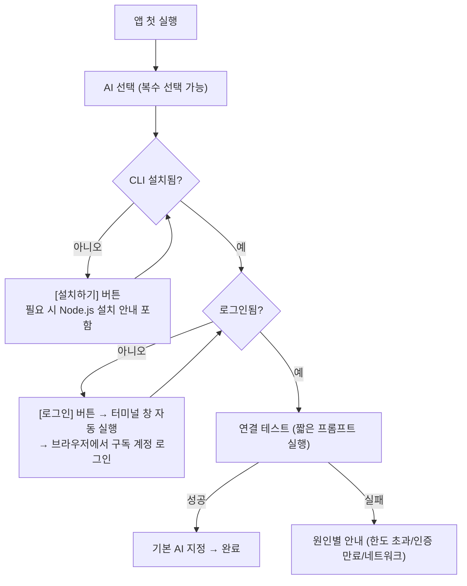

# 학원 강사용 AI 도우미 — 설계 보고서 v3 (CLI 우선)

> [!IMPORTANT]
> **v3 이후 확정 수정사항 (본문보다 우선)**
> 1. 학생 이름 마스킹/익명화 하지 않음.
> 2. 학생 답안·성적은 작업공간(`students/`)에 저장 → 팀 모드에서는 Google Drive로 공유됨.
> 3. UI는 최고급 품질을 위해 Vite + React + TypeScript 모던 컴포넌트 앱으로 구축하며, 빌드 산출물(`aihelper/web/`)을 번들링하여 일반 사용자는 별도 npm 빌드 없이 바로 실행 가능.

## 0. 확정된 방향

| 항목 | 결정 |
|---|---|
| AI 연결 | **강사 본인 구독 계정 + 공식 CLI** (Gemini CLI / Claude Code / Codex CLI). 수동 중계·API는 보류 |
| 과목 | 수학·과학 |
| 출력 | DOCX (Word 네이티브 수식) |
| 작업공간 | 개인: 로컬 폴더 / 팀: **Google Drive 공유 폴더** |
| 배포 | GitHub, 코드 서명 없음 |
| 앱 형태 | Python(FastAPI) + React UI + pywebview 데스크톱 창 |

> [!IMPORTANT]
> 프로그램 첫 실행 = **"AI 계정 연결 마법사"**. 연결이 완료되기 전에는 AI 기능이 비활성화되고, 연결 상태는 화면 상단에 항상 표시됩니다.

---

## 1. 지원 CLI 개요

| | Gemini CLI | Claude Code | Codex CLI |
|---|---|---|---|
| 필요 구독 | Google 계정(무료 가능) / Google AI Pro 등 | Claude Pro / Max | ChatGPT Plus / Pro 등 |
| 설치 | `npm i -g @google/gemini-cli` (Node.js 20+ 필요) | 공식 설치 스크립트 (맥: `curl … \| bash`, 윈도우: PowerShell `irm … \| iex`) | `npm i -g @openai/codex` |
| 로그인 | 첫 실행 시 "Login with Google" → 브라우저 | `claude` 실행 후 `/login` → 브라우저 | `codex login` → 브라우저 ("Sign in with ChatGPT") |
| 자동 실행 | `gemini -p "…"` | `claude -p "…"` | `codex exec "…"` |
| 이미지 입력 | 프롬프트 내 `@파일경로` | 파일 경로 제공 + 읽기 도구 허용 | `-i 이미지` 옵션 |
| 구조화 출력 | JSON 출력 옵션 | `--output-format json` | JSON 출력 옵션 |

> [!NOTE]
> 정확한 명령어·옵션은 CLI 버전에 따라 바뀌므로, 착수 시점에 각 공식 문서로 재확인하고 앱 내부에 **CLI별 어댑터**로 분리해 둡니다(바뀌면 어댑터만 수정).

---

## 2. 계정 연결 방식 — 앱 내장 마법사 + README 병행

### 2-1. 마법사 흐름



### 2-2. 각 단계의 구현

| 단계 | 앱이 하는 일 |
|---|---|
| 설치 확인 | PATH에서 실행파일 탐색 + 버전 확인. Node.js 필요 여부도 함께 검사 |
| 설치 | 공식 설치 명령을 **사용자 동의 후** 실행, 진행 로그 표시. 실패 시 수동 설치 명령을 복사 버튼과 함께 제시 |
| 로그인 | 로그인은 브라우저 OAuth라 앱이 대신할 수 없음 → **앱이 OS 터미널 창을 열어 로그인 명령을 실행**(맥: Terminal, 윈도우: PowerShell). 사용자는 브라우저에서 로그인만 하면 됨 |
| 상태 확인 | CLI의 상태 명령(있는 경우) 또는 "OK만 답하라" 테스트 프롬프트로 확인 |
| 유지 | 작업 실행 전 자동 점검, 인증 만료 시 마법사의 로그인 단계로 바로 이동 |

- 앱은 **로그인 정보(토큰)를 직접 읽거나 저장하지 않음.** 각 CLI가 자체적으로 보관한 인증을 그대로 사용 → 보안·약관상 가장 깔끔한 방식.

### 2-3. README 구성 (병행 제공)

```
README.md
 1. 이 프로그램은 무엇인가
 2. 준비물: 구독 중인 AI 계정 (API 키 불필요)
 3. 설치 (맥 / 윈도우) — 설치 경고 우회 방법 스크린샷
 4. AI 계정 연결
    4-1. 앱 마법사로 연결 (권장)
    4-2. 수동 연결: Gemini / Claude / Codex 별 명령어
 5. 작업 폴더 설정 (개인 / 팀-Google Drive)
 6. 문제 해결 (FAQ: 한도 초과, 로그인 만료, Node 설치 등)
```

---

## 3. CLI를 "안전하고 깨끗하게" 쓰는 법 (중요)

이 CLI들은 원래 **코딩 에이전트**라서 파일 수정·명령 실행 능력이 있고, 사용자 개인 설정/메모리 파일을 자동으로 읽습니다. 그대로 쓰면 위험하고, 컨텍스트도 오염됩니다.

| 위험 | 대책 |
|---|---|
| AI가 강사 파일을 수정/삭제 | 작업마다 **격리된 임시 작업 폴더**에서 실행, **읽기 전용·도구 제한 옵션** 적용 |
| 사용자의 개인 지침 파일(GEMINI.md, CLAUDE.md 등)이 섞임 → 엉뚱한 출력 | 격리 폴더 사용 + CLI가 제공하는 설정 격리 옵션 적용, 앱의 지침을 최우선으로 명시 |
| 대화 누적으로 성능 저하 | **작업 1건 = CLI 1회 호출(새 세션)** — 무상태 원칙 그대로 유지 |
| 응답 형식 깨짐 | JSON 스키마 검증 → 실패 시 자동 재요청(최대 N회) |
| 사용량 한도 초과 | 오류 감지 → 대기열 일시정지 + 다른 연결된 AI로 전환 제안 |
| 그림 코드 실행 | AI가 준 matplotlib 등 코드는 **앱이 별도 제한 환경**에서 실행 (CLI에게 실행 맡기지 않음) |

### 작업 대기열
- 대량 작업(DB화·채점)은 백그라운드 대기열로 처리, 진행률·중단·재개 지원.
- 동시 실행 수 제한(기본 1~2개)으로 구독 한도 소모 속도 조절.
- 모든 호출 기록(어떤 AI, 소요시간, 성공/실패)을 로그로 보관.

---

## 4. 작업공간: 로컬 / Google Drive

### 4-1. 공통 폴더 구조 (두 방식 동일)

```
작업공간/
  bank/<과목>/<과정>/<단원>/<문항ID>/
      item.json        ← 문제 본문(LaTeX), 보기, 정답, 단원, 출처
      fig_*.png        ← 원본에서 잘라낸 그림
      solution.json    ← 해설
      variants/        ← 동형문제
  sources/             ← 원본 자료(PDF/HWP/이미지)
  concepts/            ← 단원별 개념 카드
  rubrics/             ← 채점 기준
  templates/           ← 학원 DOCX 서식
  exports/             ← 생성된 DOCX
  workspace.json       ← 작업공간 설정(과목, 교육과정 등)
```

- 검색용 SQLite 색인은 **각 PC의 앱 데이터 폴더**에 두고, 작업공간을 스캔해 자동 생성/갱신.
- 학생 답안·성적은 작업공간의 `students/`에 저장 (팀 모드에서는 팀 드라이브로 공유).

### 4-2. Google Drive 연동 방식

- **Google Drive 데스크톱 앱**이 만든 로컬 경로를 그대로 작업공간으로 사용 (Drive API 연동 불필요 → 구현 단순, 추가 로그인 없음).
  - 맥: `~/Library/CloudStorage/GoogleDrive-계정/…`
  - 윈도우: `G:\` 등 드라이브 문자
- 앱이 해당 경로를 **자동 탐지**해 폴더 선택을 도와줌. 팀은 "공유 드라이브" 또는 공유 폴더 사용 권장.
- Drive의 **스트리밍 모드**(필요할 때 내려받기)에서도 동작하도록, 대용량 원본은 필요 시점에만 읽음.

### 4-3. 동시 편집 충돌 대책

| 장치 | 내용 |
|---|---|
| 문항 단위 파일 | 충돌 범위를 문항 1개로 최소화 |
| 편집 잠금 파일 | 누가 편집 중인지 표시 (`.lock` + 작성자 + 시각, 일정 시간 지나면 자동 해제) |
| 버전 필드 | 저장 시 버전 비교 → 다른 사람이 먼저 바꿨으면 "비교 후 선택" 화면 |
| Drive 충돌 사본 감지 | Drive가 만드는 `(1)` 사본 파일을 감지해 병합 안내 |
| 작성자 기록 | 각 항목에 생성자·수정자·AI 종류 기록 → 팀 내 신뢰도 관리 |

---

## 5. 기능 설계 요약 (v2와 동일, CLI 기준)

| 기능 | 핵심 |
|---|---|
| 1. 자료 DB화 | 디지털 PDF는 앱이 텍스트 직접 추출 / 스캔·이미지는 CLI에 이미지 전달 → 문항 분할·LaTeX화·그림 좌표 → 원본 그림 잘라 재사용 → 단원 분류 → **검수 UI** → DOCX 변환 |
| 2. 서술형 채점 | 모범답안 → 루브릭 생성·승인 → 강사 채점 예시 2~3개로 수준 보정 → 손글씨 인식(원문 병기) → 문항별 채점 → 성적표 DOCX/Excel. 학생 이름은 익명 ID로 치환 후 전송 |
| 3. 해설 DOCX | 단원 개념 카드로 개념 범위 제한, sympy로 계산 검증, 그래프·회로·분자구조는 코드로 그림 생성, 그 외 그림은 원본 재사용 |
| 4. 동형문제 | L1 수치(템플릿+sympy로 정답 보장) / L2 조건 / L3 맥락 / L4 개념 확장, 생성 후 다른 세션에서 독립 재풀이 검증, DB 중복 검사 |

컨텍스트 엔지니어링(작업별 새 프롬프트 조립: 고정 지침 → 과정 프로필 → 개념 카드 → 예시 → 대상 → 출력 스키마)은 그대로 적용됩니다.

---

## 6. 로드맵 (갱신)

| 단계 | 내용 |
|---|---|
| **P0** | 앱 골격, **AI 계정 연결 마법사**(Gemini → Claude → Codex 어댑터), CLI 격리 실행·대기열, 작업공간 설정(로컬/Drive 자동 탐지), README |
| P1 | 자료 DB화 + 검수 UI + 파일 기반 저장소 + 로컬 색인 |
| P2 | 해설 생성 + DOCX 출력(수식·그림) + sympy 검증 |
| P3 | 동형문제 L1~L4 |
| P4 | 서술형 채점 |
| P5 | 팀 기능 강화(잠금·충돌 해결 UI·작성자 이력), 과학 도식(회로·분자) |
| 보류 | 수동 중계, API/로컬 AI, HWPX 출력 |

---

## 7. 리스크 (CLI 우선 기준)

| 리스크 | 대응 |
|---|---|
| CLI 명령·옵션 변경 | CLI별 어댑터 분리, 버전 확인, 앱 업데이트로 대응 |
| 구독 정책/사용량 한도 변경 | 복수 AI 연결 시 자동 전환, 대기열 일시정지 |
| Node.js 미설치 (Gemini·Codex) | 마법사에서 감지·설치 안내 |
| 윈도우 환경 차이 (경로, 셸) | 윈도우 실기기 테스트를 P0부터 포함 |
| CLI 에이전트의 파일 접근 | 격리 폴더 + 읽기 전용/도구 제한 |
| Drive 동기화 지연·충돌 | 문항 단위 파일, 잠금, 충돌 사본 감지 |
| 학생 개인정보 | 로컬 전용 보관, 익명화 전송 |
